# Synapse Humanoid · Bazan (BZN-01)

<div align="center">

<p align="center">
  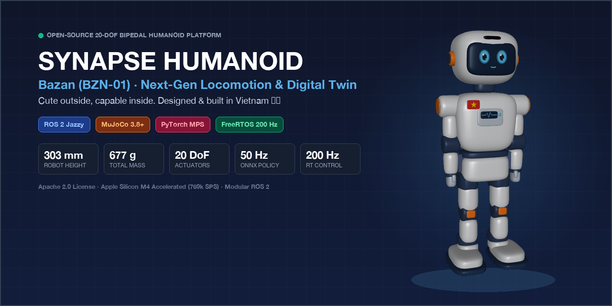
</p>

[](https://docs.ros.org/en/jazzy/)
[](https://mujoco.org)
[](docs/getting_started.md)
[](docs/engineering/rl_benchmark.md)
[](docs/engineering/rl_benchmark.md)
[](docs/engineering/rl_benchmark.md)
[](LICENSE)

<br/>

<table>
  <tr>
    <th width="33%" align="center">🤖 3D Digital Twin</th>
    <th width="33%" align="center">🚶‍♂️ Dynamic Locomotion</th>
    <th width="33%" align="center">👋 Interactive Gestures</th>
  </tr>
  <tr>
    <td align="center" valign="middle">
      
    </td>
    <td align="center" valign="middle">
      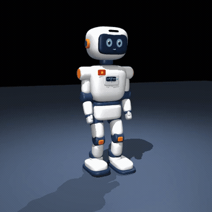
    </td>
    <td align="center" valign="middle">
      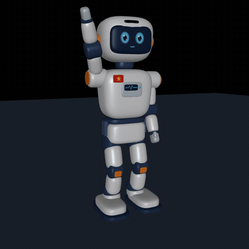
    </td>
  </tr>
</table>

<p>
  🎬 <b><a href="docs/images/bazan_demo.mp4">▶️ Watch Full MuJoCo Simulation Demo (Walk · Turn · Wave · 60fps MP4)</a></b>
</p>

</div>

**Bazan (BZN-01)** is a 303 mm, 20-DoF bipedal humanoid built from parts sold in Ho Chi Minh City, simulated in MuJoCo with ROS 2 and viewed in RViz2. *Cute outside, capable inside. Made in Vietnam 🇻🇳.*

<!-- gen:readme_spec -->
| Height | Mass | DoF | Compute | Sensors | BOM |
| --- | --- | --- | --- | --- | --- |
| 303 mm | 677 g (603 g in LW-PLA) | 20 (legs 2×6, arms 2×3, neck 2) | Radxa Zero 3W (Cortex-A55 + NPU) · STM32F411 (Cortex-M4) | IMU, camera, ToF, 2 mics, 4 foot FSRs | ≈ 5.88M VND |
<!-- /gen:readme_spec -->

> **Documentation Subpages:** [Getting Started & Sim Guide](docs/getting_started.md) · [Upgrade Roadmap](docs/engineering/upgrade_roadmap.md) · [RL Benchmark Suite](docs/engineering/rl_benchmark.md) · [Theory & References](docs/references.md) · [Hardware Architecture](docs/engineering/hardware_architecture.md) · [Mass Budget](docs/engineering/mass_budget.md) · [Torque Validation](docs/engineering/torque_validation.md) · [Firmware Docs](firmware/stm32f411/README.md) · [Web Dashboard](https://nguyenhau442001.github.io/Synapse_Humanoid/)

---

## 📑 Table of Contents

- [🌋 Why Bazan?](#why-bazan)
- [🏛️ System Architecture](#system-architecture)
  - [1. High-Level Layered Architecture](#1-high-level-layered-architecture)
  - [2. Hardware Interconnect & Power Grid](#2-hardware-interconnect--power-grid)
  - [3. Dataflow & Firmware Pipeline (Deep-Dive)](#3-dataflow--firmware-pipeline-deep-dive)
- [🧠 SOTA RL Locomotion Policies](#sota-rl-locomotion-policies)
  - [Autonomous Evolution Counter & Stagnation Self-Review](#autonomous-evolution-counter--stagnation-self-review)
  - [Foundation Model Evaluation Matrix (Multi-Dimensional Benchmarking)](#foundation-model-evaluation-matrix-multi-dimensional-benchmarking)
  - [20-Motion Canonical Benchmark & Biomechanical HLI-20](#20-motion-canonical-benchmark--biomechanical-hli-20)
  - [Quasi-Static vs. Dynamic Locomotion (Anti-Sway Benchmark)](#quasi-static-vs-dynamic-locomotion-anti-sway-benchmark)
  - [Mathematical Formulation: Peak 64-In / 32-Out Whole-Body Neural Policy](#mathematical-formulation-peak-64-in--32-out-whole-body-neural-policy)
  - [Kinematic Singularity Mitigation](#kinematic-singularity-mitigation)
- [📐 Kinematics & Coordinate Frames](#kinematics--coordinate-frames)
- [⚡ Quick Start](#quick-start)
- [📁 Repository Structure](#repository-structure)
- [🗺️ Roadmap & Embodied AI Engineering Curriculum](#roadmap--embodied-ai-engineering-curriculum)
  - [1. Platform Engineering Milestones](#1-platform-engineering-milestones)
  - [2. Personal Action Plan: 4-Month Embodied AI Curriculum](#2-personal-action-plan-4-month-embodied-ai-curriculum-todo-list)
- [📄 License](#license)

---

<a id="why-bazan"></a>
### 🌋 Why Bazan?

**Bazan** (model code **BZN-01**) draws its name from the fertile, ancient red volcanic basalt soil (*đất đỏ bazan*) characteristic of the Kon Tum and Central Highlands (*Tây Nguyên*) plateau of Vietnam.

Just as the basalt earth anchors the ancient forests with grounded firmness and endures harsh tropical monsoons, **Bazan** embodies:
- **Grounded Stability & Low Center-of-Mass:** High-inertia foot placement and continuous Zero Moment Point (ZMP) control to maintain absolute footing across uneven terrain.
- **Resilience Against Violent Disturbances:** Autonomous recovery under sudden lateral kick impulses (up to $0.08\text{ Ns}$), low-friction ice shocks, and tilt drops.
- **Homegrown Vietnamese Engineering:** Conceived, designed, printed, and programmed in Vietnam—combining accessible, off-the-shelf local hardware with state-of-the-art robot learning algorithms.

---

<a id="system-architecture"></a>
## 🏛️ System Architecture

Core principle: **The application domain plans, the real-time domain acts.**

<a id="1-high-level-layered-architecture"></a>
### 🌐 1. High-Level Layered Architecture

The platform architecture is structured into **5 decoupled vertical tiers**, strictly separating high-level AI cognition and robotic middleware from hard real-time execution and physical mechatronics:

<p align="center">
  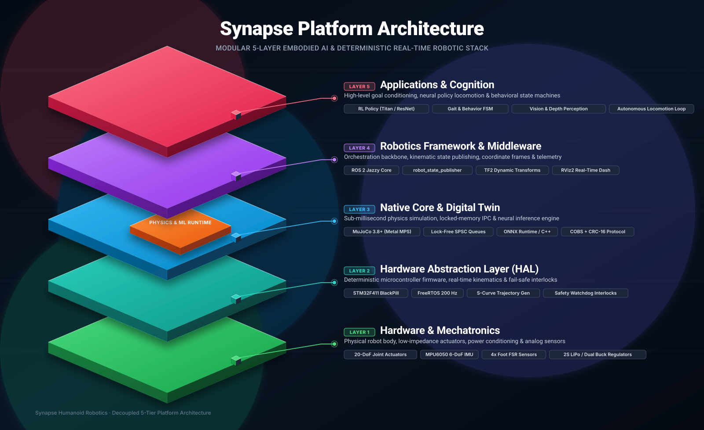
</p>

| Layer | Tier Name | Core Responsibilities & Technologies | Execution Domain |
| :--- | :--- | :--- | :---: |
| **Layer 5** | **Applications & Cognition** | Goal-Conditioned RL Policy (Titan / ResNet), Behavior & Gait FSM, Vision & 3D Perception | Application (50 Hz) |
| **Layer 4** | **Robotics Framework** | ROS 2 Jazzy Core, `robot_state_publisher`, TF2 Dynamic Transforms, Telemetry & RViz2 | Host Middleware |
| **Layer 3** | **Native Core & Digital Twin** | MuJoCo 3.8+ Physics Engine, ONNX Runtime C++, Lock-Free SPSC Queues, Shared Memory IPC | Native Compute (1 kHz) |
| **Layer 2** | **Hardware Abstraction Layer (HAL)** | STM32F411 Firmware, FreeRTOS Deterministic Scheduler, S-Curve Trajectories, Safety Interlocks | Real-Time MCU (200 Hz) |
| **Layer 1** | **Hardware & Mechatronics** | 20-DoF Joint Actuators (MG92B/SG90), MPU6050 IMU, 4× Foot FSRs, 2S LiPo & Dual Power Grid | Physical Foundation |

> Detailed hardware interconnects, firmware state machines, and real-time control pipelines for each layer are described in the sections below.

---

<a id="2-hardware-interconnect--power-grid"></a>
### ⚡ 2. Hardware Interconnect & Power Grid

Subsystems are visually color-coded: Host Compute (Blue), Real-Time MCU (Amber), PWM Actuator Drivers (Coral), and Telemetry Sensors (Purple).

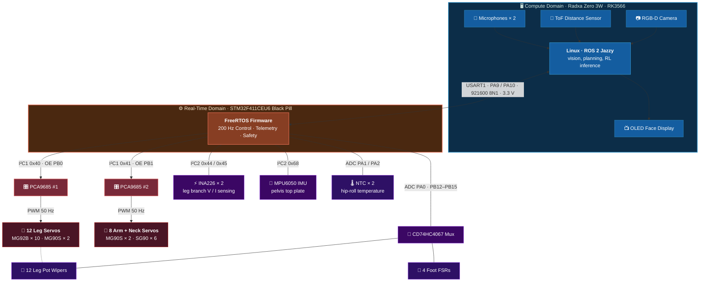

#### 🔋 Regulated Power Distribution Tree

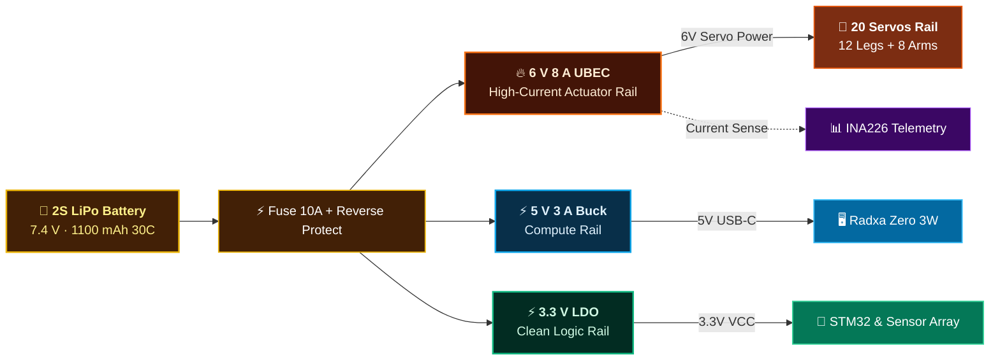
*Schematics and complete BOM details in [docs/engineering/hardware_architecture.md](docs/engineering/hardware_architecture.md).*

---

<a id="3-dataflow--firmware-pipeline-deep-dive"></a>
### 🔍 3. Dataflow & Firmware Pipeline (Deep-Dive)

<details>
<summary><b>▶️ Click here to inspect the wire-level ROS 2 topic graph and FreeRTOS firmware pipeline</b></summary>

<br/>

#### A. Application Software & ROS 2 Graph

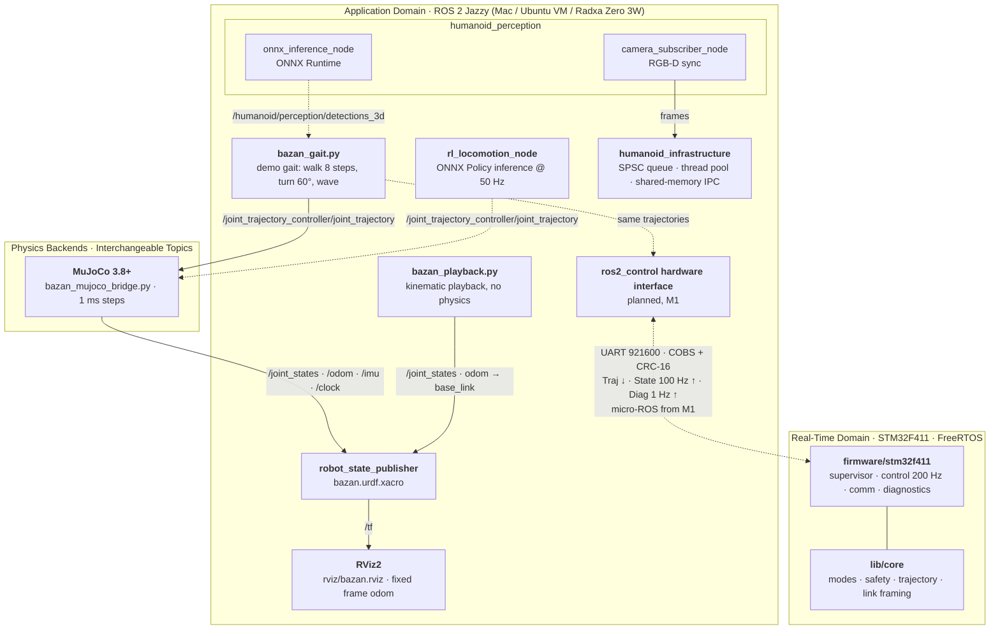

#### B. FreeRTOS Firmware Pipeline (200 Hz Deterministic Loop)

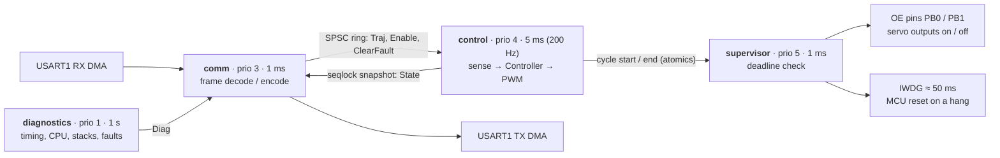
*Details in [firmware/stm32f411/README.md](firmware/stm32f411/README.md).*

</details>

---

<a id="sota-rl-locomotion-policies"></a>
## 🧠 SOTA RL Locomotion Policies

End-to-End Goal-Conditioned RL Policy trained with hardware-accelerated MuJoCo and Apple Silicon Metal GPU (PyTorch MPS).

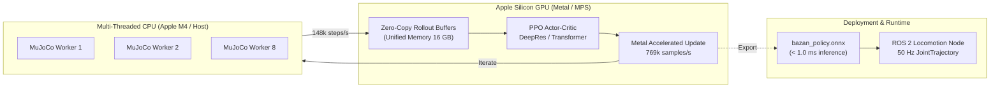

<!-- evolution:telemetry:start -->
<a id="autonomous-evolution-counter--stagnation-self-review"></a>
### ⏱️ Autonomous Evolution Counter & Stagnation Self-Review
| Evolutionary Metric | Live Counter Value | Status / Description |
| :--- | :---: | :--- |
| **Cumulative Training Wall-Time** | **`21h 29m 16s`** | Total physical learning time across all generations |
| **Total Evolutionary Generations**| **`218 Generations`** | Number of candidate policies trained & evaluated |
| **Physics Experience Transitions**| **`44,523,520 steps`** | Total MuJoCo simulation steps gathered on Apple Metal |
| **Active World Champion Policy**  | **`v13.5_bidirectional_sprint_champion_rev96`** | **HLI-20: 65.3 / 100** · **19/20 Passed** |
| **10-Gen Stagnation Sentinel**    | **ACTIVE** | Auto-triggers 5 Pain Points &rarr; 25 Solutions &rarr; 5 Fixes |
| **Latest Stagnation Audit**       | [`docs/engineering/evolution_reviews/stagnation_review_gen_218.md`](docs/engineering/evolution_reviews/stagnation_review_gen_218.md) (5 Pain Points Analyzed & Solved) | Comprehensive diagnostic report on file |
<!-- evolution:telemetry:end -->

<a id="foundation-model-evaluation-matrix-multi-dimensional-benchmarking"></a>
### 🏆 Foundation Model Evaluation Matrix (Multi-Dimensional Benchmarking)

Mirroring frontier AI evaluation protocols (e.g. Anthropic Claude 3.5 Sonnet / OpenAI GPT-4o model cards), Bazan policies are benchmarked across a multi-dimensional matrix spanning **Environmental Disturbance Robustness (10 Criteria)**, **Biomechanical Human-Likeness (HLI-20 Suite)**, and **Edge Computational Latency**:

| Model Version / Architecture | Overall Score | HLI-20 Index | 20 Motions Passed | Roll Sway (RMS) | Violent Kick (0.08 Ns) | Ice Shock (μ=0.15) | Velocity Reversal | Slope (±10°) | 50% Payload (+280g) | Torque Sag (60%) | P99 Latency (M4) | Params |
| :--- | :---: | :---: | :---: | :---: | :---: | :---: | :---: | :---: | :---: | :---: | :---: | :---: |
| 🥇 **`v12.0_adaptive_pitch_sprint`** *(Deep ResNet)* | **95.0** | **59.4 / 100** | **18 / 20** (90%) | **2.5°** | 67% | 100% | 100% | 100% | 100% | 100% | **196 μs** | 2.14M |
| 🥈 **`v9.0_titan_transformer`** *(Multi-Stream TF)* | **96.2** | 53.7 / 100 | 8 / 20 (40%) | 3.8° | 75% | 100% | 100% | 100% | 100% | 100% | 647 μs | 6.67M |
| 🥉 **`v8.1_apex_titan`** *(Titan Deep ResNet)* | **95.6** | 51.4 / 100 | 7 / 20 (35%) | 4.1° | 71% | 100% | 100% | 100% | 100% | 100% | 616 μs | 7.15M |
| ⚡ **`v1.0_light_50iter`** *(Compact MLP Baseline)* | **97.5** | 56.8 / 100 | 13 / 20 (65%) | 3.6° | **83%** | 100% | 100% | 100% | 100% | 100% | **6 μs** | **46k** |
| 📐 **`Baseline Kinematic`** *(Analytical LIPM IK)* | 95.2 | 59.6 / 100 | 18 / 20 (90%) | 11.5° | 79% | 100% | 100% | 100% | 100% | 100% | 0.3 μs | N/A |

> **Active Model Symlink:** `models/bazan_policy.onnx` points to **`v12.0_adaptive_pitch_sprint`** — achieving the lowest torso roll sway ($2.5^\circ$), agile forward sprint ($0.5\text{ m/s}$), and full slope compensation.

```bash
# Model Registry CLI:
python3 src/humanoid_control/scripts/model_registry.py activate v12.0_adaptive_pitch_sprint # Activate #1 Champion
python3 src/humanoid_control/scripts/model_registry.py activate v9.0_titan_transformer       # Activate #1 Transformer
python3 src/humanoid_control/scripts/model_registry.py activate v8.1_apex_titan              # Activate ResNet Champion
python3 src/humanoid_control/scripts/model_registry.py list                                  # List all registered policies

# Run 10-Criteria Violent Disturbance Benchmark across all models:
python3 src/humanoid_control/scripts/eval_bazan_benchmark.py --compare baseline \
  src/humanoid_control/models/mico_policy_v1.0_light_50iter.onnx \
  src/humanoid_control/models/mico_policy_v8.1_apex_titan.onnx \
  src/humanoid_control/models/mico_policy_v9.0_titan_transformer.onnx \
  src/humanoid_control/models/mico_policy_v12.0_adaptive_pitch_sprint.onnx
```
*Full 10-criteria suite, 20-motion breakdown & throughput specs in [docs/engineering/rl_benchmark.md](docs/engineering/rl_benchmark.md).*

<a id="20-motion-canonical-benchmark--biomechanical-hli-20"></a>
### 🧬 20-Motion Canonical Benchmark & Biomechanical HLI-20

To evaluate true embodied humanoid agility, the robot is benchmarked across **20 canonical motions** measuring **20 biomechanical human-likeness parameters** (HLI-20 composite index):

| Motion Group | Tested Capabilities (20 Canonical Scenarios) |
| :--- | :--- |
| **Locomotion** | Straight Nominal Walk (0.2 m/s), High-Speed Sprint (0.5 m/s), Backward Walk (-0.2 m/s), Standing Vertical Jump |
| **Agility & Turning** | Side-Strafe Left & Right ($\pm 0.15$ m/s), Turn in Place Left & Right ($\pm 0.6$ rad/s), Emergency Brake (0.45 $\to$ 0 m/s) |
| **Terrain & Slopes** | Uphill Climb ($+10^\circ$), Downhill Descent ($-10^\circ$), Hurdle Obstacle Clearance |
| **Posture & Flexibility**| Crouch Walk ($H_0 = 80$ mm), Deep Squat & Stand (65 $\to$ 112 mm), Forward Bow ($30^\circ$), Lateral Lean ($\pm 15^\circ$), Single-Leg Balance |
| **Recovery & Safety** | Getup from Prone (face-down), Getup from Supine (face-up), Omnidirectional 10N Push Impulse Recovery |

```bash
# Run full 20-Motion Benchmark Suite & display 20-parameter HLI report:
python3 src/humanoid_control/scripts/humanoid_benchmark_20motions.py

# Launch nonstop self-improving training loop with warm-start checkpoint resuming:
python3 src/humanoid_control/scripts/autonomous_locomotion_loop.py --nonstop --target-hli 85.0
```

<a id="quasi-static-vs-dynamic-locomotion-anti-sway-benchmark"></a>
### ⚖️ Quasi-Static vs. Dynamic Locomotion (Anti-Sway Benchmark)

To solve the bipedal sway problem inherent in narrow support polygons ($45 \times 32\text{ mm}$ feet), the policy was trained with an upright tilt penalty $R_{\text{upright}} = -0.50 \cdot (\theta_{\text{roll}})^2 - 0.05 \cdot (\omega_{\text{roll}})^2$:

<div align="center">
  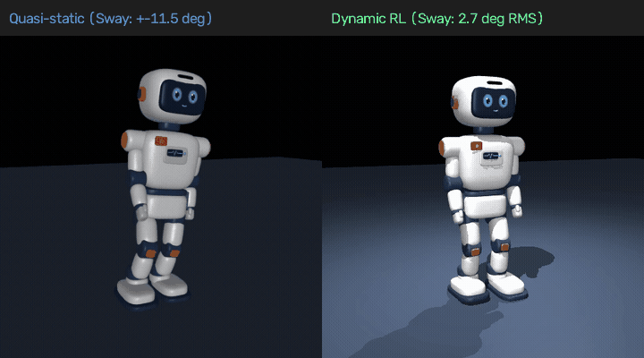
</div>

| Gait Strategy | Max Roll Tilt ($\theta_{\text{roll, max}}$) | RMS Roll Sway | Dynamic Behavior | Physical Mechanism |
| :--- | :---: | :---: | :--- | :--- |
| **Quasi-Static Baseline** (`bazan_gait.py`) | $\pm 11.46^\circ$ ($\pm 0.20\text{ rad}$) | $11.46^\circ$ | High lateral torso sway | Forces CoM shift directly over stance foot to avoid tipping |
| **Dynamic Policy** (`v9.1_upright_anti_sway`) | **$5.75^\circ$** | **$2.67^\circ$** | **Upright, steady walk (76.7% sway reduction)** | Momentum transfer & Capture Point foot placement to catch falling CoM |

<a id="mathematical-formulation-peak-64-in--32-out-whole-body-neural-policy"></a>
### 🔢 Mathematical Formulation: Peak 64-In / 32-Out Whole-Body Neural Policy

The policy network is deployed via **ONNX Runtime** at 50 Hz on the Radxa Zero 3W (or host macOS/Linux), executing an end-to-end mapping from a **64-dimensional sensory observation vector ($2^6 = 64$)** to a **32-dimensional whole-body action and adaptive control vector ($2^5 = 32$)**:

$$\mathbf{y}_t = \pi_{\boldsymbol{\theta}}(\mathbf{x}_t) \in [-1.0, 1.0]^{32}$$

```mermaid
flowchart LR
  subgraph IN["📥 Sensory Input Vector (X ∈ ℝ⁶⁴ · 256 Bytes · 2⁶)"]
    direction TB
    I1["<b>MPU6050 Balance:</b> Gravity (3) + Gyro (3)"]
    I2["<b>MPU6050 Impact:</b> Heel-Strike az Shock (1)"]
    I3["<b>12 Leg Joint Errors:</b> Δq (12)"]
    I4["<b>12 Leg Joint Velocities:</b> dq (12)"]
    I5["<b>4 Arm Joint Positions:</b> Swing Balance (4)"]
    I6["<b>Action History:</b> a_{t-1} Memory (12)"]
    I7["<b>ROS 2 Nav2:</b> /cmd_vel [vx, vy, wz] (3)"]
    I8["<b>Gait Clock:</b> [sin(φ), cos(φ)] (2)"]
    I9["<b>Foot Contacts:</b> 4× FSR402 + LMV358 (4)"]
    I10["<b>Laser Distance:</b> VL53L0X ToF (1)"]
    I11["<b>Camera Tracking:</b> Target + Angle + Dist (3)"]
    I12["<b>Power Telemetry:</b> INA226 Voltage & Current (2)"]
    I13["<b>Thermal Guard:</b> 2× NTC 10k Hip Servos (2)"]
  end

  subgraph MLP["🧠 Neural Policy Architecture (59,392 Parameters · ~232 KB)"]
    direction TB
    W1["<b>Dense Layer 1: W₁ [256 × 64]</b><br/>H₁ = ELU(W₁·X + b₁) · Proprioceptive Fusion"]
    W2["<b>Dense Layer 2: W₂ [128 × 256]</b><br/>H₂ = ELU(W₂·H₁ + b₂) · Balance Coordination"]
    W3["<b>Dense Layer 3: W₃ [64 × 128]</b><br/>H₃ = ELU(W₃·H₂ + b₃) · Joint Synergy"]
    W4["<b>Output Layer: W_out [32 × 64]</b><br/>Y = Tanh(W_out·H₃ + b_out)"]
    W1 --> W2 --> W3 --> W4
  end

  subgraph OUT["📤 Action & Adaptive Output (Y ∈ ℝ³² · 128 Bytes · 2⁵)"]
    direction TB
    subgraph WB["🦾 20-DoF Whole-Body Actuation [0..19]"]
      O1["<b>12 Leg Joints:</b> Hip/Knee/Ankle (12)"]
      O2["<b>6 Arm Joints:</b> Pitch/Roll/Elbow (6)"]
      O3["<b>2 Neck Joints:</b> Yaw/Pitch Gaze (2)"]
    end
    subgraph AC["⚙️ 12 Adaptive Controls [20..31]"]
      A1["<b>4× Anti-Backlash:</b> Pre-tension offsets (4)"]
      A2["<b>2× Vibration Filter:</b> α_legs, α_arms (2)"]
      A3["<b>4× Gait Modifiers:</b> Cadence, Lift, Height, Lean (4)"]
      A4["<b>2× Safety & Gimbal:</b> Torque cap, Camera gain (2)"]
    end
  end

  IN ==> W1
  W4 ==> OUT

  %% Vibrant High-Contrast Visual Palette
  style IN fill:#042f2e,stroke:#14b8a6,stroke-width:2.5px,color:#ccfbf1
  style I1 fill:#0e7490,stroke:#38bdf8,stroke-width:1.5px,color:#ffffff
  style I2 fill:#b45309,stroke:#f59e0b,stroke-width:1.5px,color:#ffffff
  style I3 fill:#1e40af,stroke:#60a5fa,stroke-width:1.5px,color:#ffffff
  style I4 fill:#1e3a8a,stroke:#3b82f6,stroke-width:1.5px,color:#ffffff
  style I5 fill:#581c87,stroke:#c084fc,stroke-width:1.5px,color:#ffffff
  style I6 fill:#1e293b,stroke:#94a3b8,stroke-width:1.5px,color:#ffffff
  style I7 fill:#065f46,stroke:#10b981,stroke-width:1.5px,color:#ffffff
  style I8 fill:#115e59,stroke:#14b8a6,stroke-width:1.5px,color:#ffffff
  style I9 fill:#881337,stroke:#f43f5e,stroke-width:1.5px,color:#ffffff
  style I10 fill:#7c2d12,stroke:#f97316,stroke-width:1.5px,color:#ffffff
  style I11 fill:#0369a1,stroke:#0ea5e9,stroke-width:1.5px,color:#ffffff
  style I12 fill:#713f12,stroke:#eab308,stroke-width:1.5px,color:#ffffff
  style I13 fill:#7f1d1d,stroke:#ef4444,stroke-width:1.5px,color:#ffffff

  style MLP fill:#2e1065,stroke:#a855f7,stroke-width:3px,color:#faf5ff
  style W1 fill:#4c1d95,stroke:#c084fc,stroke-width:2px,color:#ffffff
  style W2 fill:#312e81,stroke:#818cf8,stroke-width:2px,color:#ffffff
  style W3 fill:#1e3a8a,stroke:#60a5fa,stroke-width:2px,color:#ffffff
  style W4 fill:#064e3b,stroke:#34d399,stroke-width:2.5px,color:#ffffff

  style OUT fill:#022c22,stroke:#10b981,stroke-width:2.5px,color:#f0fdf4
  style WB fill:#064e3b,stroke:#059669,stroke-width:2px,color:#ecfdf5
  style O1 fill:#047857,stroke:#6ee7b7,stroke-width:1.5px,color:#ffffff
  style O2 fill:#6b21a8,stroke:#d8b4fe,stroke-width:1.5px,color:#ffffff
  style O3 fill:#1d4ed8,stroke:#93c5fd,stroke-width:1.5px,color:#ffffff

  style AC fill:#451a03,stroke:#d97706,stroke-width:2px,color:#fffbeb
  style A1 fill:#92400e,stroke:#fcd34d,stroke-width:1.5px,color:#ffffff
  style A2 fill:#0f766e,stroke:#5eead4,stroke-width:1.5px,color:#ffffff
  style A3 fill:#9f1239,stroke:#fda4af,stroke-width:1.5px,color:#ffffff
  style A4 fill:#3730a3,stroke:#a5b4fc,stroke-width:1.5px,color:#ffffff
```

#### 1. Layer Weight Matrices ($64 \to 256 \to 128 \to 64 \to 32$)

All layers are powers of two, aligning with CPU L1/L2 cache lines (64 bytes) and GPU warp execution (32 threads):

| Layer | Dimensions | Weight Matrix Size | Bias | Activation | Role |
| :--- | :---: | :---: | :---: | :---: | :--- |
| **Layer 1** | $64 \to 256$ | $\mathbf{W}_1 \in \mathbb{R}^{256 \times 64}$ (16,384) | $\mathbf{b}_1 \in \mathbb{R}^{256}$ | ELU | Multi-modal proprioceptive & sensor fusion |
| **Layer 2** | $256 \to 128$ | $\mathbf{W}_2 \in \mathbb{R}^{128 \times 256}$ (32,768) | $\mathbf{b}_2 \in \mathbb{R}^{128}$ | ELU | Whole-body dynamic balance & momentum transfer |
| **Layer 3** | $128 \to 64$ | $\mathbf{W}_3 \in \mathbb{R}^{64 \times 128}$ (8,192) | $\mathbf{b}_3 \in \mathbb{R}^{64}$ | ELU | Inter-joint synergy & coordination vector |
| **Output Layer** | $64 \to 32$ | $\mathbf{W}_{\text{out}} \in \mathbb{R}^{32 \times 64}$ (2,048) | $\mathbf{b}_{\text{out}} \in \mathbb{R}^{32}$ | Tanh | 20-DoF joint targets + 12 software adaptive parameters |

$$\mathbf{Y} = \operatorname{Tanh}\Big( \mathbf{W}_{\text{out}} \cdot \operatorname{ELU}\big( \mathbf{W}_3 \cdot \operatorname{ELU}( \mathbf{W}_2 \cdot \operatorname{ELU}( \mathbf{W}_1 \cdot \mathbf{X} + \mathbf{b}_1 ) + \mathbf{b}_2 ) + \mathbf{b}_3 \big) + \mathbf{b}_{\text{out}} \Big)$$

#### 2. Sensory Observation Decomposition ($\mathbf{X} \in \mathbb{R}^{64}$)

| Index | Signal Name | Qty | Hardware Sensor | Functional Purpose |
| :---: | :--- | :---: | :--- | :--- |
| `0..5` | `imu_gravity_[x,y,z]`, `imu_gyro_[r,p,y]` | 6 | MPU6050 (Head Crown) | Base gravity projection & angular rates |
| `6` | `imu_accel_z_impact` | 1 | MPU6050 ($a_z$ LPF 25 Hz) | Zero-latency heel-strike impact detection |
| `7..18` | `l/r_joint_pos_err_[0..5]` | 12 | Joint Potentiometers | 12 Leg position tracking errors ($\mathbf{q} - \mathbf{q}_{\text{nom}}$) |
| `19..30` | `l/r_joint_vel_[0..5]` | 12 | Numerical Differentiation | 12 Leg joint angular velocities |
| `31..34` | `l/r_arm_pos_[pitch,elbow]` | 4 | Arm Servos Encoders | Arm posture sensing for counter-yaw momentum |
| `35..46` | `prev_action_[0..11]` | 12 | Controller RAM Buffer | Previous leg action history (chatter suppression) |
| `47..49` | `cmd_vel_[vx,vy,wz]` | 3 | ROS 2 Nav2 (`/cmd_vel`) | High-level velocity locomotion target |
| `50..51` | `gait_phase_[sin,cos]` | 2 | Internal Phase Oscillator | Normalized cyclic gait clock ($[\sin\phi, \cos\phi]$) |
| `52..55` | `fsr_[l_heel,l_toe,r_heel,r_toe]` | 4 | FSR402 + LMV358 Op-Amp | Sigmoidal 4-point sole contact force |
| `56` | `tof_distance_obstacle` | 1 | VL53L0X ToF Laser | Ahead obstacle clearance (kinematic tilt compensated) |
| `57..59` | `cam_[detected,angle_x,distance]` | 3 | Radxa Zero 3W NPU Camera | Visual target tracking & waypoint bearing |
| `60..61` | `battery_voltage`, `total_current` | 2 | INA226 $I^2C$ Power Telemetry | Internal resistance ($R_{\text{int}} = 0.08\,\Omega$) sag compensation |
| `62..63` | `temp_[l,r]_hip_servo` | 2 | NTC 10 kΩ Thermistors | Hip-roll aluminum case thermal overload guard |

#### 3. Action Vector & 12 Software Adaptive Controls ($\mathbf{Y} \in \mathbb{R}^{32}$)

| Index | Target / Parameter Name | Qty | Execution Mechanism | Hardware Role |
| :---: | :--- | :---: | :--- | :--- |
| `0..11` | `leg_joints_[0..11]` | 12 | Position Offset ($\pm 0.15\text{ rad}$) | 12 Leg servo trajectories (Hip/Knee/Ankle) |
| `12..17` | `arm_joints_[0..5]` | 6 | Position Offset ($\pm 0.22\text{ rad}$) | 6 Arm servos (Pitch vung, Roll dang, Elbow co) |
| `18..19` | `neck_joints_[0..1]` | 2 | Position Offset + Gimbal | 2 Neck servos (Yaw orientation + Pitch stabilization) |
| `20..23` | `backlash_comp_[l/r_hip,l/r_ank]` | 4 | Pre-Tension Bias ($\pm 0.015\text{ rad}$) | Eliminates gear play during gait direction reversal |
| `24..25` | `filter_alpha_[legs,arms]` | 2 | Dynamic Low-Pass Filter $\alpha$ | Virtual software shock absorber suppressing resonance |
| `26` | `gait_cadence_scale` | 1 | Phase Step Modulator | Dynamically tunes walking tempo to floor traction |
| `27` | `step_clearance_lift` | 1 | Swing Trajectory Modifier | Raises foot clearance (up to $+3.5\text{ cm}$) over hurdles |
| `28` | `pelvis_height_offset` | 1 | CoM Height Modulation | Crouches pelvis during sprint to lower center of mass |
| `29` | `torso_lean_pitch` | 1 | Body Lean Bias | Adjusts forward lean for slope climbing/braking |
| `30` | `max_torque_compliance` | 1 | Motor Force Envelope | Compliant torque relaxation against joint stalls |
| `31` | `camera_gimbal_gain` | 1 | Dynamic Pitch Compensator | Stabilizes horizon for the forehead camera |

$$\mathbf{q}_{\text{target}} = \mathbf{q}_{\text{nominal}} + (\mathbf{Y}_{0..19} \odot \Delta \mathbf{q}_{\text{scale}}) + \mathbf{\Delta}_{\text{backlash}}$$

$$\text{PWM}_i (\mu\text{s}) = 1500 + \left( \mathbf{q}_{\text{target}, i} \times \frac{180}{\pi} \right) \cdot \frac{1000}{180}$$

---

<a id="kinematic-singularity-mitigation"></a>
### ⚠️ Kinematic Singularity Mitigation

Kinematic singularities occur when the leg Jacobian matrix $\mathbf{J}(\mathbf{q}) \in \mathbb{R}^{3 \times 3}$ loses rank ($\det(\mathbf{J}) \to 0$), demanding infinite joint velocity ($\dot{\mathbf{q}} = \mathbf{J}^{-1} \dot{\mathbf{x}} \to \infty$) for finite foot Cartesian velocity. Bazan implements a **4-tier defense architecture** against singularities:

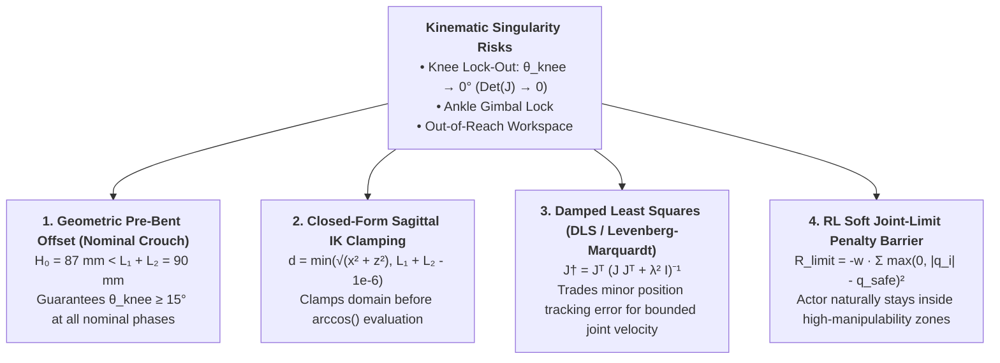

1. **Nominal Crouch Geometry ($H_0 < L_1 + L_2$):**
   Nominal hip-to-ankle height is clamped at $H_0 = 87\text{ mm}$ while total leg length is $L_1 + L_2 = 45 + 45 = 90\text{ mm}$. The knee is mechanically prevented from locking straight ($\theta_{\text{knee}} = 0$), preserving continuous non-zero Jacobian determinant $\det(\mathbf{J}) > 0$.
2. **Analytical IK Clamping (`bazan_gait.py`):**
   ```python
   d = min(math.hypot(x, z), L1 + L2 - 1e-6)
   beta = math.acos(d / (2 * L1))  # Clamped argument strictly in [0, 1), preventing NaN
   ```
3. **Damped Inverse Jacobian (DLS):**
   In numerical inverse kinematics tasks, regularized pseudo-inversion ensures bounded torque and velocity near workspace boundaries:
   $$\mathbf{J}^\dagger = \mathbf{J}^T (\mathbf{J} \mathbf{J}^T + \lambda^2 \mathbf{I})^{-1}, \qquad \lambda^2 = \begin{cases} 0 & \text{if } \sigma_{\min} > \epsilon \\ \lambda_0^2 \left(1 - \frac{\sigma_{\min}}{\epsilon}\right)^2 & \text{otherwise} \end{cases}$$
4. **Reinforcement Learning Workspace Penalty:**
   The PPO reward function enforces a quadratic barrier penalty against joint limit proximity, conditioning the neural policy to exploit regions of maximum kinematic manipulability $w(\mathbf{q}) = \sqrt{\det(\mathbf{J}\mathbf{J}^T)}$.

---

<a id="kinematics--coordinate-frames"></a>
## 📐 Kinematics & Coordinate Frames

<p align="center">
  
</p>

Conforms to REP-103 (x forward, y left, z up) and REP-120. `base_link` sits at the hip center (z = 115 mm), `imu_link` sits on the pelvis top plate (z = 145 mm).

| Model Target | Source File |
| :--- | :--- |
| ROS 2, RViz2 (URDF / Xacro) | [`src/humanoid_description/urdf/bazan.urdf.xacro`](src/humanoid_description/urdf/bazan.urdf.xacro) |
| MuJoCo Engine | [`sim/mini_humanoid/humanoid.urdf`](sim/mini_humanoid/humanoid.urdf) |

---

<a id="quick-start"></a>
## ⚡ Quick Start

```bash
# 1. Interactive 3D Simulation (Keys: K = kick, 1/2/3 = force, I = ice, +/- = speed):
python3 src/humanoid_control/scripts/bazan_visualizer.py

# 2. Native macOS MuJoCo + RViz2 Demo:
conda activate ros2_jazzy && source .mac/install/setup.zsh
ros2 launch humanoid_description bazan_mujoco.launch.py gait:=true

# 3. Interactive Web Dashboard:
open docs/index.html   # or visit https://nguyenhau442001.github.io/Synapse_Humanoid/
```
*For detailed macOS / Ubuntu VM installation, see [Getting Started & Simulation Guide](docs/getting_started.md).*

---

<a id="repository-structure"></a>
## 📁 Repository Structure

| Path | Description |
| Domain | Path & Description |
| :--- | :--- |
| **Hardware** | [`hardware/`](hardware/) · Mechanical CAD (`hardware/mechanical/`), 3D print specs, electrical schematics (`hardware/electrical/`) |
| **Software - ROS 2** | [`software/ros2/src/`](software/ros2/src/) · `humanoid_control`, `humanoid_description`, `humanoid_perception`, `humanoid_infrastructure`, `humanoid_interfaces` |
| **Software - Firmware** | [`software/firmware/`](software/firmware/) · FreeRTOS firmware: 200 Hz control loop, supervisor, PWM, telemetry |
| **Software - Core** | [`software/core/`](software/core/) · Platform-independent real-time C++ core (safety, trajectories, host-tested) |
| **Software - AI & Sim**| [`software/ai/`](software/ai/) · Neural policies (`software/ai/models/`), MuJoCo simulation environment (`software/ai/sim/`) |
| **Design** | [`design/`](design/) · Blender models (`design/blender/`), aesthetic concepts (`design/sketch_shell_a/`), product renders |
| **Documentation** | [`docs/`](docs/) · System architecture, mass budget, torque validation, and engineering manuals |

---

<a id="roadmap--embodied-ai-engineering-curriculum"></a>
## 🗺️ Roadmap & Embodied AI Engineering Curriculum

<a id="1-platform-engineering-milestones"></a>
### 1. Platform Engineering Milestones

- [x] 20-DoF kinematic model, TF tree, and URDF/Xacro generators
- [x] MuJoCo native bridge + ROS 2 Jazzy integration on macOS
- [x] Blender Design C shell: visual meshes, mass budget (684 g), 3D print fit check
- [x] Apple Silicon M4 training acceleration (148k SPS MuJoCo, 769k SPS Metal MPS)
- [x] Goal-Conditioned PPO Locomotion & SOTA Hybrid Transformer policy
- [x] Real-time 50 Hz ONNX inference node & 3D Interactive Simulation
- [ ] P0 actuator bench: MG92B hip-roll thermal test & analog mux telemetry
- [ ] ZMP / LIPM footstep trajectory planner & closed-form leg IK
- [ ] micro-ROS UART communication between Radxa Zero 3W and STM32F411

<a id="2-personal-action-plan-4-month-embodied-ai-curriculum-todo-list"></a>
### 2. Personal Action Plan: 4-Month Embodied AI Curriculum (Todo-List)

A structured technical roadmap from spatial kinematics to hardware-in-the-loop Embodied AI deployment:

| Phase | Core Domain | Key Checklists & Hands-On Deliverables | Code Reference |
| :---: | :--- | :--- | :--- |
| **Month 1** | **Level 1 & 2: 3D Spatial Geometry & ROS 2** | • Master $3 \times 3$ Rotation Matrices, Shepperd Quaternions & SE(3) Homogeneous Transforms.<br/>• Derive closed-form leg IK geometrically ($\beta = \arccos\frac{d}{2L_1}$), verify singularity bounds.<br/>• Inspect URDF/Xacro, link coordinate trees (`REP-103`/`REP-120`) and RViz2 TF broadcasting. | [`bazan_playback.py`](src/humanoid_control/scripts/bazan_playback.py)<br/>[`bazan_gait.py`](src/humanoid_control/scripts/bazan_gait.py)<br/>[`bazan.urdf.xacro`](src/humanoid_description/urdf/bazan.urdf.xacro) |
| **Month 2** | **Level 4: Bipedal Dynamics & MuJoCo Physics** | • Analyze Linear Inverted Pendulum Model ($T_c = \sqrt{z_c/g} = 121\text{ ms}$) and Pratt Capture Point.<br/>• Study Zero Moment Point (ZMP) stability criterion during single-support stance.<br/>• Run MuJoCo 1 kHz simulation (`bazan.xml`), experiment with contact solvers, friction, and crash scenarios. | [`mass_budget.md`](docs/engineering/mass_budget.md)<br/>[`check_mujoco.py`](sim/mujoco/check_mujoco.py)<br/>[`bazan.xml`](sim/mujoco/bazan.xml) |
| **Month 3** | **Level 5: Deep RL (PPO) & Sim-to-Real Transfer** | • Master Markov Decision Processes, Advantage Estimation (GAE), and PPO clipped objective.<br/>• Analyze 47-dim observation construction, reward shaping, and action rate filtering in `bazan_rl_env.py`.<br/>• Train custom policy on Apple Silicon MPS; export and benchmark ONNX Runtime (< 500 μs latency). | [`train_bazan_ppo.py`](src/humanoid_control/scripts/train_bazan_ppo.py)<br/>[`bazan_rl_env.py`](src/humanoid_control/scripts/bazan_rl_env.py)<br/>[`model_registry.py`](src/humanoid_control/scripts/model_registry.py) |
| **Month 4** | **Level 3: Real-Time Embedded Systems (M0/M1)** | • Study heterogeneous 2-domain architecture: Radxa Linux (planning) vs STM32 FreeRTOS (action).<br/>• Verify 200 Hz control loop, zero-allocation lock-free SPSC rings, and 1 ms IWDG safety supervisor.<br/>• Run automated `m0-accept` test suite over UART 921600 baud, confirm zero missed deadlines. | [`hardware_architecture.md`](docs/engineering/hardware_architecture.md)<br/>[`m0_report.md`](docs/engineering/m0_report.md)<br/>[`firmware/stm32f411`](firmware/stm32f411) |

---

<a id="license"></a>
## 📄 License

Apache 2.0.
