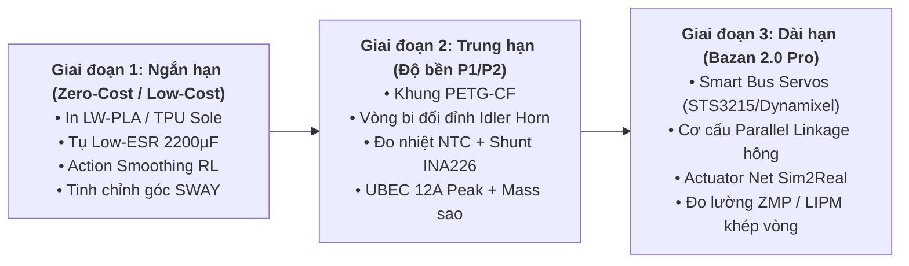

# 🚀 Lộ trình Nâng cấp Robot Bazan (Upgrade Roadmap)

Tài liệu này tổng hợp phân tích kỹ thuật, các điểm nghẽn vật lý (thermal, latency, power, structure) và lộ trình nâng cấp thực tế cho robot Bazan từ phiên bản nguyên mẫu giá rẻ (Hobby Servos) đến nền tảng bipedal chuyên nghiệp.

---

## 📌 Tổng quan các thách thức kỹ thuật cốt lõi

| Thách thức | Hiện tượng thực tế | Giới hạn thiết kế | Hậu quả nếu không xử lý |
| :--- | :--- | :--- | :--- |
| **Quá nhiệt khớp hông** | Servo `hip_roll` (MG92B) gánh RMS 77% tải liên tục, 21% thời gian vượt ngưỡng | Ngưỡng an toàn liên tục = 1/3 stall (1.17 kg·cm) | Sau 1–2 phút bước đi, servo trôi nhiệt (thermal drift) hoặc cháy cuộn dây |
| **Trễ điều khiển 50 Hz** | Chu kỳ PWM 20 ms, trong khi thời gian con lắc ngã $\sqrt{z/g} = 121\text{ ms}$ | Trễ lệnh chiếm ~17% thời gian sụp đổ của robot | Dễ dao động cộng hưởng, trượt chân khi tiếp đất, Sim2Real gap lớn |
| **Sụt áp nguồn (Voltage Sag)** | 12 servo chân đồng thời tăng tốc hoặc gập gối, dòng đỉnh > 8A–10A | UBEC 6V 8A giới hạn, pin 2S LiPo 1100 mAh | Nhiễu EMI / sụt áp gây reset STM32F411 hoặc treo Radxa Zero 3W |
| **Võng khung & rơ khớp** | Vỏ PLA mỏng 1.0–1.2 mm, trục servo đơn điểm (single horn) | Diện tích bàn chân nhỏ ($45 \times 32\text{ mm}$) | Biến dạng đàn hồi 2°–3° làm điểm ZMP văng ra ngoài bàn chân $\to$ ngã |

---

## 🗺️ Lộ trình nâng cấp 3 giai đoạn (Phase 1 $\to$ Phase 3)

---

### 🟢 Giai đoạn 1: Khắc phục tức thời (Chi phí thấp / Tối ưu phần mềm & in 3D)
*Mục tiêu: Đảm bảo nguyên mẫu ban đầu chạy ổn định, không bị sập nguồn hay cháy servo hông.*

1. **Giảm tải khối lượng bằng vật liệu in LW-PLA (Lightweight PLA):**
   - Thay thế toàn bộ vỏ thân (trunk) và đầu từ PLA tiêu chuẩn sang **LW-PLA (active foaming)**.
   - Giảm tổng trọng lượng robot từ **677 g $\to$ 603 g** (giảm 74 g, tương đương ~11% toàn thân).
   - Tải RMS của servo hông `hip_roll` tự động giảm từ 77% xuống **~68%**, đưa điểm làm việc về vùng an toàn.

2. **Đế giày đàn hồi triệt tiêu phản lực tiếp đất (TPU 95A Sole):**
   - In 3D lớp đệm đáy bàn chân dày 2.0 mm bằng **TPU 95A** dạng tổ ong (gyroid/infill 25%).
   - Hấp thụ xung lực va chạm (impact shock) khi tiếp đất (heel-strike), bảo vệ nhông kim loại MG92B khỏi mẻ răng và giữ cảm biến FSR tiếp xúc phẳng với sàn.

3. **Chống sập áp bằng Tụ đệm Low-ESR (Bulk Capacitor):**
   - Hàn 1–2 tụ hóa trở kháng thấp **16V 2200 µF Low-ESR** (chi phí ~5,000 – 10,000 VND tại Nhật Tảo) trực tiếp song song với ngõ ra 6.0 V của mạch UBEC.
   - Bù dòng xả tức thời trong 1–5 ms đầu khi motor đảo chiều, dập tắt gai điện áp (voltage spikes).

4. **Tối ưu phần mềm & Hàm thưởng RL (Action Smoothing & Gait Tuning):**
   - Trong `mico_gait.py`: Giảm góc lắc ngang `SWAY` từ `0.20 rad` xuống `0.16 rad`, tăng tốc độ chuyển trọng tâm để rút ngắn thời gian giữ tải tĩnh trên một chân.
   - Trong huấn luyện RL (`train_mico_ppo.py`): Bật phạt gia tốc hành động $\|\ddot{a}\| = \|a_t - 2a_{t-1} + a_{t-2}\|^2$ để triệt tiêu hiện tượng rung giật tần số cao (chattering).

---

### 🟡 Giai đoạn 2: Gia cố cơ điện & Đo kiểm thực tế (P1 / P2 Hardware)
*Mục tiêu: Đạt chuẩn tin cậy công nghiệp cho các bài kiểm tra di chuyển liên tục 10–30 phút.*

1. **Khung chịu lực bằng vật liệu pha sợi Carbon (PETG-CF / PA-CF):**
   - Các cụm chi tiết chịu lực uốn chính (khung xương chậu Pelvis, cùm gối, ngàm cổ chân) chuyển sang in bằng **PETG-CF** hoặc **PA-CF (Nylon Carbon)**.
   - Độ cứng uốn (stiffness) tăng gấp 3 lần, chịu nhiệt độ tiếp xúc từ servo lên tới $90^\circ\text{C}-110^\circ\text{C}$ mà không biến dạng.

2. **Khớp xoay trục đối đỉnh có vòng bi (Dual-Bearing Idler Horn):**
   - Bổ sung gối đỡ vòng bi gờ (**Flanged Ball Bearing 3x8x3 mm**) ở mặt lưng của tất cả các khớp chân tải nặng (`hip_roll`, `hip_pitch`, `knee`, `ankle_pitch`).
   - Khử hoàn toàn lực bẻ ngang (bending moment) tác dụng lên trục servo, triệt tiêu độ rơ (backlash) của nhông truyền động.

3. **Giám sát nhiệt & ngắt bảo vệ phần cứng (A+ Monitoring):**
   - Hoàn thiện module đo dòng 2 nhánh chân bằng **INA226 (R010 shunt, 8.2A full-scale)**.
   - Dán 2 cảm biến nhiệt **NTC 10 kΩ (MF52)** bằng keo tản nhiệt vào vỏ nhôm servo `hip_roll`.
   - Cấu hình FreeRTOS trên STM32: Khi nhiệt độ vỏ servo vượt quá $60^\circ\text{C}$, tự động kích hoạt chế độ **CROUCH / SAFE_HOLD**, cắt lệnh PWM để bảo vệ motor.

4. **Nâng cấp công suất nguồn:**
   - Thay UBEC 6V 8A bằng khối UBEC kép hoặc UBEC 6V/12A peak.
   - Đi dây **Mass hình sao (Star Grounding)** tuyệt đối giữa cụm động lực (Servos/UBEC) và cụm tính toán (STM32/Radxa).

---

### 🔴 Giai đoạn 3: Kiến trúc Thế hệ mới (Bazan 2.0 Pro Platform)
*Mục tiêu: Đưa Bazan tiệm cận tiêu chuẩn robot bipedal nghiên cứu chuyên nghiệp (như Robotis OP3, K-Scale).*

1. **Chuyển đổi toàn bộ sang Smart Bus Servos (Serial TTL / RS-485):**
   - Thay thế toàn bộ servo PWM phổ thông bằng dòng **Feetech STS3215** (mô-men 19 kg·cm @ 7.4V, vỏ nhôm CNC, nhông thép) hoặc **Dynamixel XC330 / XL430**.
   - Giao tiếp bus nối tiếp 2 dây tốc độ **1 Mbps**, tần số điều khiển khép vòng lên tới **200 Hz – 500 Hz** (thay vì 50 Hz PWM).
   - Đọc trực tiếp góc thực, vận tốc, dòng điện tải và nhiệt độ cuộn dây theo thời gian thực (real-time telemetry) qua 1 đường UART duy nhất của STM32, loại bỏ hoàn toàn cụm Mux ADC CD74HC4067 cồng kềnh.

2. **Cơ cấu hông thanh truyền song song (Parallel Hip Linkage):**
   - Đưa cả 2 motor xoay hông (`hip_roll` và `hip_yaw`) đặt cố định bên trong khoang xương chậu (Pelvis).
   - Truyền động xuống đùi qua đũa đẩy Carbon và khớp cầu (Ball joint). Giảm khối lượng chi dưới xuống mức tối thiểu, tăng tốc độ vung chân lên gấp đôi.

3. **Mô hình hóa bộ truyền động trong Sim (Actuator Net & Domain Randomization):**
   - Xây dựng mạng nơ-ron xấp xỉ đặc tính phi tuyến của motor (Actuator Network) đưa vào môi trường MuJoCo.
   - Đưa độ trễ ngẫu nhiên 10–40 ms vào rollout buffer để huấn luyện các mạng Transformer/ResNet thích ứng với độ trễ phần cứng thực tế (Sim-to-Real transfer rate > 95%).

---

## 📊 Bảng so sánh chi phí & hiệu quả

| Giải pháp | Hạng mục | Chi phí ước tính (VND) | Tác động kỹ thuật |
| :--- | :--- | :--- | :--- |
| **Giai đoạn 1** | Tụ Low-ESR 2200µF × 2 | ~15,000 | Chống sập nguồn, dập xung nhọn 6V |
| | Cuộn nhựa LW-PLA (0.8 kg) | ~450,000 | Giảm 76 g khối lượng, giảm 12% nhiệt hông |
| | Cuộn nhựa TPU 95A (0.5 kg) | ~300,000 | Chống mẻ nhông kim loại khi chạm đất |
| | Tối ưu code Gait / PPO | 0 | Giảm rung lắc, hạ thời gian chịu tải tĩnh |
| **Giai đoạn 2** | Cuộn nhựa PETG-CF | ~480,000 | Tăng gấp 3 độ cứng khung chân |
| | Bộ vòng bi đối đỉnh (16 cái) | ~120,000 | Khử lực bẻ trục servo, chống rơ khớp |
| | Mạch A+ (INA226, NTC, Mux) | ~233,000 | Giám sát dòng/nhiệt, tự ngắt bảo vệ |
| **Giai đoạn 3** | Cụm 12 Bus Servo STS3215 | ~4,200,000 | Điều khiển dòng/nhiệt 200 Hz, lực khỏe gấp 5 |
