# Bazan v4 · Whole-Robot Assembly Manual

Sinh tự động bởi `mechanical/gen_manual.py` từ `leg.py` + `body.py` — không sửa tay. Đơn vị mm. Hệ trục robot: gốc ở giữa hai điểm hông H, x ra trước, y sang TRÁI robot, z lên trên, robot đứng thẳng. Bên phải là ảnh gương của bên trái (file `R_*`).

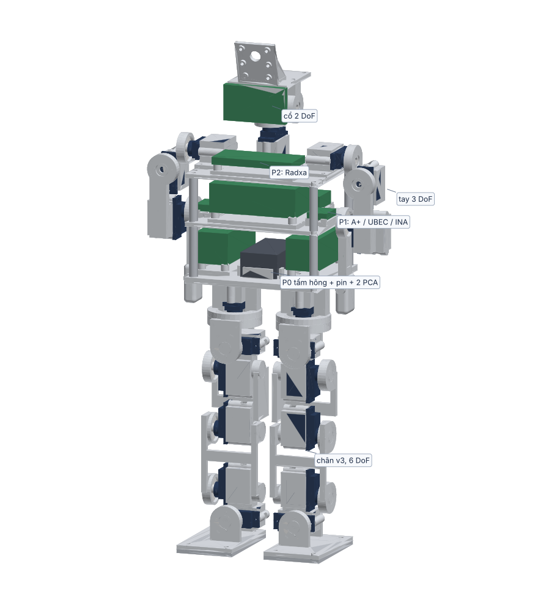

## 1. Key Dimensions

| Đại lượng | Giá trị |
| --- | --- |
| Chiều cao (sàn → đỉnh giá camera, chưa vỏ) | 400.7 |
| Điểm hông H trên sàn | 137.33 |
| Mặt dưới tấm hông P0 (= đỉnh đế gắn chân) trên H | 73.03 |
| Mặt trên P0 / tầng 1 / tầng 2 trên H | 77.53 / 120.53 / 158.53 |
| Tầng (cả 3 tầng) x × y | 89 × 108 (x -49…+40) |
| Trụ đứng: lưới 4 trụ | x −44 / +35, y ±49 |
| Trục vai (pitch) trên H | 169.83 (y ±60.5 = mặt đầu servo) |
| Trục roll vai / khuỷu trên H | 155.83 / 120.33 |
| Trục cổ (yaw) x / trục gật đầu trên H | -3.0 / 207.53 |
| Bề rộng qua 2 khuỷu (ngoài ổ servo) | 192.4 |
| Chân: L1, L2, khoảng cách 2 chân | 48, 48, y ±28 |

So với bản 303 mm cũ: robot cao hơn khoảng 100 mm vì (1) chân v3 đặt mọi trục servo đúng trục khớp và tách trục roll khỏi trục pitch 20 mm, (2) thân thành 3 tầng để mỗi mạch có chỗ riêng và tháo được độc lập. Phải chạy lại mô hình URDF/khối lượng/mô-men trước khi mua servo (xem mục 11).

## 2. Design Rules (Easy Motor and Board Swaps)

1. **Một khớp = một hộp servo chuẩn.** Cả 20 khớp dùng cùng ổ servo 9 g (MG92B / MG90S / SG90 cùng khung vỏ), cùng đĩa horn, cùng idler MR63ZZ ở khớp chịu tải. Servo nào cũng lắp được vào khớp nào; thay 1 servo chỉ mở đúng khớp đó.
2. **Mạch không bao giờ bắt thẳng vào tầng.** Mỗi mạch nằm trên đế in riêng (4 trụ có tán M2 đúng lỗ của mạch); đế bắt vào tầng bằng 2 × M2×6 vào một *bay*: 2 tán cách nhau 40 mm (SL-40) hoặc 20 mm (SL-20). Đổi mạch khác = in đế mới 15 phút, không in lại tầng.
3. **Thân là chồng tầng**: P0 + tầng 1 + tầng 2 trên 4 trụ nhựa M3 mỗi tầng. Tháo từng tầng, không keo.
4. **Dây vào thân ở chỗ cố định**: dây chân qua 2 khe sau P0; dây tay + cổ + đầu qua khe sau tầng 2 và tầng 1.

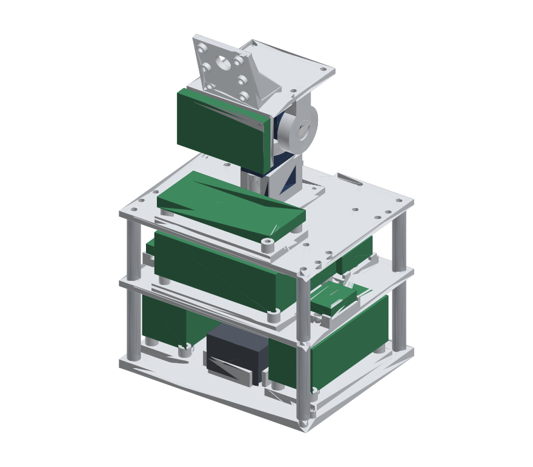

## 3. Fits and Tolerances (All Parts)

In FDM, đầu 0.4, PLA. Kích thước lỗ trong file in đã cộng sẵn dung sai dưới đây — **không** chỉnh "hole compensation" trong slicer, trừ khi phiếu thử (bước 0.3) cho thấy lệch.

| Mối ghép | Danh định | Lỗ in | Kiểu lắp | Kiểm tra sau in |
| --- | --- | --- | --- | --- |
| Vỏ servo trong ổ | 12.2 × 22.8 | +0.2 mỗi bên | lỏng (trượt tay) | servo trượt vào bằng tay, không lắc quá 0.3 mm |
| Tán cấy M2 | OD 3.2 | Ø3.2 | ép nhiệt 220 °C | tán bằng mặt ±0.2, không nghiêng |
| Tán cấy M3 | OD 4.2 | Ø4.0 | ép nhiệt 220 °C | tán bằng mặt ±0.2 |
| Lỗ xuyên ốc M2 | 2.0 | Ø2.3 | lỏng 0.3 | ốc M2 lọt qua bằng tay |
| Lỗ xuyên ren trụ M3 | 3.0 | Ø3.3 | lỏng 0.3 | ren đực trụ lọt qua |
| Khoét đầu ốc M2 | đầu Ø3.8 × 2.0 | Ø4.4 sâu 2.2 | đầu chìm 0.2 | đầu ốc không lồi |
| Ổ bạc đạn MR63ZZ | OD 6.00 | Ø6.05 sâu 2.5 | ép (in ra ~5.95) | ép bằng ngón cái/kẹp, quay êm |
| Lỗ mồi vít ST2 | 2.2 ren | Ø1.6 | tự ren | vít ăn chặt, không nứt |
| Lỗ vào vít horn | đầu vít ~Ø4 | Ø5.2 | lỏng | tua vít PH0 lọt |
| Đĩa horn trong hốc | Ø20.0 | Ø20.4 | lỏng 0.2 | horn nằm phẳng đáy hốc |
| Khe giữa 2 chi tiết chuyển động | — | ≥ 1.0 | khe hở | quay hết hành trình không cọ |
| Đĩa horn ↔ tháp servo | — | 0.6 | khe hở |  |
| Giá yaw ↔ vòng chặn tải | — | 0.2 | khe hở + mỡ | xoay nhẹ, không rơ dọc |
| Trụ nhựa M3 lục giác | 5.5 AF | — | — | vặn tay vừa chặt (≤ 0.4 N·m) |

Độ sâu ốc (đã kiểm cho từng loại): ốc M2×6 qua tai servo dày 2.5 → ăn 3.5 vào lỗ tán sâu 4.0; qua đế board/mặt bích dày 3 → ăn 3.0 (tán dài 3); qua đế sled dày 4 khoét 2.2 → ăn 4.2 (tầng 1, 2 dày 3: mũi ốc lòi 1.2 mm dưới tầng, không chạm gì); qua PCB 1.6 vào trụ board → ăn 4.4 vào lỗ sâu 5.0; qua lỗ khoét P0 vào đế gắn chân → ăn 3.7 vào lỗ sâu 4.0. M3×6 qua tầng 2 dày 3 → ăn 3.0 vào trụ.

## 4. Bill of Materials (Whole Robot)

### 4.1 Servos

| Servo | SL | Khớp |
| --- | --- | --- |
| MG92B | 10 | hip roll, hip pitch, knee, ankle pitch, ankle roll × 2 chân |
| MG90S | 4 | hip yaw × 2, shoulder pitch × 2 |
| SG90 | 6 | shoulder roll × 2, elbow × 2, neck yaw, head pitch |

SG90 hẹp hơn MG92B 0.4 mm: nếu servo lắc trong ổ, dán 1 lớp băng keo giấy 0.1 mm lên 2 mặt bên vỏ servo. Lỗ tai SG90 cách nhau 27.6 (MG92B 27.8): nếu ốc M2 không vào, khoét lỗ tai Ø2.4.

### 4.2 Screws, Inserts, Bearings, Standoffs (Both Legs Included)

| Mã | Tổng | Trong 2 chân | Trong thân + tay + đầu | Hỏi cửa hàng |
| --- | ---: | ---: | ---: | --- |
| M2x6 | 112 | 36 | 76 | ốc lục giác chìm M2×6 inox |
| M3x6 | 4 | 0 | 4 | ốc lục giác chìm M3×6 inox |
| M3x6B | 11 | 10 | 1 | ốc đầu dù M3×6 inox (trục idler) |
| ST2x4 | 40 | 24 | 16 | vít tự ren đầu tròn 2×4 (bắt horn) |
| INS-M2 | 128 | 44 | 84 | tán cấy nhiệt M2, dài 3, OD 3.2 |
| INS-M3 | 15 | 10 | 5 | tán cấy nhiệt M3, dài 3, OD 4.2 |
| MR63ZZ | 11 | 10 | 1 | bạc đạn MR63ZZ 3×6×2.5 |
| W3 | 11 | 10 | 1 | long đền mỏng M3 3.2×5×0.5 |
| SO40 | 4 | 0 | 4 | trụ nhựa M3 đực-cái 40 mm (+6 ren) |
| SO35 | 4 | 0 | 4 | trụ nhựa M3 đực-cái 35 mm (+6 ren) |
| TIE | 10 | 0 | 10 | dây rút 2.5×100 mm |
| STRAP | 1 | 0 | 1 | dây dán pin velcro 20 mm |
| FOAM | 1 | 0 | 1 | băng keo xốp 2 mặt 1 mm |

Cộng thêm cho vỏ (Design C, bắt sau): 16 × M2×6 vào các tán vỏ đã cấy (6 dưới P0, 6 trên tầng 2, 4 trên sàn đầu). Mua dư 20 % mỗi loại ốc nhỏ — rơi mất là chuyện thường.

### 4.3 Boards and Modules (MEASURE Before Printing Sleds)

| Mã | Module | Kích thước | Lỗ bắt | Cao trên PCB | Đế | Bay |
| --- | --- | --- | --- | --- | --- | --- |
| PCA | PCA9685 16-channel PWM module (Adafruit-style clone) | 62.5 × 25.4 | 4 × Ø2.5, 55.90 × 19.00 | 23.0 | S1 ×2 | P0: PCA_L, PCA_R |
| RADXA | Radxa Zero 3W (Pi Zero outline) | 65.0 × 30.0 | 4 × Ø2.75, 58.00 × 23.00 | 4.0 | S3 | P2: RADXA |
| PERF | A+ monitoring board: 7 × 5 cm perfboard carrying the STM32F411 Black Pill in female headers, LMV358 × 6, CD74HC4067, MPU6050 | 70.0 × 50.0 | 4 × Ø2.2, 63.00 × 43.00 | 21.0 | S2 | P1: PERF |
| UBEC | 6 V 5 A UBEC (heat-shrunk, no holes) | 45.0 × 25.0 | không — dây rút + băng keo xốp | 10.0 | S4 | P1: UBEC |
| BUCK | 5 V buck for the Radxa (Mini560 class) | 22.0 × 17.0 | không — dây rút + băng keo xốp | 5.0 | S5 | P1: BUCK |
| INA | INA226 module CJMCU-226, R010 shunt | 21.0 × 16.0 | không — dây rút + băng keo xốp | 5.0 | S6 ×2 | P1: INA_L, INA_R |
| BATT | 2S LiPo 7.4 V (about 1000 mAh) | 56.0 × 30.0 | không — dây rút + băng keo xốp | 19.0 | — | P0 hốc pin (velcro) |
| CAM | Raspberry Pi Camera V2 (IMX219) | 25.0 × 24.0 | 4 × Ø2.2, 21.00 × 12.50 | 6.0 | — | N4 (4 trụ) |
| TOF | VL53L0X module (GY-VL53L0XV2) | 25.0 × 10.7 | 2 × Ø2.2, cách 19.0 | 3.0 | — | N4 (2 trụ) |
| DISP | 1.9″ 170 × 320 IPS (ST7789) module | 50.0 × 28.0 | không — dây rút + băng keo xốp | 4.0 | — | N3 mặt trước (dây rút) |

### 4.4 Printed Parts

| Mã | File | Tên | SL | Vật liệu | Khối lượng đặc (g) | Hướng in | Bản vẽ |
| --- | --- | --- | ---: | --- | ---: | --- | --- |
| P0 | `L_pelvis_plate` | Pelvis Plate (Deck 0) | 1 | PLA | 52.5 | mặt dưới úp xuống bàn; tường pin hướng lên | [bản vẽ](v4/drawings/pelvis_plate.png) |
| P1 | `L_deck_1` | Deck 1 | 1 | PLA | 35.0 | phẳng, 2 viền, 15 % infill | [bản vẽ](v4/drawings/deck_1.png) |
| P2 | `L_deck_2` | Deck 2 | 1 | PLA | 34.7 | phẳng, 2 viền, 15 % infill | [bản vẽ](v4/drawings/deck_2.png) |
| S1 | `L_sled_pca` + `R_sled_pca` | PCA9685 Sled (L/R) | 2 | PLA | 9.6 | đế phẳng xuống bàn, trụ hướng lên | [bản vẽ](v4/drawings/sled_pca.png) |
| S2 | `L_sled_perf` | A+ Board Sled (Black Pill) | 1 | PLA | 19.0 | đế phẳng xuống bàn | [bản vẽ](v4/drawings/sled_perf.png) |
| S3 | `L_sled_radxa` | Radxa Zero 3W Sled | 1 | PLA | 10.7 | đế phẳng xuống bàn | [bản vẽ](v4/drawings/sled_radxa.png) |
| S4 | `L_sled_ubec` | UBEC Sled | 1 | PLA | 6.9 | đế phẳng xuống bàn | [bản vẽ](v4/drawings/sled_ubec.png) |
| S5 | `L_sled_buck` | 5 V Buck Sled | 1 | PLA | 2.6 | đế phẳng xuống bàn | [bản vẽ](v4/drawings/sled_buck.png) |
| S6 | `L_sled_ina` + `R_sled_ina` | INA226 Sled (L/R) | 2 | PLA | 2.1 | đế phẳng xuống bàn | [bản vẽ](v4/drawings/sled_ina.png) |
| A1 | `L_shoulder_mount` + `R_shoulder_mount` | Shoulder Mount (L/R) | 2 | PLA | 9.3 | mặt bích xuống bàn, ổ servo mở lên trên | [bản vẽ](v4/drawings/shoulder_mount.png) |
| A2 | `L_shoulder_link` + `R_shoulder_link` | Shoulder Link (L/R) | 2 | PLA | 8.1 | nằm mặt đĩa horn xuống bàn, có support trong ổ | [bản vẽ](v4/drawings/shoulder_link.png) |
| A3 | `L_upper_arm` + `R_upper_arm` | Upper Arm (L/R) | 2 | PLA | 15.0 | nằm nghiêng mặt đĩa horn xuống bàn | [bản vẽ](v4/drawings/upper_arm.png) |
| A4 | `L_forearm` + `R_forearm` | Forearm and Mitten (L/R) | 2 | PLA | 11.1 | nằm mặt đĩa horn xuống bàn | [bản vẽ](v4/drawings/forearm.png) |
| N1 | `L_neck_mount` | Neck Mount | 1 | PLA | 10.1 | mặt bích xuống bàn | [bản vẽ](v4/drawings/neck_mount.png) |
| N2 | `L_neck_link` | Neck Link | 1 | PLA | 7.6 | đĩa horn cổ xuống bàn | [bản vẽ](v4/drawings/neck_link.png) |
| N3 | `L_head_frame` | Head Frame | 1 | PLA | 19.1 | mặt sàn đầu úp xuống bàn, support dưới 2 đĩa | [bản vẽ](v4/drawings/head_frame.png) |
| N4 | `L_cam_mount` | Camera + ToF Mount (15° Tilt) | 1 | PLA | 7.0 | đế xuống bàn | [bản vẽ](v4/drawings/cam_mount.png) |
| L1 | `L_foot` + `R_foot` | Foot | 2 | PLA | 17.0 | xem leg_v3.md | [bản vẽ](drawings/foot.png) |
| L2 | `L_sole` + `R_sole` | TPU Sole | 2 | TPU 95A | 12.3 | xem leg_v3.md | [bản vẽ](drawings/sole.png) |
| L3 | `L_ankle_block` + `R_ankle_block` | Ankle Block | 2 | PLA | 12.3 | xem leg_v3.md | [bản vẽ](drawings/ankle_block.png) |
| L4 | `L_shin` + `R_shin` | Shin | 2 | PLA | 10.1 | xem leg_v3.md | [bản vẽ](drawings/shin.png) |
| L5 | `L_thigh` + `R_thigh` | Thigh | 2 | PLA | 18.1 | xem leg_v3.md | [bản vẽ](drawings/thigh.png) |
| L6 | `L_hip_block` + `R_hip_block` | Hip Block | 2 | PLA | 12.3 | xem leg_v3.md | [bản vẽ](drawings/hip_block.png) |
| L7 | `L_yaw_bracket` + `R_yaw_bracket` | Yaw Bracket | 2 | PLA | 14.8 | xem leg_v3.md | [bản vẽ](drawings/yaw_bracket.png) |
| L8 | `L_thrust_ring` + `R_thrust_ring` | Thrust Ring | 2 | PLA | 4.8 | xem leg_v3.md | [bản vẽ](drawings/thrust_ring.png) |
| L9 | `L_hip_mount` + `R_hip_mount` | Hip Mount | 2 | PLA | 12.9 | xem leg_v3.md | [bản vẽ](drawings/hip_mount.png) |

Cài đặt in đề xuất: lớp 0.2, 4 viền cho chi tiết khớp (A2–A4, N2–N3, L1–L9), 2 viền + 15 % gyroid cho 3 tầng và đế mạch, 40 % infill cho chi tiết khớp. Khối lượng in thực tế ≈ 60–70 % cột "đặc".

## 5. Preparation (Step 0)

1. **Đo** 1 servo mỗi loại và 1 horn bằng thước kẹp: dài, rộng, cao vỏ; dày và độ cao tai; khoảng cách 2 lỗ tai; khoảng cách trục đến đầu vỏ; Ø và dày đĩa horn; độ cao đĩa horn trên mặt vỏ. Đo từng module mục 4.3. Sửa `hardware.py` / `electronics.py`, chạy `python mechanical/robot.py` (phải báo 0 va chạm, mọi ốc vặn được) rồi `python mechanical/gen_manual.py`.
2. **In thử** `hip_block` (2 ổ servo) và đế S1: servo trượt vào bằng tay; PCA9685 khớp 4 trụ.
3. **Phiếu thử lỗ**: in tấm 30 × 15 × 3 có lỗ Ø2.3, Ø3.2, Ø3.3, Ø4.0, Ø6.05. Ø2.3 phải cho M2 lọt; Ø6.05 phải ép được MR63ZZ. Lệch > 0.1 mm → chỉnh XY hole compensation trong slicer, KHÔNG sửa file.
4. **Căn giữa servo**: cấp nguồn từng servo, đưa về 1500 µs (`mico_link.py … calibrate` hoặc bộ test servo). Chỉ ép horn khi servo đang ở 1500 µs và khâu ở tư thế 0 (thẳng) như mô tả ở từng bước. Dán nhãn tên khớp lên dây từng servo (bảng mục 9).
5. **Dụng cụ**: lục giác 1.5 / 2.0 / 2.5 mm, tua vít PH0 (dài ≥ 40 mm), mỏ hàn đầu cấy tán 220 °C, kìm, thước kẹp, mũi khoan tay 2.2 / 3.0 / 6.0 mm để làm sạch lỗ.

## 6. Assembly

Màu trong hình: **cam** = chi tiết mới của bước, xám = đã lắp, xanh navy = servo, xanh lá = mạch, chấm đỏ = vị trí ốc/tán của bước.

### Step 1. Leg 1: Foot + TPU Sole

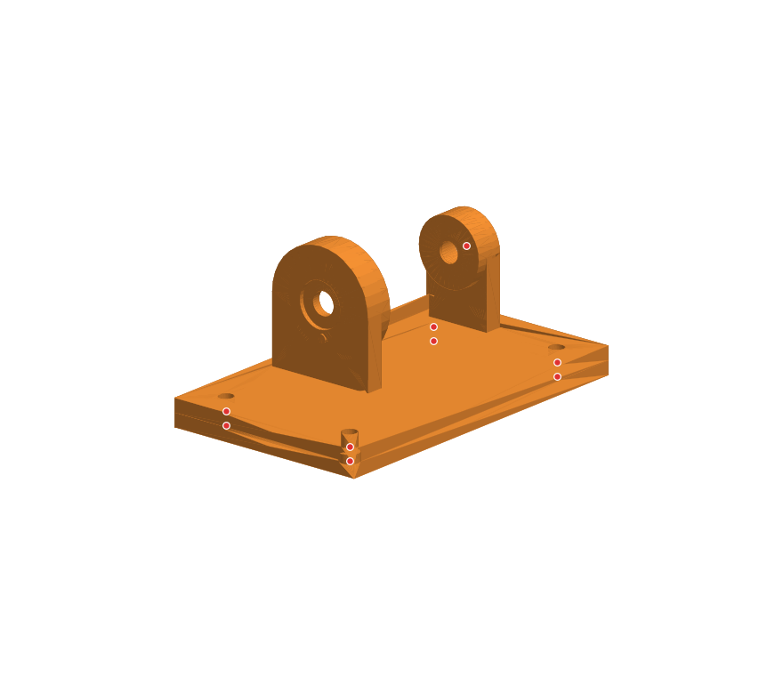

Bắt đế TPU (L2) dưới bàn chân (L1): 4 × M2×6 từ dưới lên, đầu ốc chìm 2 mm trong đế, vặn vào 4 tán M2 đã cấy ở 4 góc bàn chân.

### Step 2. Leg 2: Ankle Block

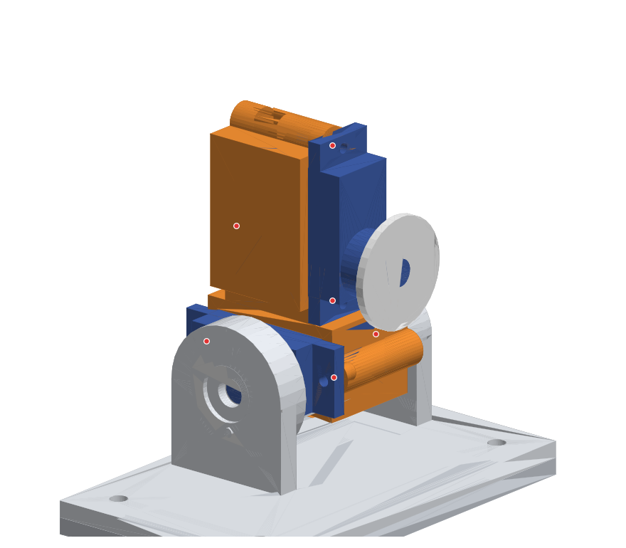

Khối cổ chân (L3) mang 2 servo MG92B: ankle roll (trục x) và ankle pitch (trục y). Mỗi servo: luồn dây qua rãnh cuối ổ, đẩy servo vào từ phía trục, 2 × M2×6 qua tai servo vào tán M2. Lắp bàn chân vào ankle roll: đĩa horn ép vào trục khi servo ở 1500 µs, bàn chân song song mặt khối; vít giữa horn qua lỗ Ø5.2; phía đối diện: long đền W3 lên bạc đạn rồi ốc đầu dù M3×6 vào tán M3 — vặn vừa khít, bạc đạn phải còn quay.

### Step 3. Leg 3: Shin

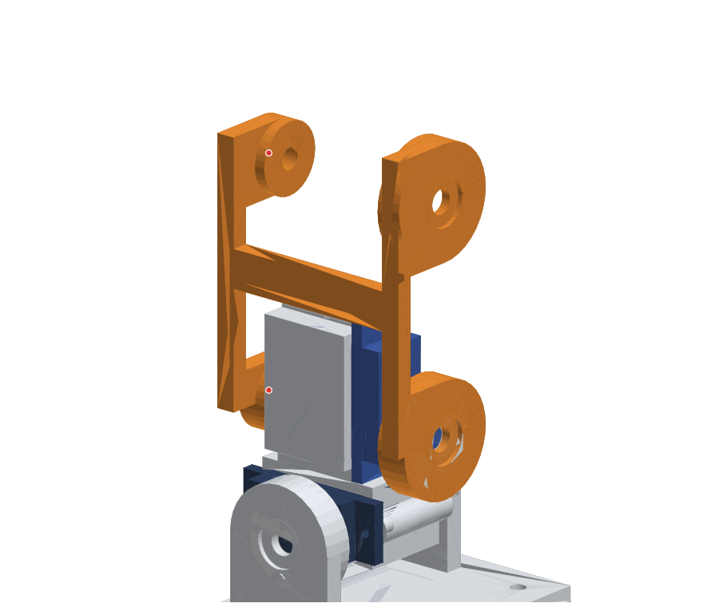

Ống chân (L4) lên trục ankle pitch (ống chân thẳng đứng): horn + vít giữa, idler M3×6 + W3.

### Step 4. Leg 4: Thigh

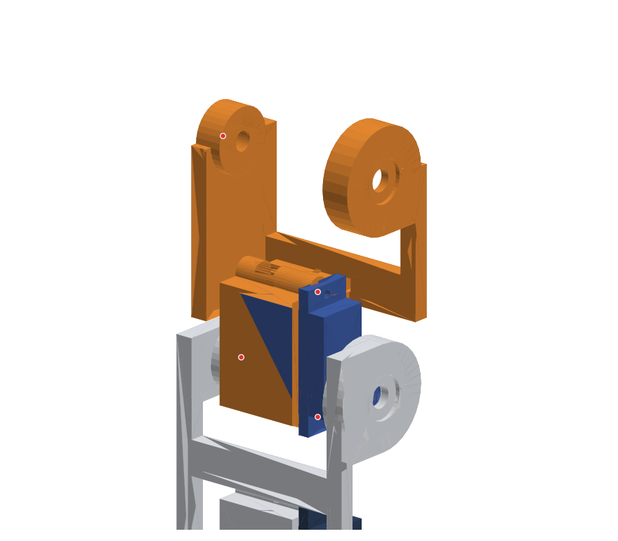

Servo knee vào ổ trong đùi (L5); lắp đầu trên ống chân vào trục knee (gối thẳng): horn + vít giữa, idler M3×6 + W3.

### Step 5. Leg 5: Hip Block

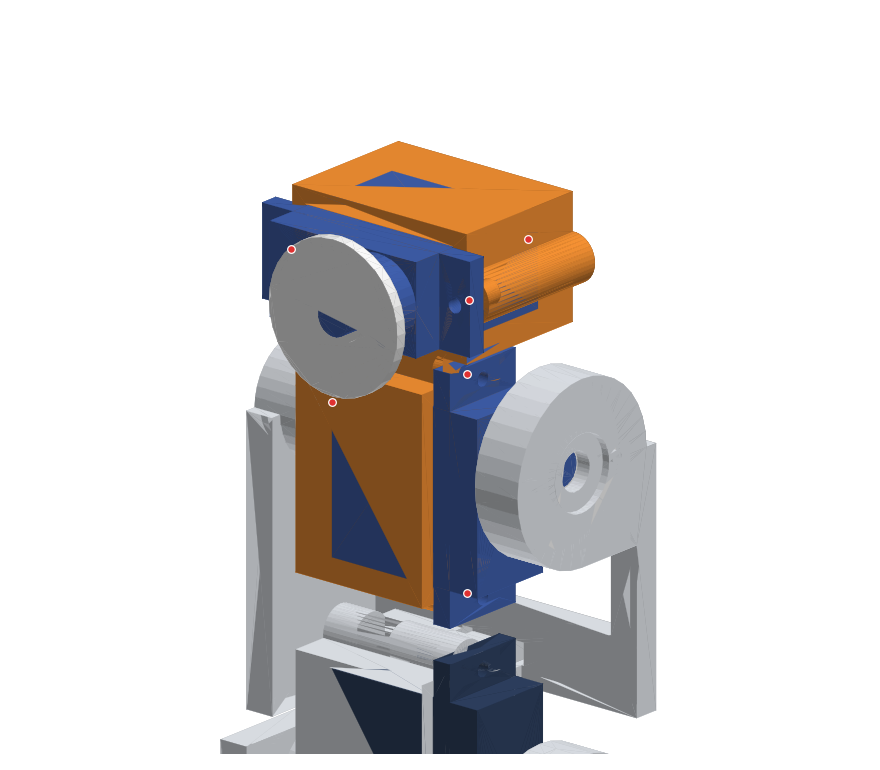

Khối hông (L6) mang hip roll và hip pitch. Đùi lên trục hip pitch (chân thẳng).

### Step 6. Leg 6: Yaw Bracket

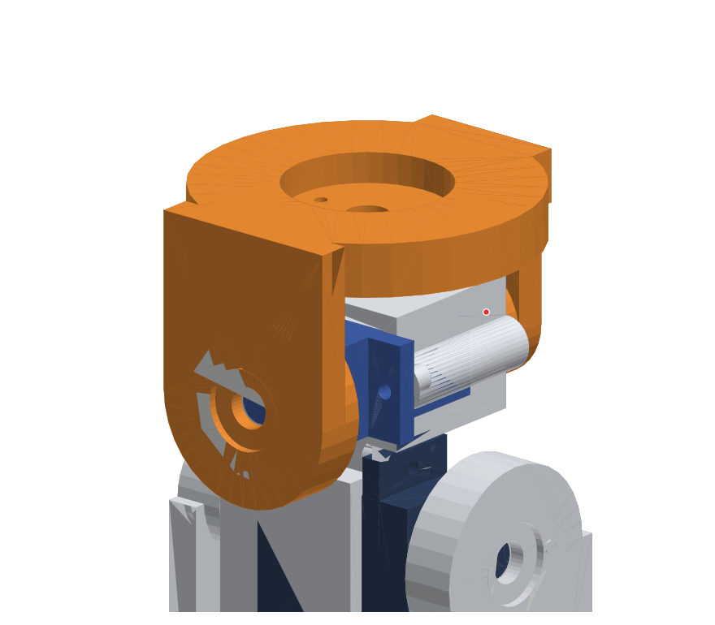

Giá yaw (L7) lên trục hip roll (khối hông nằm ngang): horn + vít giữa, idler M3×6 + W3.

### Step 7. Leg 7: Thrust Ring + Hip Mount

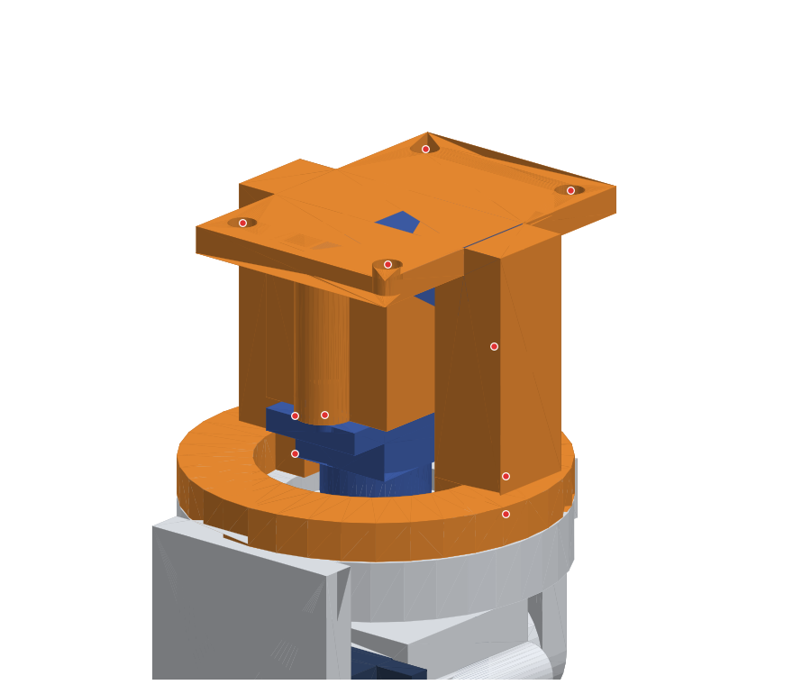

Servo hip yaw MG90S vào đế gắn chân (L9) từ dưới, 2 × M2×6 qua tai. Ép mặt trên giá yaw vào trục (chân hướng thẳng ra trước), vít giữa horn từ dưới. Lắp vòng chặn tải (L8) từ dưới: 2 × M2×6 vào đế gắn chân. Giá yaw phải xoay nhẹ, khe 0.2 mm với vòng; 1 giọt mỡ lithium.

### Step 8. Torso 1: Heat-Set Inserts in Pelvis Plate P0

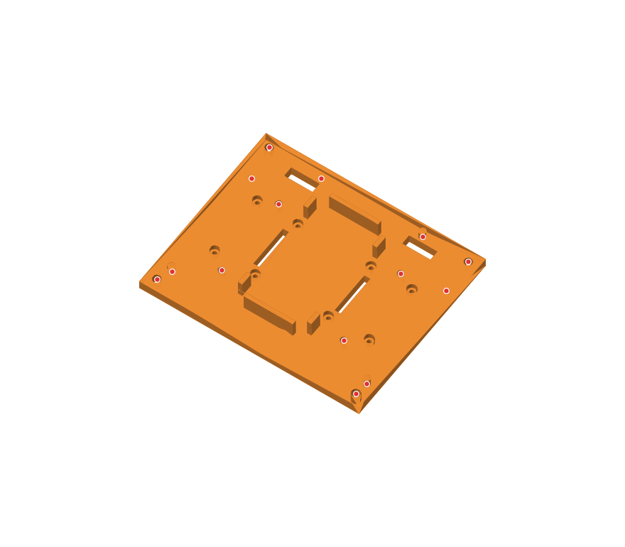

4 tán M3 vào 4 lỗ góc Ø4.0 (ép từ mặt TRÊN, bằng mặt); 4 tán M2 vào 2 bay PCA (lỗ xuyên, ép từ mặt trên, bằng mặt); 6 tán M2 cho vành dưới vỏ thân (ép từ mặt DƯỚI, lỗ sâu 4). Mỏ hàn 220 °C, ấn thẳng, để nguội 1 phút.

### Step 9. Torso 2: Mount Both Leg Modules to P0

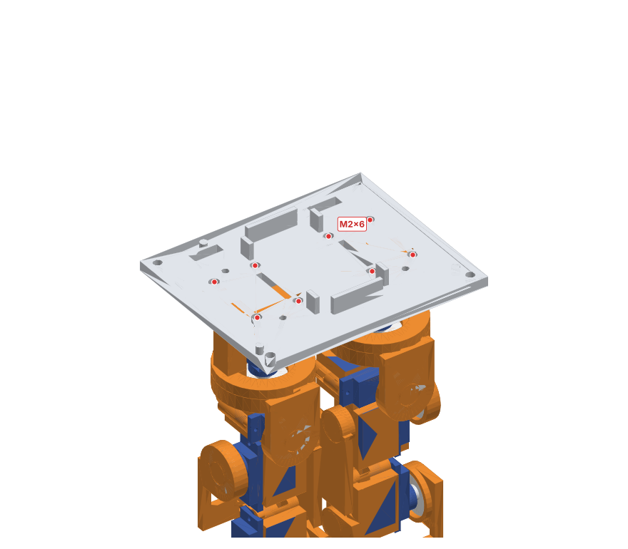

Đặt module chân trái dưới P0 (dây 5 servo luồn lên qua khe trái phía sau, khe 5 × 14 mm), 4 lỗ trên P0 trùng 4 tán của đế gắn chân. 4 × M2×6 từ mặt trên (đầu ốc chìm trong lỗ khoét Ø4.4 sâu 2.2). Lặp lại bên phải. Chú ý: dùng M2×6, không dùng M2×8 như leg_v3 cũ — ốc dài hơn sẽ chạm đáy lỗ tán.

### Step 10. Torso 3: Four SO40 Standoffs

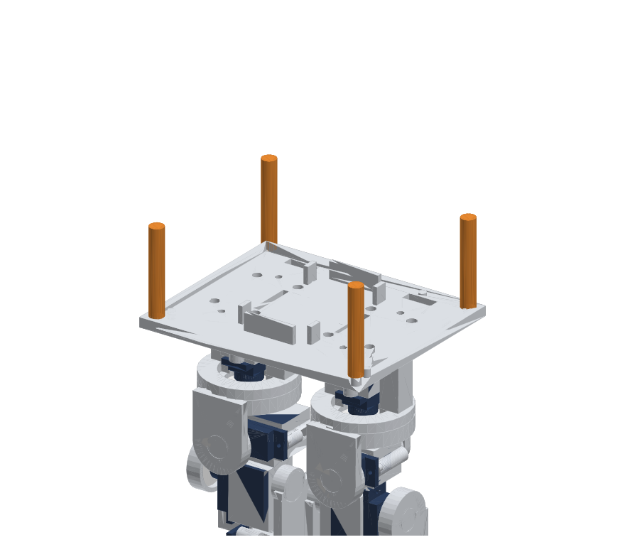

Vặn 4 trụ nhựa M3 40 mm (đầu đực xuống) vào 4 tán M3 góc P0, tay vặn vừa chặt. Ren đực dài 6 nên lòi 1.5 mm dưới P0 — bình thường.

### Step 11. Torso 4: Two PCA9685 Boards on Sleds S1

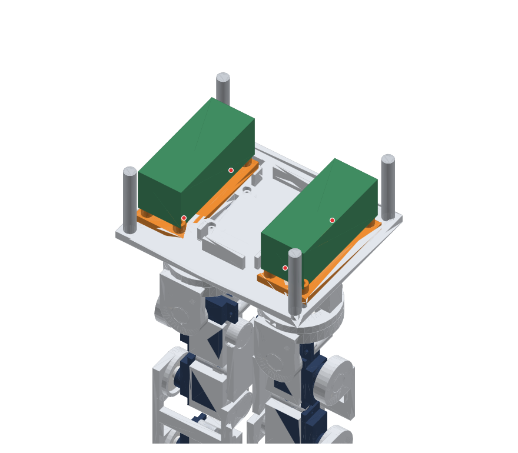

Cấy 4 tán M2 vào 4 trụ của mỗi đế S1 (bằng mặt đỉnh trụ). Bắt 2 ốc M2×6 giữ đế vào bay (lỗ khoét, đầu ốc chìm) TRƯỚC, sau đó đặt PCA9685 lên 4 trụ, 4 × M2×6. Hàng header servo quay ra mép ngoài (|y| lớn). PCA trái = #1, PCA phải = #2 (địa chỉ I²C 0x40 / 0x41 — hàn jumper A0 trên tấm phải).

### Step 12. Torso 5: 2S Battery

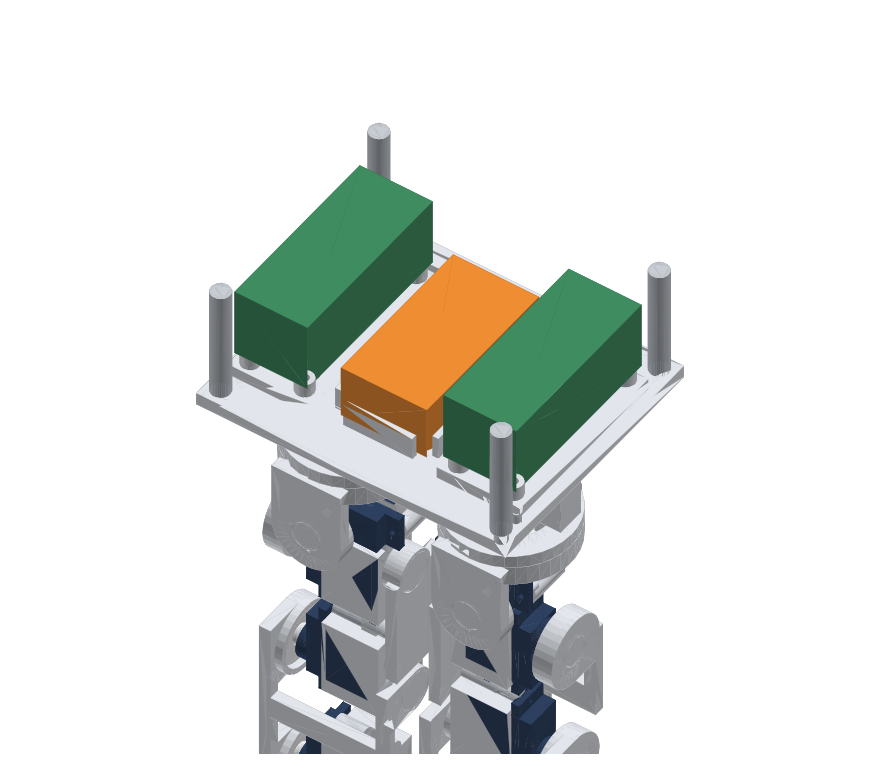

Luồn dây velcro 20 mm qua 2 khe 21 × 3 mm hai bên hốc pin. Đặt pin (dây ra phía sau), kéo velcro chặt. Pin nằm giữa 2 tường đầu (khe 1 mm mỗi đầu) và 4 cột bên.

### Step 13. Torso 6: Deck 1 on the Bench

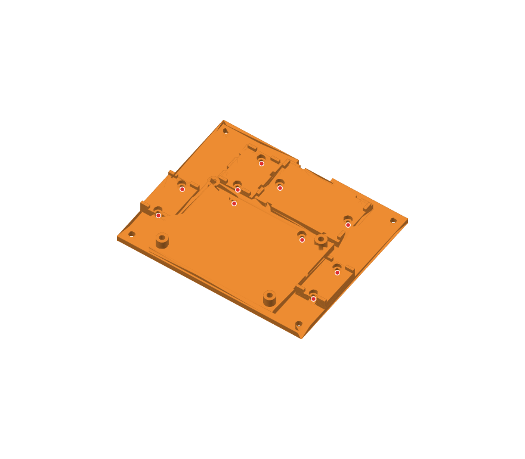

Cấy 10 tán M2 xuyên tầng 1 (ép từ mặt trên, bằng mặt). Bắt các đế: S2 (mạch A+), S4 (UBEC), S5 (hạ áp), S6 ×2 (INA226) — mỗi đế 2 × M2×6. UBEC, mạch hạ áp, INA226: dán băng keo xốp 1 mm rồi siết 2 dây rút qua 4 khe. Mạch A+: 4 × M2×6 vào 4 trụ (khoan 4 lỗ Ø2.2 trên phíp 7×5 cách mép 3.5 mm; mặt dưới phíp để trống 2 vòng Ø6 tại 2 ốc giữ đế).

### Step 14. Torso 7: Deck 1 onto Standoffs, Four SO35

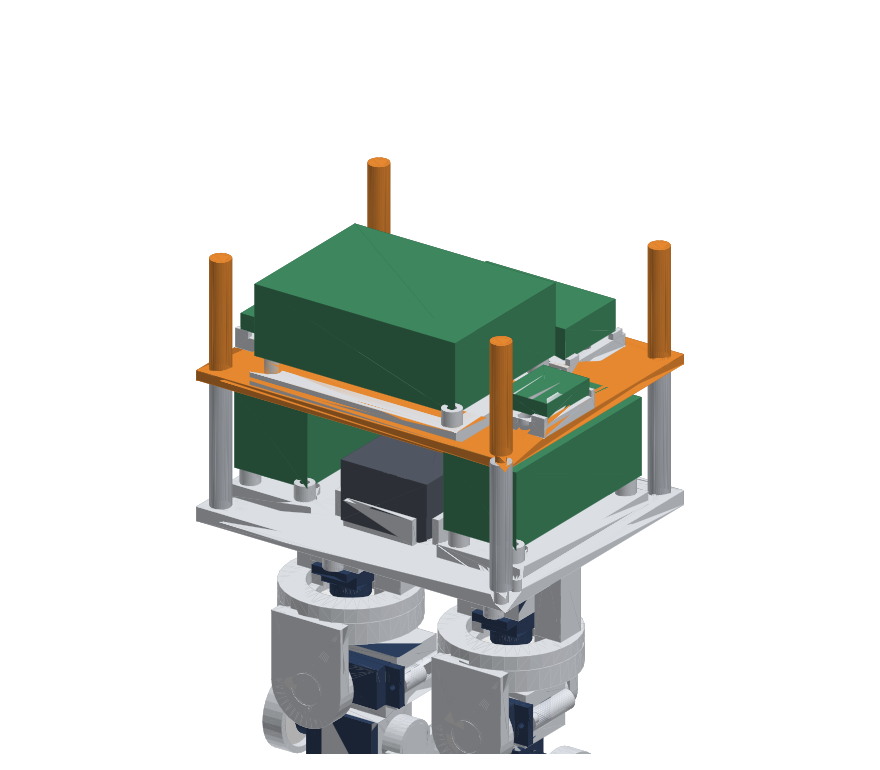

Nối dây nguồn pin → cầu chì → công tắc → UBEC trước khi đặt tầng. Đặt tầng 1 lên 4 trụ SO40 (lỗ Ø3.3). Vặn 4 trụ SO35: ren đực xuyên qua tầng, vặn vào đầu cái SO40 — tầng bị kẹp giữa 2 trụ.

### Step 15. Torso 8: Deck 2 and Radxa

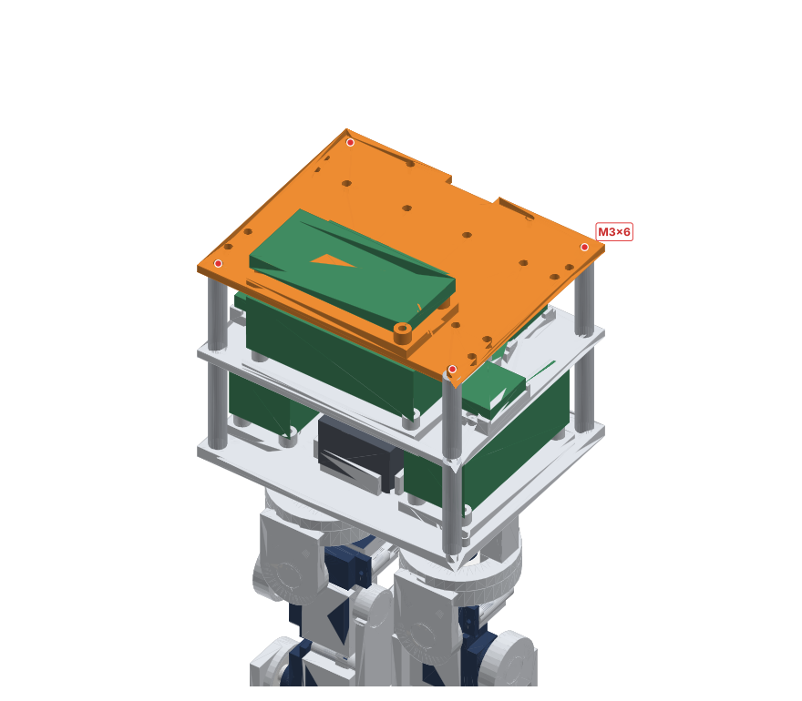

Cấy 20 tán M2 xuyên tầng 2 (2 bay Radxa, 8 giá vai, 4 giá cổ, 6 vành vỏ trên). Đế S3 vào bay (2 × M2×6), Radxa lên 4 trụ (4 × M2×6), cổng camera hướng ra sau-giữa. Đặt tầng 2 lên SO35, 4 × M3×6 từ trên.

### Step 16. Head 1: Neck Mount N1 and Neck Yaw Servo

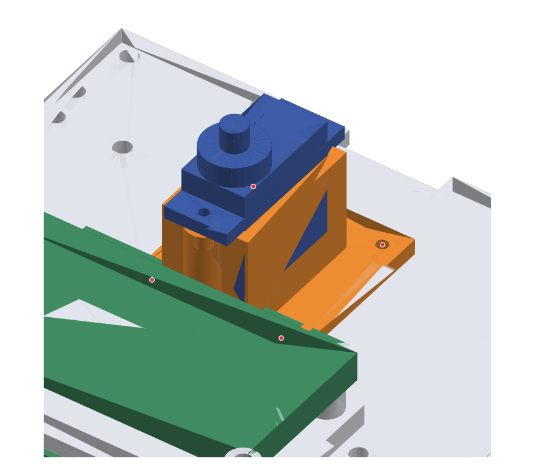

Servo cắm từ trên xuống (trục hướng lên), dây ra phía sau qua rãnh, 2 × M2×6 qua tai. Đặt N1 lên tầng 2, 4 × M2×6 qua mặt bích vào 4 tán.

### Step 17. Head 2: Neck Link N2 and Head Pitch Servo

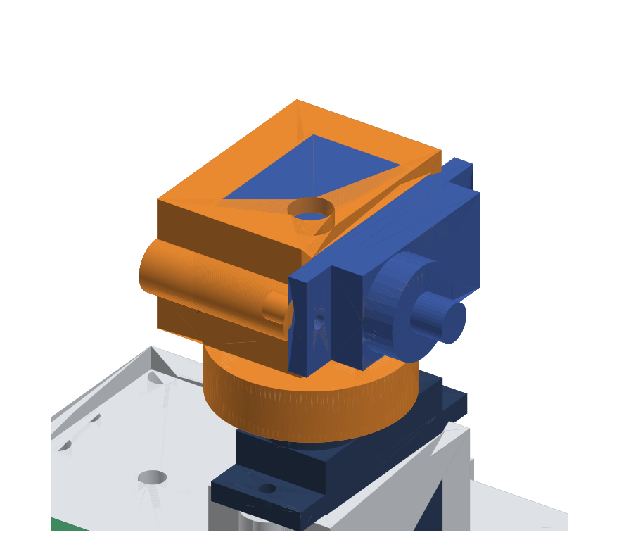

Bắt horn tròn vào đĩa dưới của N2 bằng 2 vít ST2×4 (từ phía servo). Cắm servo head pitch vào ổ của N2 (trục hướng +y, sang trái robot), 2 × M2×6. Servo cổ ở 1500 µs, đầu nhìn thẳng: ép N2 xuống trục; vít giữa horn cổ đi qua lỗ Ø5.2 xuyên 2 vách ổ — vì vậy lắp vít này TRƯỚC khi cắm servo head pitch, hoặc tháo servo head pitch ra khi cần vặn lại.

### Step 18. Head 3: Head Frame N3, Camera Mount N4, Display

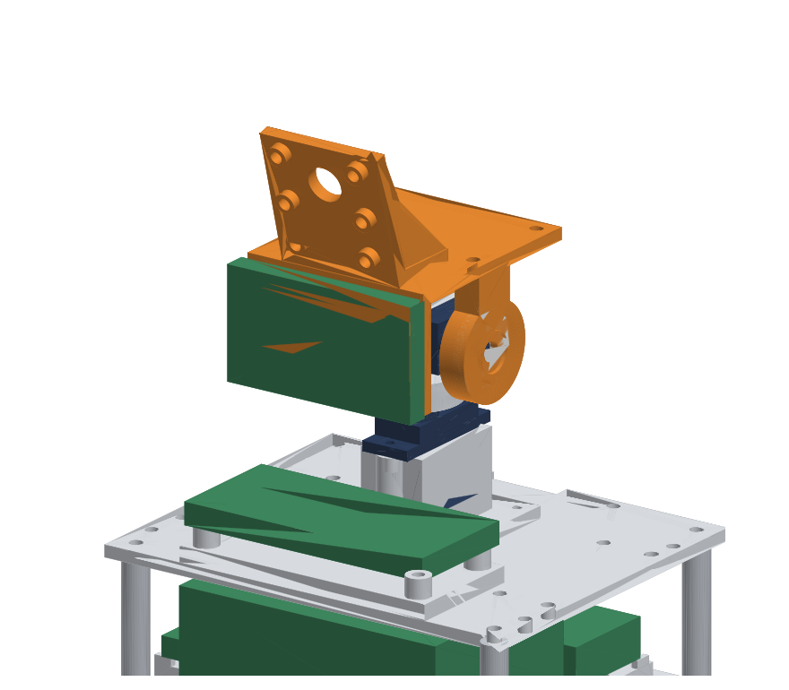

Bạc đạn MR63ZZ ép vào đĩa idler (phía −y) của N3. Horn vào đĩa phía +y (2 × ST2×4). Ép N3 lên trục head pitch (sàn đầu nằm ngang), vít giữa horn; idler: W3 + M3×6 đầu dù vào tán M3 của N2. N4 lên sàn đầu, 2 × M2×6. Camera Pi V2: 4 × M2×6 vào 4 trụ (cấy tán từ phía trước). ToF: 2 × M2×6. Màn 1.9″: băng keo xốp lên mặt trước khung + 2 dây rút qua 4 khe.

### Step 19. Arm 1: Shoulder Mount A1 and Shoulder Pitch Servo

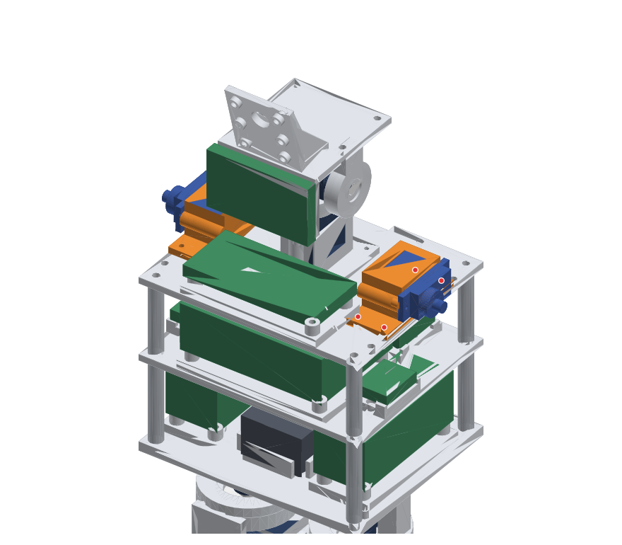

Servo nằm ngang, trục hướng ra ngoài (+y bên trái, −y bên phải), dây ra phía sau. 2 × M2×6 qua tai. A1 lên tầng 2, 4 × M2×6 qua mặt bích.

### Step 20. Arm 2: Arm Sub-Assembly on the Bench

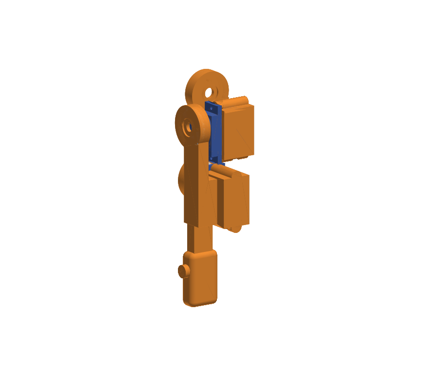

Trên bàn, với cả 3 servo ở 1500 µs: (1) servo roll SG90 vào ổ của khâu vai A2 (trục hướng ra trước), 2 × M2×6; (2) servo khuỷu SG90 vào ổ của cánh tay trên A3 (trục hướng vào trong thân), 2 × M2×6; (3) mỗi đĩa horn: horn bắt 2 × ST2×4; (4) cẳng tay A4 lên trục khuỷu (tay thẳng xuống), vít giữa; (5) A3 lên trục roll (tay thẳng xuống), vít giữa từ phía trước.

### Step 21. Arm 3: Arm onto the Shoulder

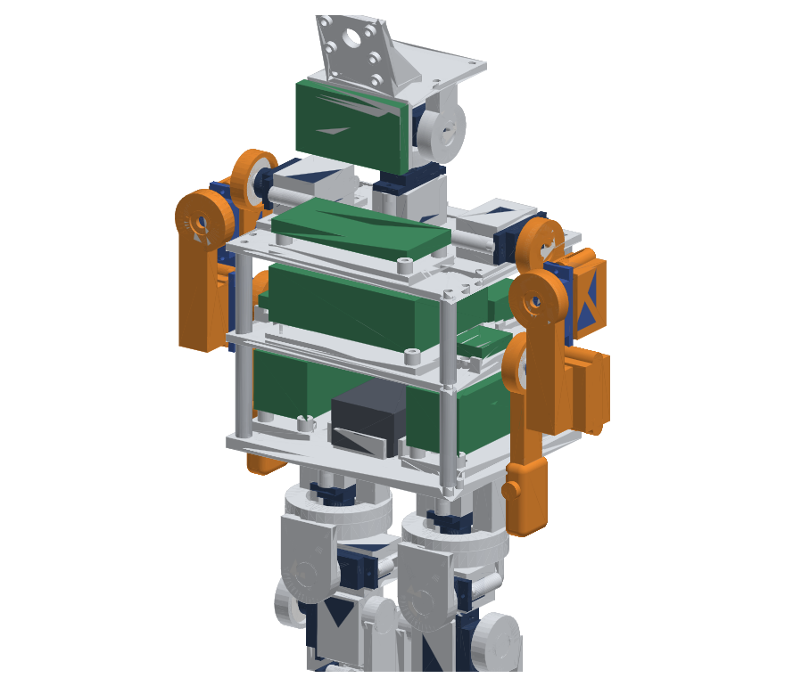

Bắt horn shoulder pitch vào đĩa trong của A2 (2 × ST2×4). Shoulder pitch ở 1500 µs, tay thẳng xuống: ép cụm tay vào trục. Vít giữa horn đi qua lỗ Ø6 xuyên khâu vai (tua vít PH0 dài ≥ 40 mm). Lặp lại bên phải.

## 7. Hole Tables: Torso, Arms, Head

Toạ độ = điểm vào của lỗ, so với điểm tham chiếu của chi tiết (dấu + đỏ trên bản vẽ), trục như hệ robot. Hướng = hướng khoan / hướng ốc đi vào. Sâu 0 = xuyên. Chi tiết chân: bảng lỗ trong `leg_v3.md`.

#### N4 · `cam_mount` — Camera + ToF Mount (15° Tilt)

Điểm tham chiếu: mặt sàn đầu, tâm bay camera = robot (+12.0, +0.0, +230.5).

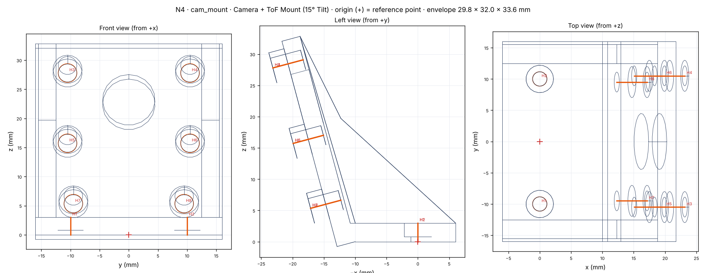

| # | Lỗ | Loại | Ø | Sâu | Vị trí (x, y, z) | Hướng | Dùng cho |
| --- | --- | --- | ---: | --- | --- | --- | --- |
| H1 | `attach1` | cb_m2 | 2.30 | xuyên | (+0.0, -10.0, +3.0) | −z | M2x6 into the head deck |
| H2 | `attach2` | cb_m2 | 2.30 | xuyên | (+0.0, +10.0, +3.0) | −z | M2x6 into the head deck |
| H3 | `cam1` | boss_m2 | 3.20 | 5.0 | (+23.1, -10.5, +27.8) | (-1.0, -0.0, +0.3) | INS-M2 (pressed from the front), M2x6 through the camera |
| H4 | `cam2` | boss_m2 | 3.20 | 5.0 | (+23.1, +10.5, +27.8) | (-1.0, -0.0, +0.3) | INS-M2 (pressed from the front), M2x6 through the camera |
| H5 | `cam3` | boss_m2 | 3.20 | 5.0 | (+19.9, -10.5, +15.7) | (-1.0, -0.0, +0.3) | INS-M2 (pressed from the front), M2x6 through the camera |
| H6 | `cam4` | boss_m2 | 3.20 | 5.0 | (+19.9, +10.5, +15.7) | (-1.0, -0.0, +0.3) | INS-M2 (pressed from the front), M2x6 through the camera |
| H7 | `tof1` | boss_m2 | 3.20 | 5.0 | (+17.1, -9.5, +5.3) | (-1.0, -0.0, +0.3) | INS-M2 (pressed from the front), M2x6 through the ToF board |
| H8 | `tof2` | boss_m2 | 3.20 | 5.0 | (+17.1, +9.5, +5.3) | (-1.0, -0.0, +0.3) | INS-M2 (pressed from the front), M2x6 through the ToF board |

#### P1 · `deck_1` — Deck 1

Điểm tham chiếu: tâm robot trên mặt trên tầng = robot (+0.0, +0.0, +120.5).

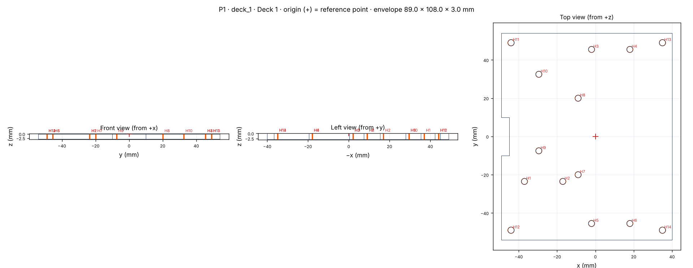

| # | Lỗ | Loại | Ø | Sâu | Vị trí (x, y, z) | Hướng | Dùng cho |
| --- | --- | --- | ---: | --- | --- | --- | --- |
| H1 | `bay_buck1` | ins_m2_thru | 3.20 | xuyên | (-37.0, -23.5, +0.0) | −z | INS-M2 for sled_buck (M2x6) |
| H2 | `bay_buck2` | ins_m2_thru | 3.20 | xuyên | (-17.0, -23.5, +0.0) | −z | INS-M2 for sled_buck (M2x6) |
| H3 | `bay_ina_l1` | ins_m2_thru | 3.20 | xuyên | (-2.0, +45.5, +0.0) | −z | INS-M2 for sled_ina (M2x6) |
| H4 | `bay_ina_l2` | ins_m2_thru | 3.20 | xuyên | (+18.0, +45.5, +0.0) | −z | INS-M2 for sled_ina (M2x6) |
| H5 | `bay_ina_r1` | ins_m2_thru | 3.20 | xuyên | (-2.0, -45.5, +0.0) | −z | INS-M2 for sled_ina (M2x6) |
| H6 | `bay_ina_r2` | ins_m2_thru | 3.20 | xuyên | (+18.0, -45.5, +0.0) | −z | INS-M2 for sled_ina (M2x6) |
| H7 | `bay_perf1` | ins_m2_thru | 3.20 | xuyên | (-9.0, -20.0, +0.0) | −z | INS-M2 for sled_perf (M2x6) |
| H8 | `bay_perf2` | ins_m2_thru | 3.20 | xuyên | (-9.0, +20.0, +0.0) | −z | INS-M2 for sled_perf (M2x6) |
| H9 | `bay_ubec1` | ins_m2_thru | 3.20 | xuyên | (-29.5, -7.5, +0.0) | −z | INS-M2 for sled_ubec (M2x6) |
| H10 | `bay_ubec2` | ins_m2_thru | 3.20 | xuyên | (-29.5, +32.5, +0.0) | −z | INS-M2 for sled_ubec (M2x6) |
| H11 | `so1` | clr_so | 3.30 | xuyên | (-44.0, +49.0, +0.0) | −z | SO35 male thread down into SO40 |
| H12 | `so2` | clr_so | 3.30 | xuyên | (-44.0, -49.0, +0.0) | −z | SO35 male thread down into SO40 |
| H13 | `so3` | clr_so | 3.30 | xuyên | (+35.0, +49.0, +0.0) | −z | SO35 male thread down into SO40 |
| H14 | `so4` | clr_so | 3.30 | xuyên | (+35.0, -49.0, +0.0) | −z | SO35 male thread down into SO40 |

#### P2 · `deck_2` — Deck 2

Điểm tham chiếu: tâm robot trên mặt trên tầng = robot (+0.0, +0.0, +158.5).

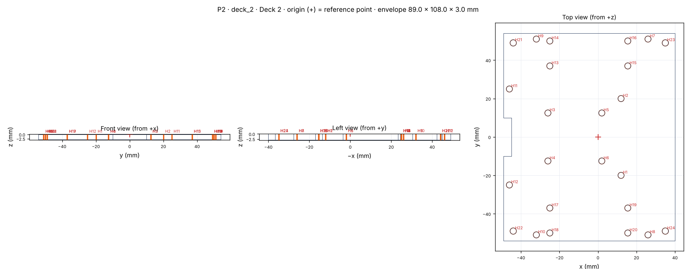

| # | Lỗ | Loại | Ø | Sâu | Vị trí (x, y, z) | Hướng | Dùng cho |
| --- | --- | --- | ---: | --- | --- | --- | --- |
| H1 | `bay_radxa1` | ins_m2_thru | 3.20 | xuyên | (+12.0, -20.0, +0.0) | −z | INS-M2 for sled_radxa (M2x6) |
| H2 | `bay_radxa2` | ins_m2_thru | 3.20 | xuyên | (+12.0, +20.0, +0.0) | −z | INS-M2 for sled_radxa (M2x6) |
| H3 | `neck1` | ins_m2_thru | 3.20 | xuyên | (-26.0, +12.5, +0.0) | −z | INS-M2 for neck_mount (M2x6) |
| H4 | `neck2` | ins_m2_thru | 3.20 | xuyên | (-26.0, -12.5, +0.0) | −z | INS-M2 for neck_mount (M2x6) |
| H5 | `neck3` | ins_m2_thru | 3.20 | xuyên | (+2.0, +12.5, +0.0) | −z | INS-M2 for neck_mount (M2x6) |
| H6 | `neck4` | ins_m2_thru | 3.20 | xuyên | (+2.0, -12.5, +0.0) | −z | INS-M2 for neck_mount (M2x6) |
| H7 | `shell1` | ins_m2_thru | 3.20 | xuyên | (+26.0, +51.0, +0.0) | −z | INS-M2, shell top ring (M2x6) |
| H8 | `shell2` | ins_m2_thru | 3.20 | xuyên | (+26.0, -51.0, +0.0) | −z | INS-M2, shell top ring (M2x6) |
| H9 | `shell3` | ins_m2_thru | 3.20 | xuyên | (-32.0, +51.0, +0.0) | −z | INS-M2, shell top ring (M2x6) |
| H10 | `shell4` | ins_m2_thru | 3.20 | xuyên | (-32.0, -51.0, +0.0) | −z | INS-M2, shell top ring (M2x6) |
| H11 | `shell5` | ins_m2_thru | 3.20 | xuyên | (-46.0, +25.0, +0.0) | −z | INS-M2, shell top ring (M2x6) |
| H12 | `shell6` | ins_m2_thru | 3.20 | xuyên | (-46.0, -25.0, +0.0) | −z | INS-M2, shell top ring (M2x6) |
| H13 | `shoulderL1` | ins_m2_thru | 3.20 | xuyên | (-25.0, +37.0, +0.0) | −z | INS-M2 for shoulder_mount L (M2x6) |
| H14 | `shoulderL2` | ins_m2_thru | 3.20 | xuyên | (-25.0, +50.0, +0.0) | −z | INS-M2 for shoulder_mount L (M2x6) |
| H15 | `shoulderL3` | ins_m2_thru | 3.20 | xuyên | (+15.5, +37.0, +0.0) | −z | INS-M2 for shoulder_mount L (M2x6) |
| H16 | `shoulderL4` | ins_m2_thru | 3.20 | xuyên | (+15.5, +50.0, +0.0) | −z | INS-M2 for shoulder_mount L (M2x6) |
| H17 | `shoulderR1` | ins_m2_thru | 3.20 | xuyên | (-25.0, -37.0, +0.0) | −z | INS-M2 for shoulder_mount R (M2x6) |
| H18 | `shoulderR2` | ins_m2_thru | 3.20 | xuyên | (-25.0, -50.0, +0.0) | −z | INS-M2 for shoulder_mount R (M2x6) |
| H19 | `shoulderR3` | ins_m2_thru | 3.20 | xuyên | (+15.5, -37.0, +0.0) | −z | INS-M2 for shoulder_mount R (M2x6) |
| H20 | `shoulderR4` | ins_m2_thru | 3.20 | xuyên | (+15.5, -50.0, +0.0) | −z | INS-M2 for shoulder_mount R (M2x6) |
| H21 | `so1` | clr_so | 3.30 | xuyên | (-44.0, +49.0, +0.0) | −z | M3x6 from the top into SO35 |
| H22 | `so2` | clr_so | 3.30 | xuyên | (-44.0, -49.0, +0.0) | −z | M3x6 from the top into SO35 |
| H23 | `so3` | clr_so | 3.30 | xuyên | (+35.0, +49.0, +0.0) | −z | M3x6 from the top into SO35 |
| H24 | `so4` | clr_so | 3.30 | xuyên | (+35.0, -49.0, +0.0) | −z | M3x6 from the top into SO35 |

#### A4 · `forearm` — Forearm and Mitten (L/R)

Điểm tham chiếu: điểm trục khuỷu trên mặt đầu servo = robot (+0.0, +69.7, +120.3).

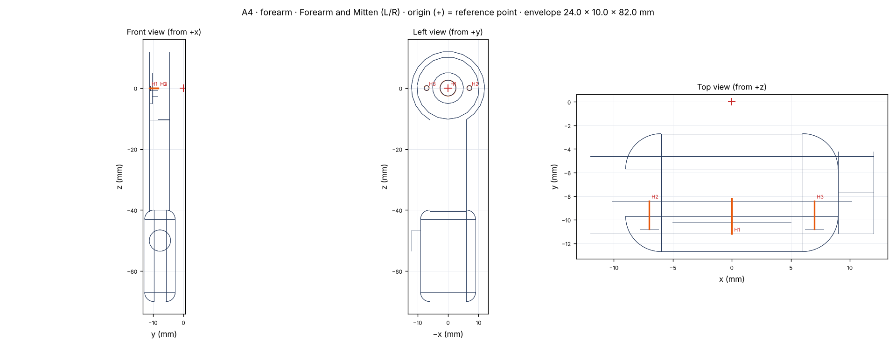

| # | Lỗ | Loại | Ø | Sâu | Vị trí (x, y, z) | Hướng | Dùng cho |
| --- | --- | --- | ---: | --- | --- | --- | --- |
| H1 | `elbow.access` | access | 5.20 | xuyên | (+0.0, -11.2, +0.0) | +y | horn centre screw (comes with the servo) |
| H2 | `elbow.horn1` | pilot_st2 | 1.60 | 2.4 | (-7.0, -8.4, +0.0) | −y | ST2x4 through the horn (plate to horn) |
| H3 | `elbow.horn2` | pilot_st2 | 1.60 | 2.4 | (+7.0, -8.4, +0.0) | −y | ST2x4 through the horn (plate to horn) |

#### N3 · `head_frame` — Head Frame

Điểm tham chiếu: tâm trục gật đầu (giữa ổ) = robot (-3.0, +0.0, +207.5).

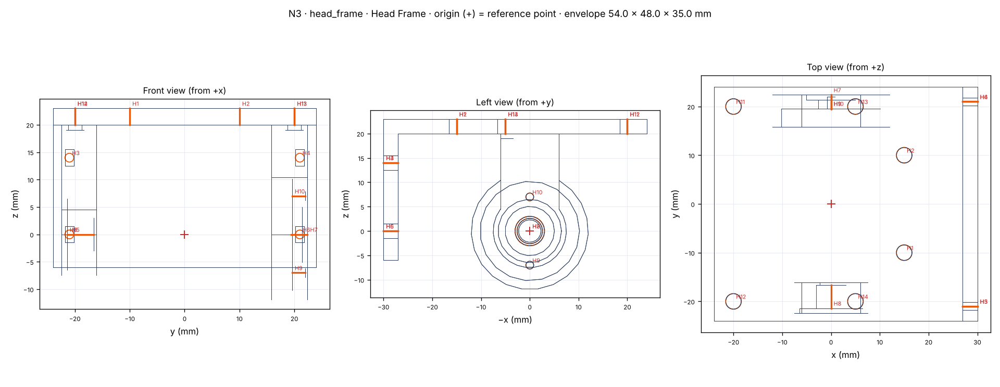

| # | Lỗ | Loại | Ø | Sâu | Vị trí (x, y, z) | Hướng | Dùng cho |
| --- | --- | --- | ---: | --- | --- | --- | --- |
| H1 | `bay_cam1` | ins_m2_thru | 3.20 | xuyên | (+15.0, -10.0, +23.0) | −z | INS-M2 for cam_mount (M2x6) |
| H2 | `bay_cam2` | ins_m2_thru | 3.20 | xuyên | (+15.0, +10.0, +23.0) | −z | INS-M2 for cam_mount (M2x6) |
| H3 | `disp_tie1` | tie | 1.60 | xuyên | (+30.0, -21.0, +14.0) | −x | cable tie over the display module |
| H4 | `disp_tie2` | tie | 1.60 | xuyên | (+30.0, +21.0, +14.0) | −x | cable tie over the display module |
| H5 | `disp_tie3` | tie | 1.60 | xuyên | (+30.0, -21.0, +0.0) | −x | cable tie over the display module |
| H6 | `disp_tie4` | tie | 1.60 | xuyên | (+30.0, +21.0, +0.0) | −x | cable tie over the display module |
| H7 | `head_pitch.access` | access | 5.20 | xuyên | (+0.0, +22.4, +0.0) | −y | horn centre screw (comes with the servo) |
| H8 | `head_pitch.bearing` | bearing | 6.05 | 4.8 | (+0.0, -21.4, +0.0) | +y | MR63ZZ + W3 + M3x6 button head (idler) |
| H9 | `head_pitch.horn1` | pilot_st2 | 1.60 | 2.4 | (+0.0, +19.6, -7.0) | +y | ST2x4 through the horn (plate to horn) |
| H10 | `head_pitch.horn2` | pilot_st2 | 1.60 | 2.4 | (+0.0, +19.6, +7.0) | +y | ST2x4 through the horn (plate to horn) |
| H11 | `shell1` | ins_m2_thru | 3.20 | xuyên | (-20.0, +20.0, +23.0) | −z | INS-M2, head shell (M2x6) |
| H12 | `shell2` | ins_m2_thru | 3.20 | xuyên | (-20.0, -20.0, +23.0) | −z | INS-M2, head shell (M2x6) |
| H13 | `shell3` | ins_m2_thru | 3.20 | xuyên | (+5.0, +20.0, +23.0) | −z | INS-M2, head shell (M2x6) |
| H14 | `shell4` | ins_m2_thru | 3.20 | xuyên | (+5.0, -20.0, +23.0) | −z | INS-M2, head shell (M2x6) |

#### N2 · `neck_link` — Neck Link

Điểm tham chiếu: tâm trục gật đầu (giữa ổ) = robot (-3.0, +0.0, +207.5).

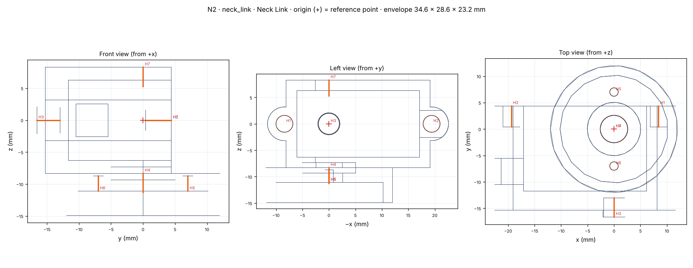

| # | Lỗ | Loại | Ø | Sâu | Vị trí (x, y, z) | Hướng | Dùng cho |
| --- | --- | --- | ---: | --- | --- | --- | --- |
| H1 | `head_pitch.ear1` | ins_m2 | 3.20 | 4.0 | (+8.4, +4.4, +0.0) | −y | INS-M2 + M2x6 (servo ear) |
| H2 | `head_pitch.ear2` | ins_m2 | 3.20 | 4.0 | (-19.4, +4.4, +0.0) | −y | INS-M2 + M2x6 (servo ear) |
| H3 | `head_pitch.idler_insert` | ins_m3 | 4.00 | 3.6 | (+0.0, -16.6, +0.0) | +y | INS-M3 (idler pivot) |
| H4 | `neck_yaw.access` | access | 5.20 | xuyên | (+0.0, +0.0, -8.3) | −z | horn centre screw (comes with the servo) |
| H5 | `neck_yaw.horn1` | pilot_st2 | 1.60 | 2.4 | (+0.0, +7.0, -11.1) | +z | ST2x4 through the horn (plate to horn) |
| H6 | `neck_yaw.horn2` | pilot_st2 | 1.60 | 2.4 | (+0.0, -7.0, -11.1) | +z | ST2x4 through the horn (plate to horn) |
| H7 | `neck_yaw.service` | access | 5.20 | xuyên | (+0.0, +0.0, +8.3) | −z | horn screw of neck yaw: straight down through both walls of the empty head-pitch pocket |

#### N1 · `neck_mount` — Neck Mount

Điểm tham chiếu: điểm trục cổ trên mặt đầu servo = robot (-3.0, +0.0, +188.0).

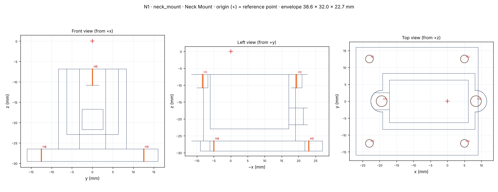

| # | Lỗ | Loại | Ø | Sâu | Vị trí (x, y, z) | Hướng | Dùng cho |
| --- | --- | --- | ---: | --- | --- | --- | --- |
| H1 | `flange1` | clr_m2 | 2.30 | xuyên | (-23.0, +12.5, -26.5) | −z | M2x6 into deck_2 (head on the flange) |
| H2 | `flange2` | clr_m2 | 2.30 | xuyên | (-23.0, -12.5, -26.5) | −z | M2x6 into deck_2 (head on the flange) |
| H3 | `flange3` | clr_m2 | 2.30 | xuyên | (+5.0, +12.5, -26.5) | −z | M2x6 into deck_2 (head on the flange) |
| H4 | `flange4` | clr_m2 | 2.30 | xuyên | (+5.0, -12.5, -26.5) | −z | M2x6 into deck_2 (head on the flange) |
| H5 | `neck_yaw.ear1` | ins_m2 | 3.20 | 4.0 | (+8.4, +0.0, -6.8) | −z | INS-M2 + M2x6 (servo ear) |
| H6 | `neck_yaw.ear2` | ins_m2 | 3.20 | 4.0 | (-19.4, +0.0, -6.8) | −z | INS-M2 + M2x6 (servo ear) |

#### P0 · `pelvis_plate` — Pelvis Plate (Deck 0)

Điểm tham chiếu: tâm robot (x=0, y=0) trên mặt TRÊN của tấm = robot (+0.0, +0.0, +77.5).

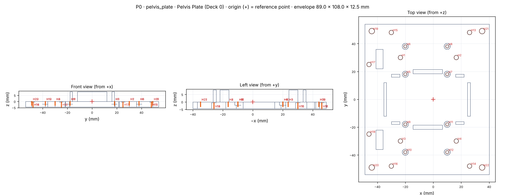

| # | Lỗ | Loại | Ø | Sâu | Vị trí (x, y, z) | Hướng | Dùng cho |
| --- | --- | --- | ---: | --- | --- | --- | --- |
| H1 | `bay_pcaL1` | ins_m2_thru | 3.20 | xuyên | (-23.5, +30.0, +0.0) | −z | INS-M2 for sled_pca_L (M2x6) |
| H2 | `bay_pcaL2` | ins_m2_thru | 3.20 | xuyên | (+16.5, +30.0, +0.0) | −z | INS-M2 for sled_pca_L (M2x6) |
| H3 | `bay_pcaR1` | ins_m2_thru | 3.20 | xuyên | (-23.5, -30.0, +0.0) | −z | INS-M2 for sled_pca_R (M2x6) |
| H4 | `bay_pcaR2` | ins_m2_thru | 3.20 | xuyên | (+16.5, -30.0, +0.0) | −z | INS-M2 for sled_pca_R (M2x6) |
| H5 | `legL1` | cb_m2 | 2.30 | xuyên | (-20.0, +18.0, +0.0) | −z | M2x6 into the L hip_mount insert (head flush) |
| H6 | `legL2` | cb_m2 | 2.30 | xuyên | (-20.0, +38.0, +0.0) | −z | M2x6 into the L hip_mount insert (head flush) |
| H7 | `legL3` | cb_m2 | 2.30 | xuyên | (+10.0, +18.0, +0.0) | −z | M2x6 into the L hip_mount insert (head flush) |
| H8 | `legL4` | cb_m2 | 2.30 | xuyên | (+10.0, +38.0, +0.0) | −z | M2x6 into the L hip_mount insert (head flush) |
| H9 | `legR1` | cb_m2 | 2.30 | xuyên | (-20.0, -18.0, +0.0) | −z | M2x6 into the R hip_mount insert (head flush) |
| H10 | `legR2` | cb_m2 | 2.30 | xuyên | (-20.0, -38.0, +0.0) | −z | M2x6 into the R hip_mount insert (head flush) |
| H11 | `legR3` | cb_m2 | 2.30 | xuyên | (+10.0, -18.0, +0.0) | −z | M2x6 into the R hip_mount insert (head flush) |
| H12 | `legR4` | cb_m2 | 2.30 | xuyên | (+10.0, -38.0, +0.0) | −z | M2x6 into the R hip_mount insert (head flush) |
| H13 | `shell1` | ins_m2 | 3.20 | 4.0 | (+26.0, +48.0, -4.5) | +z | INS-M2 from below, shell bottom ring (M2x6) |
| H14 | `shell2` | ins_m2 | 3.20 | 4.0 | (+26.0, -48.0, -4.5) | +z | INS-M2 from below, shell bottom ring (M2x6) |
| H15 | `shell3` | ins_m2 | 3.20 | 4.0 | (-30.0, +48.0, -4.5) | +z | INS-M2 from below, shell bottom ring (M2x6) |
| H16 | `shell4` | ins_m2 | 3.20 | 4.0 | (-30.0, -48.0, -4.5) | +z | INS-M2 from below, shell bottom ring (M2x6) |
| H17 | `shell5` | ins_m2 | 3.20 | 4.0 | (-46.0, +25.0, -4.5) | +z | INS-M2 from below, shell bottom ring (M2x6) |
| H18 | `shell6` | ins_m2 | 3.20 | 4.0 | (-46.0, -25.0, -4.5) | +z | INS-M2 from below, shell bottom ring (M2x6) |
| H19 | `so1` | ins_m3_thru | 4.00 | xuyên | (-44.0, +49.0, +0.0) | −z | INS-M3, then a SO40 standoff screwed in from the top |
| H20 | `so2` | ins_m3_thru | 4.00 | xuyên | (-44.0, -49.0, +0.0) | −z | INS-M3, then a SO40 standoff screwed in from the top |
| H21 | `so3` | ins_m3_thru | 4.00 | xuyên | (+35.0, +49.0, +0.0) | −z | INS-M3, then a SO40 standoff screwed in from the top |
| H22 | `so4` | ins_m3_thru | 4.00 | xuyên | (+35.0, -49.0, +0.0) | −z | INS-M3, then a SO40 standoff screwed in from the top |

#### A2 · `shoulder_link` — Shoulder Link (L/R)

Điểm tham chiếu: điểm trục roll trên mặt đầu servo = robot (+9.5, +80.0, +155.8).

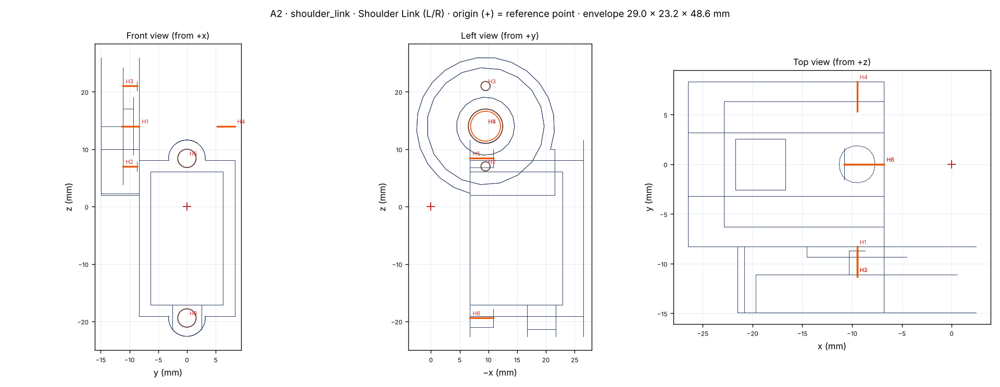

| # | Lỗ | Loại | Ø | Sâu | Vị trí (x, y, z) | Hướng | Dùng cho |
| --- | --- | --- | ---: | --- | --- | --- | --- |
| H1 | `shoulder_pitch.access` | access | 5.20 | xuyên | (-9.5, -8.3, +14.0) | −y | horn centre screw (comes with the servo) |
| H2 | `shoulder_pitch.horn1` | pilot_st2 | 1.60 | 2.4 | (-9.5, -11.1, +7.0) | +y | ST2x4 through the horn (plate to horn) |
| H3 | `shoulder_pitch.horn2` | pilot_st2 | 1.60 | 2.4 | (-9.5, -11.1, +21.0) | +y | ST2x4 through the horn (plate to horn) |
| H4 | `shoulder_pitch.service` | access | 6.00 | xuyên | (-9.5, +8.3, +14.0) | −y | horn screw of shoulder pitch, under the roll pocket |
| H5 | `shoulder_roll.ear1` | ins_m2 | 3.20 | 4.0 | (-6.8, +0.0, +8.4) | −x | INS-M2 + M2x6 (servo ear) |
| H6 | `shoulder_roll.ear2` | ins_m2 | 3.20 | 4.0 | (-6.8, +0.0, -19.4) | −x | INS-M2 + M2x6 (servo ear) |

#### A1 · `shoulder_mount` — Shoulder Mount (L/R)

Điểm tham chiếu: điểm trục vai trên mặt đầu servo = robot (+0.0, +60.5, +169.8).

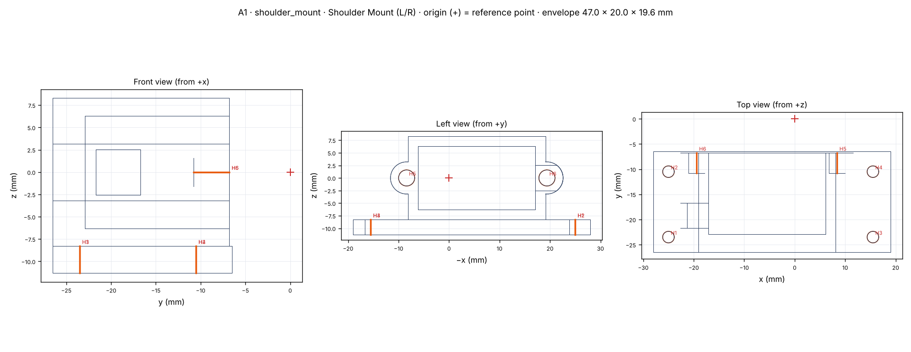

| # | Lỗ | Loại | Ø | Sâu | Vị trí (x, y, z) | Hướng | Dùng cho |
| --- | --- | --- | ---: | --- | --- | --- | --- |
| H1 | `flange1` | clr_m2 | 2.30 | xuyên | (-25.0, -23.5, -8.3) | −z | M2x6 into deck_2 (head on the flange) |
| H2 | `flange2` | clr_m2 | 2.30 | xuyên | (-25.0, -10.5, -8.3) | −z | M2x6 into deck_2 (head on the flange) |
| H3 | `flange3` | clr_m2 | 2.30 | xuyên | (+15.5, -23.5, -8.3) | −z | M2x6 into deck_2 (head on the flange) |
| H4 | `flange4` | clr_m2 | 2.30 | xuyên | (+15.5, -10.5, -8.3) | −z | M2x6 into deck_2 (head on the flange) |
| H5 | `shoulder_pitch.ear1` | ins_m2 | 3.20 | 4.0 | (+8.4, -6.8, +0.0) | −y | INS-M2 + M2x6 (servo ear) |
| H6 | `shoulder_pitch.ear2` | ins_m2 | 3.20 | 4.0 | (-19.4, -6.8, +0.0) | −y | INS-M2 + M2x6 (servo ear) |

#### S5 · `sled_buck` — 5 V Buck Sled

Điểm tham chiếu: tâm bay trên mặt deck 1 = robot (-27.0, -23.5, +120.5).

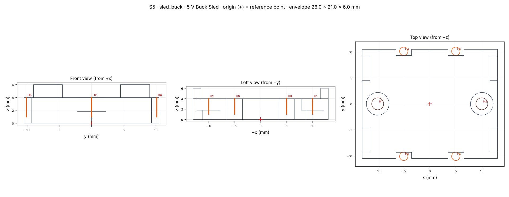

| # | Lỗ | Loại | Ø | Sâu | Vị trí (x, y, z) | Hướng | Dùng cho |
| --- | --- | --- | ---: | --- | --- | --- | --- |
| H1 | `attach1` | cb_m2 | 2.30 | xuyên | (-10.0, +0.0, +4.0) | −z | M2x6 into the deck_1 bay BUCK |
| H2 | `attach2` | cb_m2 | 2.30 | xuyên | (+10.0, +0.0, +4.0) | −z | M2x6 into the deck_1 bay BUCK |
| H3 | `tie1a` | tie | 1.60 | xuyên | (-5.0, -10.1, +4.0) | −z | cable tie around the module |
| H4 | `tie1b` | tie | 1.60 | xuyên | (-5.0, +10.1, +4.0) | −z | cable tie around the module |
| H5 | `tie2a` | tie | 1.60 | xuyên | (+5.0, -10.1, +4.0) | −z | cable tie around the module |
| H6 | `tie2b` | tie | 1.60 | xuyên | (+5.0, +10.1, +4.0) | −z | cable tie around the module |

#### S6 · `sled_ina` — INA226 Sled (L/R)

Điểm tham chiếu: tâm bay trên mặt deck 1 = robot (+8.0, +45.5, +120.5).

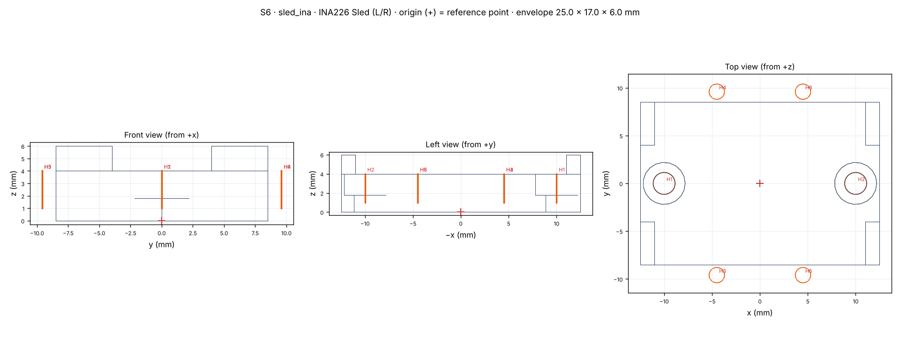

| # | Lỗ | Loại | Ø | Sâu | Vị trí (x, y, z) | Hướng | Dùng cho |
| --- | --- | --- | ---: | --- | --- | --- | --- |
| H1 | `attach1` | cb_m2 | 2.30 | xuyên | (-10.0, +0.0, +4.0) | −z | M2x6 into the deck_1 bay INA_L |
| H2 | `attach2` | cb_m2 | 2.30 | xuyên | (+10.0, +0.0, +4.0) | −z | M2x6 into the deck_1 bay INA_L |
| H3 | `tie1a` | tie | 1.60 | xuyên | (-4.5, -9.6, +4.0) | −z | cable tie around the module |
| H4 | `tie1b` | tie | 1.60 | xuyên | (-4.5, +9.6, +4.0) | −z | cable tie around the module |
| H5 | `tie2a` | tie | 1.60 | xuyên | (+4.5, -9.6, +4.0) | −z | cable tie around the module |
| H6 | `tie2b` | tie | 1.60 | xuyên | (+4.5, +9.6, +4.0) | −z | cable tie around the module |

#### S1 · `sled_pca` — PCA9685 Sled (L/R)

Điểm tham chiếu: tâm bay trên mặt deck 0 = robot (-3.5, +36.5, +77.5).

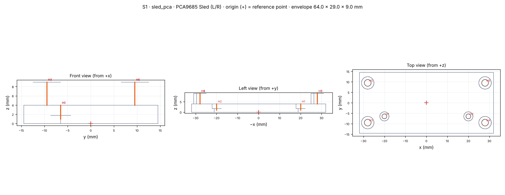

| # | Lỗ | Loại | Ø | Sâu | Vị trí (x, y, z) | Hướng | Dùng cho |
| --- | --- | --- | ---: | --- | --- | --- | --- |
| H1 | `attach1` | cb_m2 | 2.30 | xuyên | (-20.0, -6.5, +4.0) | −z | M2x6 into the pelvis_plate bay PCA_L |
| H2 | `attach2` | cb_m2 | 2.30 | xuyên | (+20.0, -6.5, +4.0) | −z | M2x6 into the pelvis_plate bay PCA_L |
| H3 | `boss1` | boss_m2 | 3.20 | 5.0 | (-27.9, -9.5, +9.0) | −z | INS-M2 in the boss, M2x6 through the PCA board |
| H4 | `boss2` | boss_m2 | 3.20 | 5.0 | (+27.9, -9.5, +9.0) | −z | INS-M2 in the boss, M2x6 through the PCA board |
| H5 | `boss3` | boss_m2 | 3.20 | 5.0 | (-27.9, +9.5, +9.0) | −z | INS-M2 in the boss, M2x6 through the PCA board |
| H6 | `boss4` | boss_m2 | 3.20 | 5.0 | (+27.9, +9.5, +9.0) | −z | INS-M2 in the boss, M2x6 through the PCA board |

#### S2 · `sled_perf` — A+ Board Sled (Black Pill)

Điểm tham chiếu: tâm bay trên mặt deck 1 = robot (+13.0, +0.0, +120.5).

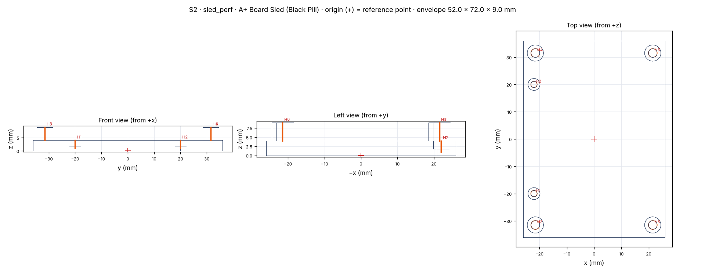

| # | Lỗ | Loại | Ø | Sâu | Vị trí (x, y, z) | Hướng | Dùng cho |
| --- | --- | --- | ---: | --- | --- | --- | --- |
| H1 | `attach1` | cb_m2 | 2.30 | xuyên | (-22.0, -20.0, +4.0) | −z | M2x6 into the deck_1 bay PERF |
| H2 | `attach2` | cb_m2 | 2.30 | xuyên | (-22.0, +20.0, +4.0) | −z | M2x6 into the deck_1 bay PERF |
| H3 | `boss1` | boss_m2 | 3.20 | 5.0 | (-21.5, -31.5, +9.0) | −z | INS-M2 in the boss, M2x6 through the PERF board |
| H4 | `boss2` | boss_m2 | 3.20 | 5.0 | (-21.5, +31.5, +9.0) | −z | INS-M2 in the boss, M2x6 through the PERF board |
| H5 | `boss3` | boss_m2 | 3.20 | 5.0 | (+21.5, -31.5, +9.0) | −z | INS-M2 in the boss, M2x6 through the PERF board |
| H6 | `boss4` | boss_m2 | 3.20 | 5.0 | (+21.5, +31.5, +9.0) | −z | INS-M2 in the boss, M2x6 through the PERF board |

#### S3 · `sled_radxa` — Radxa Zero 3W Sled

Điểm tham chiếu: tâm bay trên mặt deck 2 = robot (+24.5, +0.0, +158.5).

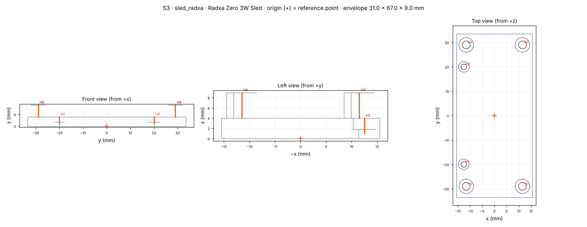

| # | Lỗ | Loại | Ø | Sâu | Vị trí (x, y, z) | Hướng | Dùng cho |
| --- | --- | --- | ---: | --- | --- | --- | --- |
| H1 | `attach1` | cb_m2 | 2.30 | xuyên | (-12.5, -20.0, +4.0) | −z | M2x6 into the deck_2 bay RADXA |
| H2 | `attach2` | cb_m2 | 2.30 | xuyên | (-12.5, +20.0, +4.0) | −z | M2x6 into the deck_2 bay RADXA |
| H3 | `boss1` | boss_m2 | 3.20 | 5.0 | (-11.5, -29.0, +9.0) | −z | INS-M2 in the boss, M2x6 through the RADXA board |
| H4 | `boss2` | boss_m2 | 3.20 | 5.0 | (-11.5, +29.0, +9.0) | −z | INS-M2 in the boss, M2x6 through the RADXA board |
| H5 | `boss3` | boss_m2 | 3.20 | 5.0 | (+11.5, -29.0, +9.0) | −z | INS-M2 in the boss, M2x6 through the RADXA board |
| H6 | `boss4` | boss_m2 | 3.20 | 5.0 | (+11.5, +29.0, +9.0) | −z | INS-M2 in the boss, M2x6 through the RADXA board |

#### S4 · `sled_ubec` — UBEC Sled

Điểm tham chiếu: tâm bay trên mặt deck 1 = robot (-29.5, +12.5, +120.5).

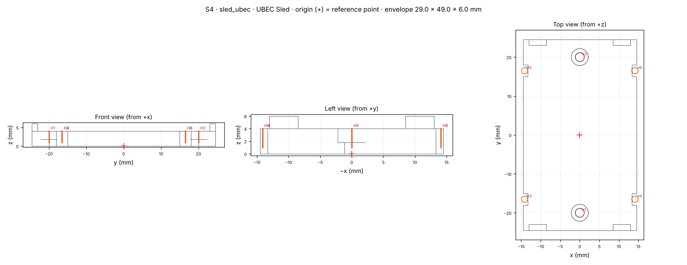

| # | Lỗ | Loại | Ø | Sâu | Vị trí (x, y, z) | Hướng | Dùng cho |
| --- | --- | --- | ---: | --- | --- | --- | --- |
| H1 | `attach1` | cb_m2 | 2.30 | xuyên | (+0.0, -20.0, +4.0) | −z | M2x6 into the deck_1 bay UBEC |
| H2 | `attach2` | cb_m2 | 2.30 | xuyên | (+0.0, +20.0, +4.0) | −z | M2x6 into the deck_1 bay UBEC |
| H3 | `tie1a` | tie | 1.60 | xuyên | (-14.1, -16.5, +4.0) | −z | cable tie around the module |
| H4 | `tie1b` | tie | 1.60 | xuyên | (+14.1, -16.5, +4.0) | −z | cable tie around the module |
| H5 | `tie2a` | tie | 1.60 | xuyên | (-14.1, +16.5, +4.0) | −z | cable tie around the module |
| H6 | `tie2b` | tie | 1.60 | xuyên | (+14.1, +16.5, +4.0) | −z | cable tie around the module |

#### A3 · `upper_arm` — Upper Arm (L/R)

Điểm tham chiếu: điểm trục khuỷu trên mặt đầu servo = robot (+0.0, +69.7, +120.3).

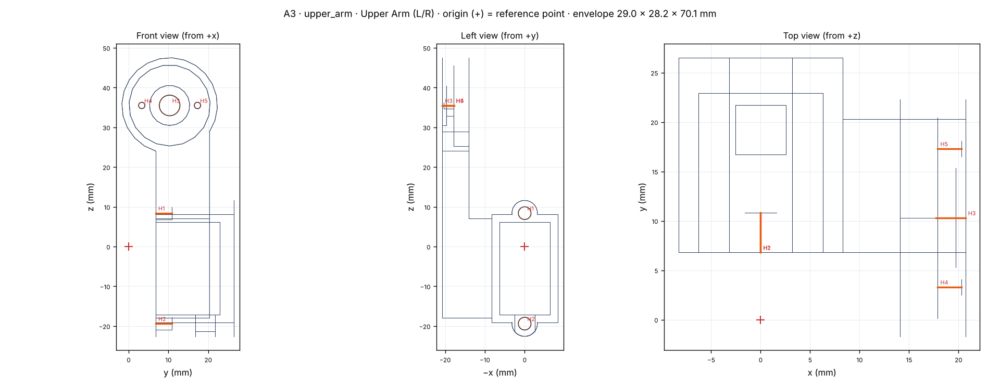

| # | Lỗ | Loại | Ø | Sâu | Vị trí (x, y, z) | Hướng | Dùng cho |
| --- | --- | --- | ---: | --- | --- | --- | --- |
| H1 | `elbow.ear1` | ins_m2 | 3.20 | 4.0 | (+0.0, +6.8, +8.4) | +y | INS-M2 + M2x6 (servo ear) |
| H2 | `elbow.ear2` | ins_m2 | 3.20 | 4.0 | (+0.0, +6.8, -19.4) | +y | INS-M2 + M2x6 (servo ear) |
| H3 | `shoulder_roll.access` | access | 5.20 | xuyên | (+20.7, +10.3, +35.5) | −x | horn centre screw (comes with the servo) |
| H4 | `shoulder_roll.horn1` | pilot_st2 | 1.60 | 2.4 | (+17.9, +3.3, +35.5) | +x | ST2x4 through the horn (plate to horn) |
| H5 | `shoulder_roll.horn2` | pilot_st2 | 1.60 | 2.4 | (+17.9, +17.3, +35.5) | +x | ST2x4 through the horn (plate to horn) |

## 8. Cable Routing

| Nhóm | Ra khỏi khớp | Vào thân | Đến | Vòng chùng |
| --- | --- | --- | --- | --- |
| Chân trái (6) | rãnh cuối vỏ servo, dọc mặt sau chân, buộc qua khe dây rút ở đùi, ống chân, giá yaw | khe 5 × 14 phía sau P0 bên trái (x −41…−36, y +22…+36) | PCA trái (#1) | 30 mm mỗi khớp đi qua |
| Chân phải (6) | như trên, đối xứng | khe P0 bên phải | PCA trái (#1), đi sau tường pin | 30 mm mỗi khớp |
| Tay (3 × 2) | rãnh cuối vỏ, mặt sau cánh tay, vòng 40 mm quanh trục vai | khe sau tầng 2 (x −50…−45, y ±10) rồi khe sau tầng 1 | PCA phải (#2) | 40 mm ở vai |
| Cổ + đầu (2) | ra sau giá cổ | khe sau tầng 2, tầng 1 | PCA phải (#2) | 60 mm ở cổ (cổ xoay ±90°) |
| Camera (FFC) | sau giá N4 | thẳng xuống Radxa (tầng 2) | Radxa CSI | 40 mm |

Thứ tự kênh PCA giữ như `hardware_architecture.md` (PCA #1 = 12 servo chân, PCA #2 = tay và cổ). Mỗi servo có dây nối dài riêng, cắm/rút ở gần PCA — khi thay servo không phải đụng vào PCA.

## 9. Replacing One Servo

| Servo | Tháo trước | Rồi |
| --- | --- | --- |
| Chân (6 khớp) | theo bảng "Replacing one servo" trong leg_v3.md | — |
| Shoulder pitch | cụm tay (vít giữa horn qua lỗ Ø6 ở khâu vai) | 2 ốc tai, rút servo ra ngoài theo trục |
| Shoulder roll | cánh tay trên A3 (vít giữa horn phía trước) | 2 ốc tai trong A2, rút servo ra trước |
| Elbow | đưa tay ngang (roll 90°), tháo cẳng tay A4 | 2 ốc tai trong A3, rút servo vào phía thân |
| Head pitch | khung đầu N3 (vít horn + ốc idler M3) | 2 ốc tai trong N2, rút servo sang trái |
| Neck yaw | N3, servo head pitch, rồi vít horn cổ qua lỗ Ø5.2 xuyên N2, nhấc N2 | 2 ốc tai, rút servo lên |

Mỗi servo: rút dây ở đầu nối gần PCA, thay servo đã căn 1500 µs, lắp ngược lại.

## 10. CAD Checks Run

- `robot.py`: toàn robot ở tư thế 0 không có 2 chi tiết nào chồng nhau (dung sai 0.05 mm³); quét shoulder pitch −180…60°, shoulder roll 0…160°, elbow −130…0°, neck yaw ±90°, head pitch −30…32° và các tư thế kết hợp: 0 va chạm; mọi ốc của tay/cổ/đầu vặn được bằng dụng cụ thẳng (elbow: ở tư thế roll 90°); mọi servo tay/cổ/đầu rút ra được theo trục khi tháo khâu phía sau nó.
- `check.py`: chân như leg_v3 (va chạm, rút servo, dụng cụ, 2 chân cạnh nhau).
- Roll vai bị giới hạn ≥ 0° (bản cũ −10°): dưới 0° cẳng tay chạm thân và đế gắn chân. Cập nhật giới hạn này trong URDF và firmware.

## 11. Open Items

1. Mọi kích thước MEASURE (servo, horn, module) — đo trước khi in.
2. Robot cao ~400 mm, nặng ước tính 0.85–0.95 kg có vỏ: chạy lại `mass_budget` / `torque_validation` và bench P0 với MG92B trước khi mua đủ servo (nguyên tắc A+: đo trên bàn trước, không nâng cấp theo mô phỏng).
3. URDF `mico.urdf.xacro` cần sinh lại từ `body.py` + `leg.py` (vị trí khớp mới, giới hạn roll vai 0…160°).
4. ToF lắp cùng mặt nghiêng 15° với camera (bản thiết kế cũ 20°): tia chạm sàn xa hơn ~20 %.
5. Vỏ Design C phải vẽ lại quanh khung này, bắt vào 16 tán vỏ đã chừa sẵn.

