# Bazan leg v3: mechanical design and assembly

Generated by `mechanical/gen_docs.py` from `mechanical/leg.py`; do not edit by hand. CI fails if it drifts.
Left leg shown; the right leg is its mirror in y (`R_*` print files). Dimensions in mm, leg frame: origin at
the hip point H on the hip-pitch axis, x forward, y outboard, z up, leg straight.

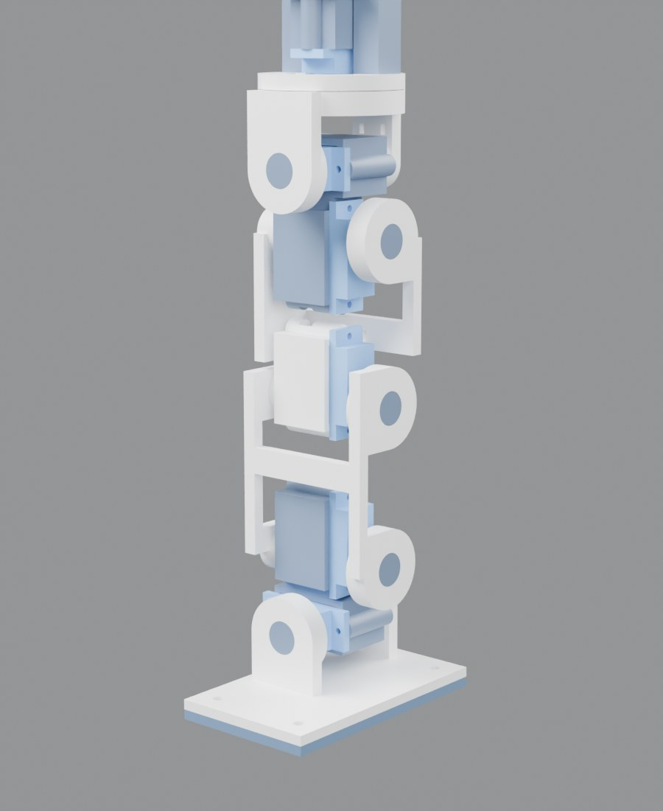

## Key dimensions (decisions D1 and D2B)

| | Leg v3 | Before (gen_robot.py) |
| --- | --- | --- |
| Leg width at the joints (caps flush) | 44.8 | 24–26 |
| Hip roll axis above the hip pitch axis | 20.0 | 0 (intersecting) |
| Ankle roll axis below the ankle pitch axis | 20.0 | 0 (intersecting) |
| Hip → knee → ankle (L1, L2) | 48.0, 48.0 | 45, 45 |
| Ankle point A above the floor | 41.33 | 25 |
| Hip point H above the floor | 137.33 | 115 |
| Hip yaw horn plate (underside) above H | 35.33 | – |
| Pelvis floor (top of `hip_mount`) above H | 73.03 | 39 (pelvis top) |
| Leg centre lines | y = ±28.0 | ±22 |

Where those come from: every joint has the servo shaft on the joint axis, a horn plate on one side and an
MR63ZZ idler on the other, so the stack across a joint is fixed by the servo and the bearing (table below).
The roll axes sit 20.0 mm off the pitch axes so the roll servo clears the pitch servo's ears;
the yaw plate and the sole sit where the hip and ankle blocks can swing ±20° in roll.

## Joint stack (every joint is built the same way)

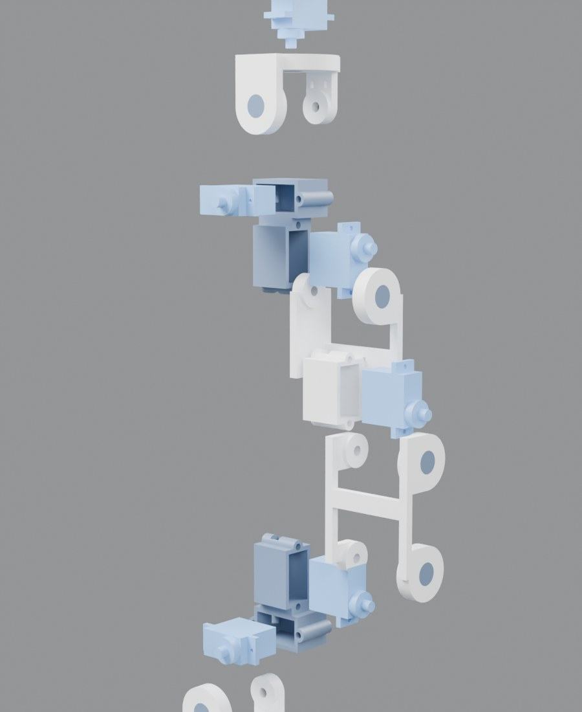

Along the shaft, from the case top of the servo (mm):

| Element | From | To |
| --- | --- | --- |
| Idler plate (driven link), MR63ZZ seat, cap recess | -33.60 | -27.30 |
| MR63ZZ bearing | -30.30 | -27.80 |
| Holder boss on the inner race | -27.80 | -26.50 |
| Idler wall (holder) with M3 insert | -26.50 | -22.90 |
| Servo case | -22.70 | +0.00 |
| Servo ears | -6.80 | -4.30 |
| Horn disc | +6.90 | +8.40 |
| Horn plate (driven link) | +4.60 | +11.20 |

## Bill of materials, one leg

Printed parts:

| Part | Material | Volume (cm³) | Mass, solid (g) | Print orientation | Drawing |
| --- | --- | --- | --- | --- | --- |
| `foot` | PLA | 12.2 | 15.1 | sole plate down; uprights vertical | [drawing](drawings/foot.png) |
| `sole` | TPU 95A | 8.5 | 10.3 | flat, 3 walls, 30 % gyroid | [drawing](drawings/sole.png) |
| `ankle_block` | PLA | 9.9 | 12.3 | as the hip block: −y face down | [drawing](drawings/ankle_block.png) |
| `shin` | PLA | 8.1 | 10.1 | lying on its −y side: all four plate holes print round | [drawing](drawings/shin.png) |
| `thigh` | PLA | 14.6 | 18.1 | lying on its −y side (idler plate down): both bearing seats print as round holes | [drawing](drawings/thigh.png) |
| `hip_block` | PLA | 9.9 | 12.3 | idler wall of the hip pitch pocket (−y face) down; no supports inside the pockets | [drawing](drawings/hip_block.png) |
| `yaw_bracket` | PLA | 12.0 | 14.8 | top plate down on the bed; supports only under the roll horn recess | [drawing](drawings/yaw_bracket.png) |
| `thrust_ring` | PLA | 3.9 | 4.8 | thrust face down on the bed (smooth face against the yaw bracket) | [drawing](drawings/thrust_ring.png) |
| `hip_mount` | PLA | 10.4 | 12.9 | top flange down on the bed: the yaw pocket opens upward, no supports | [drawing](drawings/hip_mount.png) |
| **Total** | | 89.4 | **110.6** | upper bound: printed at 4 walls, 40 % infill they come out about 30 % lighter | |

Bought parts (servos: 5 × MG92B and the hip-yaw MG90S, which sits in `hip_mount`):

| Code | Qty | Part | Ask the shop for |
| --- | --- | --- | --- |
| M2x6 | 18 | M2×6 socket head cap screw, ISO 4762, stainless | ốc lục giác M2×6 inox |
| M2x8 | 4 | M2×8 socket head cap screw, ISO 4762, stainless | ốc lục giác M2×8 inox |
| M3x6B | 5 | M3×6 button head, ISO 7380 (idler pivot) | ốc đầu dù M3×6 inox |
| ST2x4 | 12 | 2×4 self-tapping pan head (horn to plate) | vít tự ren đầu tròn 2×4 |
| INS-M2 | 22 | M2 brass heat-set insert, 3 long, 3.2 OD | tán cấy nhiệt M2 L3 OD3.2 |
| INS-M3 | 5 | M3 brass heat-set insert, 3 long, 4.2 OD | tán cấy nhiệt M3 L3 OD4.2 |
| MR63ZZ | 5 | Ball bearing 3×6×2.5, shielded | bạc đạn MR63ZZ 3×6×2.5 |
| W3 | 5 | M3 shim washer 3.2×5×0.5 (inner race only) | long đền mỏng M3 3.2×5×0.5 |

Tools: hex keys 1.5 and 2.0 mm, Phillips #0, soldering iron with a heat-set tip (220 °C), 3.0 and 6.0 mm
drill bits by hand to clean holes, calipers.

## Holes, per part

Positions are the hole entry point in the part frame (origin on the joint axis named, axes as the leg frame).
Direction is the drilling direction. Depth 0 = through. Every hole is modelled in the print files; the table
is for checking a print and for pressing the inserts in the right place.

### `foot` · origin: ankle roll axis

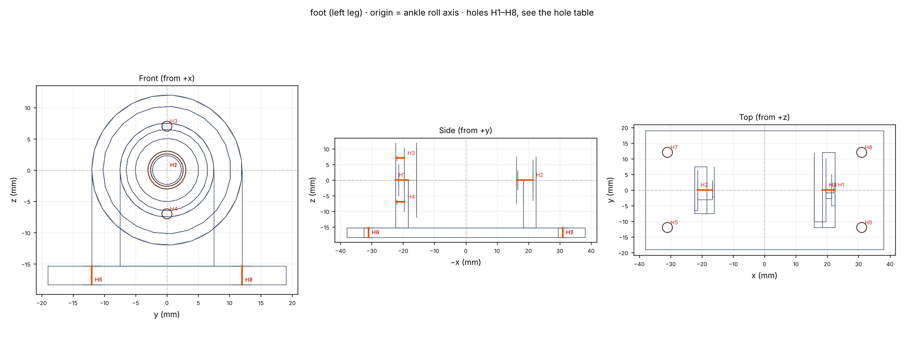

| # | Hole | Ø | Depth | Position (x, y, z) | Direction | For |
| --- | --- | --- | --- | --- | --- | --- |
| H1 | `ankle_roll.access` | 5.20 | through | (+22.4, +0.0, +0.0) | −x | horn centre screw (comes with the servo) |
| H2 | `ankle_roll.bearing` | 6.05 | 4.8 | (-21.4, +0.0, +0.0) | +x | MR63ZZ + W3 + M3x6 button head (idler) |
| H3 | `ankle_roll.horn1` | 1.60 | 2.4 | (+19.6, +0.0, +7.0) | +x | ST2x4 through the horn (plate to horn) |
| H4 | `ankle_roll.horn2` | 1.60 | 2.4 | (+19.6, +0.0, -7.0) | +x | ST2x4 through the horn (plate to horn) |
| H5 | `sole.ins1` | 3.20 | 3.0 | (-31.0, -12.0, -18.3) | +z | INS-M2 + M2x6 (TPU sole) |
| H6 | `sole.ins2` | 3.20 | 3.0 | (+31.0, -12.0, -18.3) | +z | INS-M2 + M2x6 (TPU sole) |
| H7 | `sole.ins3` | 3.20 | 3.0 | (-31.0, +12.0, -18.3) | +z | INS-M2 + M2x6 (TPU sole) |
| H8 | `sole.ins4` | 3.20 | 3.0 | (+31.0, +12.0, -18.3) | +z | INS-M2 + M2x6 (TPU sole) |

### `sole` · origin: ankle roll axis

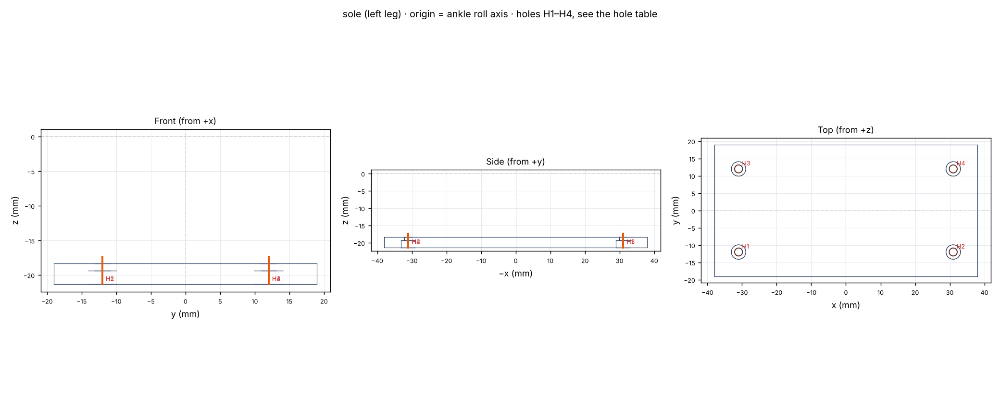

| # | Hole | Ø | Depth | Position (x, y, z) | Direction | For |
| --- | --- | --- | --- | --- | --- | --- |
| H1 | `sole.screw1` | 2.30 | through | (-31.0, -12.0, -21.3) | +z | M2x6 from below, head sunk 2 |
| H2 | `sole.screw2` | 2.30 | through | (+31.0, -12.0, -21.3) | +z | M2x6 from below, head sunk 2 |
| H3 | `sole.screw3` | 2.30 | through | (-31.0, +12.0, -21.3) | +z | M2x6 from below, head sunk 2 |
| H4 | `sole.screw4` | 2.30 | through | (+31.0, +12.0, -21.3) | +z | M2x6 from below, head sunk 2 |

### `ankle_block` · origin: point A

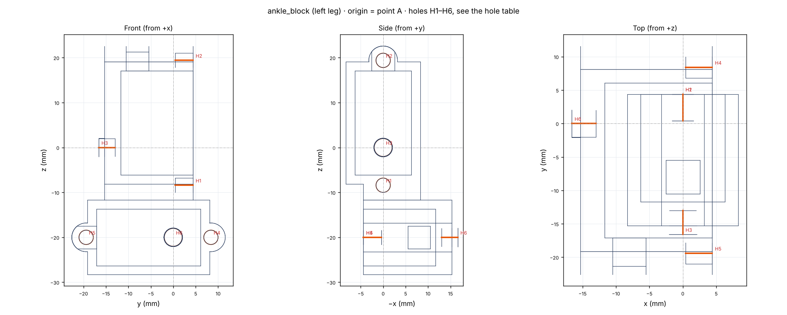

| # | Hole | Ø | Depth | Position (x, y, z) | Direction | For |
| --- | --- | --- | --- | --- | --- | --- |
| H1 | `ankle_pitch.ear1` | 3.20 | 4.0 | (+0.0, +4.4, -8.4) | −y | INS-M2 + M2x6 (servo ear) |
| H2 | `ankle_pitch.ear2` | 3.20 | 4.0 | (+0.0, +4.4, +19.4) | −y | INS-M2 + M2x6 (servo ear) |
| H3 | `ankle_pitch.idler_insert` | 4.00 | 3.6 | (+0.0, -16.6, +0.0) | +y | INS-M3 (idler pivot) |
| H4 | `ankle_roll.ear1` | 3.20 | 4.0 | (+4.4, +8.4, -20.0) | −x | INS-M2 + M2x6 (servo ear) |
| H5 | `ankle_roll.ear2` | 3.20 | 4.0 | (+4.4, -19.4, -20.0) | −x | INS-M2 + M2x6 (servo ear) |
| H6 | `ankle_roll.idler_insert` | 4.00 | 3.6 | (-16.6, +0.0, -20.0) | +x | INS-M3 (idler pivot) |

### `shin` · origin: knee axis

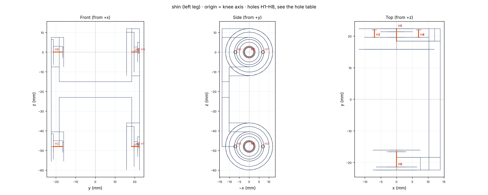

| # | Hole | Ø | Depth | Position (x, y, z) | Direction | For |
| --- | --- | --- | --- | --- | --- | --- |
| H1 | `ankle_pitch.access` | 5.20 | through | (+0.0, +22.4, -48.0) | −y | horn centre screw (comes with the servo) |
| H2 | `ankle_pitch.bearing` | 6.05 | 4.8 | (+0.0, -21.4, -48.0) | +y | MR63ZZ + W3 + M3x6 button head (idler) |
| H3 | `ankle_pitch.horn1` | 1.60 | 2.4 | (-7.0, +19.6, -48.0) | +y | ST2x4 through the horn (plate to horn) |
| H4 | `ankle_pitch.horn2` | 1.60 | 2.4 | (+7.0, +19.6, -48.0) | +y | ST2x4 through the horn (plate to horn) |
| H5 | `knee.access` | 5.20 | through | (+0.0, +22.4, +0.0) | −y | horn centre screw (comes with the servo) |
| H6 | `knee.bearing` | 6.05 | 4.8 | (+0.0, -21.4, +0.0) | +y | MR63ZZ + W3 + M3x6 button head (idler) |
| H7 | `knee.horn1` | 1.60 | 2.4 | (-7.0, +19.6, +0.0) | +y | ST2x4 through the horn (plate to horn) |
| H8 | `knee.horn2` | 1.60 | 2.4 | (+7.0, +19.6, +0.0) | +y | ST2x4 through the horn (plate to horn) |

### `thigh` · origin: hip point H

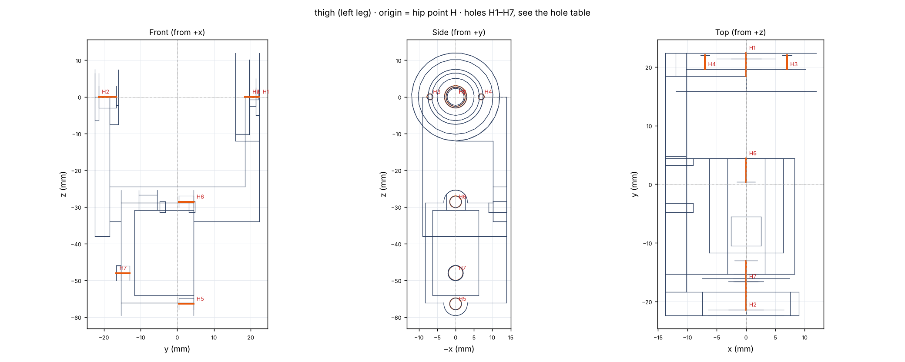

| # | Hole | Ø | Depth | Position (x, y, z) | Direction | For |
| --- | --- | --- | --- | --- | --- | --- |
| H1 | `hip_pitch.access` | 5.20 | through | (+0.0, +22.4, +0.0) | −y | horn centre screw (comes with the servo) |
| H2 | `hip_pitch.bearing` | 6.05 | 4.8 | (+0.0, -21.4, +0.0) | +y | MR63ZZ + W3 + M3x6 button head (idler) |
| H3 | `hip_pitch.horn1` | 1.60 | 2.4 | (+7.0, +19.6, +0.0) | +y | ST2x4 through the horn (plate to horn) |
| H4 | `hip_pitch.horn2` | 1.60 | 2.4 | (-7.0, +19.6, +0.0) | +y | ST2x4 through the horn (plate to horn) |
| H5 | `knee.ear1` | 3.20 | 4.0 | (+0.0, +4.4, -56.4) | −y | INS-M2 + M2x6 (servo ear) |
| H6 | `knee.ear2` | 3.20 | 4.0 | (+0.0, +4.4, -28.6) | −y | INS-M2 + M2x6 (servo ear) |
| H7 | `knee.idler_insert` | 4.00 | 3.6 | (+0.0, -16.6, -48.0) | +y | INS-M3 (idler pivot) |

### `hip_block` · origin: hip point H (hip pitch axis)

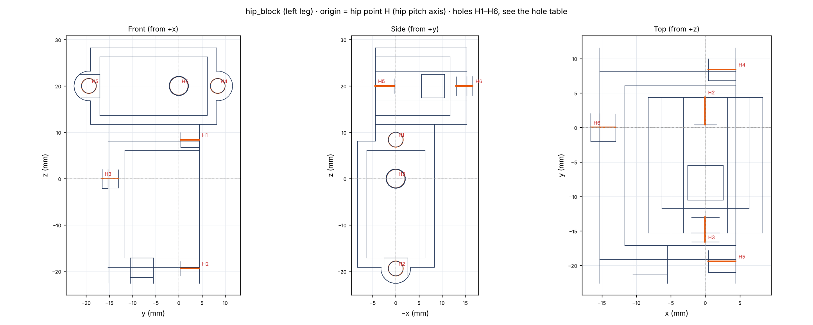

| # | Hole | Ø | Depth | Position (x, y, z) | Direction | For |
| --- | --- | --- | --- | --- | --- | --- |
| H1 | `hip_pitch.ear1` | 3.20 | 4.0 | (+0.0, +4.4, +8.4) | −y | INS-M2 + M2x6 (servo ear) |
| H2 | `hip_pitch.ear2` | 3.20 | 4.0 | (+0.0, +4.4, -19.4) | −y | INS-M2 + M2x6 (servo ear) |
| H3 | `hip_pitch.idler_insert` | 4.00 | 3.6 | (+0.0, -16.6, +0.0) | +y | INS-M3 (idler pivot) |
| H4 | `hip_roll.ear1` | 3.20 | 4.0 | (+4.4, +8.4, +20.0) | −x | INS-M2 + M2x6 (servo ear) |
| H5 | `hip_roll.ear2` | 3.20 | 4.0 | (+4.4, -19.4, +20.0) | −x | INS-M2 + M2x6 (servo ear) |
| H6 | `hip_roll.idler_insert` | 4.00 | 3.6 | (-16.6, +0.0, +20.0) | +x | INS-M3 (idler pivot) |

### `yaw_bracket` · origin: hip roll axis

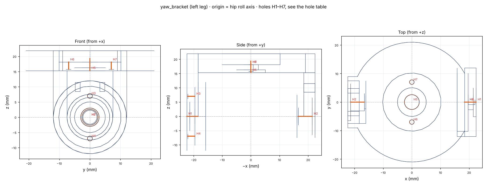

| # | Hole | Ø | Depth | Position (x, y, z) | Direction | For |
| --- | --- | --- | --- | --- | --- | --- |
| H1 | `hip_roll.access` | 5.20 | through | (+22.4, +0.0, +0.0) | −x | horn centre screw (comes with the servo) |
| H2 | `hip_roll.bearing` | 6.05 | 4.8 | (-21.4, +0.0, +0.0) | +x | MR63ZZ + W3 + M3x6 button head (idler) |
| H3 | `hip_roll.horn1` | 1.60 | 2.4 | (+19.6, +0.0, +7.0) | +x | ST2x4 through the horn (plate to horn) |
| H4 | `hip_roll.horn2` | 1.60 | 2.4 | (+19.6, +0.0, -7.0) | +x | ST2x4 through the horn (plate to horn) |
| H5 | `hip_yaw.access` | 5.20 | through | (+0.0, +0.0, +15.3) | +z | horn centre screw (comes with the servo) |
| H6 | `hip_yaw.horn1` | 1.60 | 2.4 | (+0.0, -7.0, +18.1) | −z | ST2x4 through the horn (plate to horn) |
| H7 | `hip_yaw.horn2` | 1.60 | 2.4 | (+0.0, +7.0, +18.1) | −z | ST2x4 through the horn (plate to horn) |

### `thrust_ring` · origin: hip yaw axis, mid stack

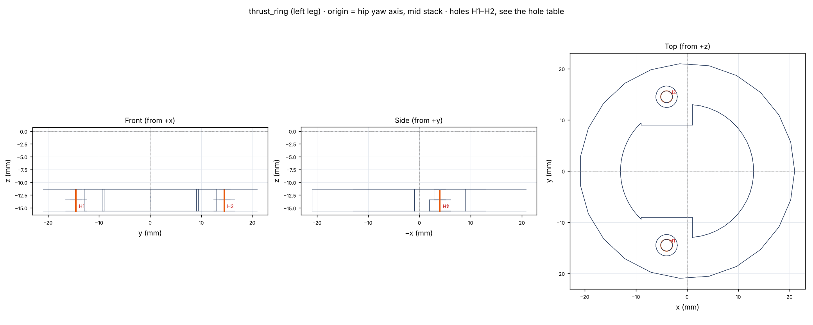

| # | Hole | Ø | Depth | Position (x, y, z) | Direction | For |
| --- | --- | --- | --- | --- | --- | --- |
| H1 | `ring.screw1` | 2.30 | through | (-4.0, -14.5, -15.6) | +z | M2x6 from below, head sunk 2.2 (into hip_mount) |
| H2 | `ring.screw2` | 2.30 | through | (-4.0, +14.5, -15.6) | +z | M2x6 from below, head sunk 2.2 (into hip_mount) |

### `hip_mount` · origin: hip yaw axis, mid stack

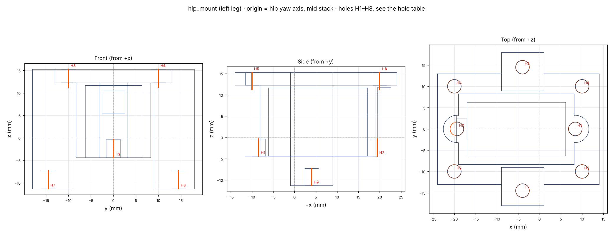

| # | Hole | Ø | Depth | Position (x, y, z) | Direction | For |
| --- | --- | --- | --- | --- | --- | --- |
| H1 | `hip_yaw.ear1` | 3.20 | 4.0 | (+8.4, +0.0, -4.4) | +z | INS-M2 + M2x6 (servo ear) |
| H2 | `hip_yaw.ear2` | 3.20 | 4.0 | (-19.4, +0.0, -4.4) | +z | INS-M2 + M2x6 (servo ear) |
| H3 | `pelvis.ins1` | 3.20 | 4.0 | (-20.0, -10.0, +15.3) | −z | INS-M2 + M2x8 from the pelvis floor (leg module) |
| H4 | `pelvis.ins2` | 3.20 | 4.0 | (-20.0, +10.0, +15.3) | −z | INS-M2 + M2x8 from the pelvis floor (leg module) |
| H5 | `pelvis.ins3` | 3.20 | 4.0 | (+10.0, -10.0, +15.3) | −z | INS-M2 + M2x8 from the pelvis floor (leg module) |
| H6 | `pelvis.ins4` | 3.20 | 4.0 | (+10.0, +10.0, +15.3) | −z | INS-M2 + M2x8 from the pelvis floor (leg module) |
| H7 | `ring.ins1` | 3.20 | 4.0 | (-4.0, -14.5, -11.3) | +z | INS-M2 + M2x6 (thrust ring) |
| H8 | `ring.ins2` | 3.20 | 4.0 | (-4.0, +14.5, -11.3) | +z | INS-M2 + M2x6 (thrust ring) |

Hole rules: `ins_m2` Ø3.2 (heat-set insert M2: press with a soldering iron at 220 °C); `ins_m3` Ø4.0 (heat-set insert M3: press with a soldering iron at 220 °C); `clr_m2` Ø2.3 (M2 clearance); `clr_m3` Ø3.3 (M3 clearance); `pilot_st2` Ø1.6 (pilot for 2 mm self-tapping screw through the horn); `bearing` Ø6.05 (MR63ZZ seat, press fit; ream lightly if tight); `access` Ø5.2 (hex key and screwdriver access to the horn screw).

## Assembly, one leg

Before anything: power each servo once and drive it to the centre (1500 µs; `mico_link.py ... calibrate` or any
servo tester). Fit the horns only with the servo centred and the leg straight, so the zero pose of the URDF is the
centre of every servo.

1. **Inserts.** Press every heat-set insert (M2 into the servo ear bosses, M3 into the idler walls, M2 into the
   foot plate) with the iron at 220 °C, flush with the surface. Let cool before screwing.
2. **Bearings.** Press an MR63ZZ into every idler plate seat from the outside (thigh ×1, shin ×2, yaw bracket ×1,
   foot ×1). It must spin freely.
3. **Horns to plates.** Open the two horn holes at radius 7 to Ø2.1 so the screws pass the horn. Screw each round
   horn to its horn plate from the servo side with 2 × ST2×4 (heads end up between horn and case).
4. **Servos into pockets.** Slide each servo into its pocket from the shaft side, cable first through the notch at
   the far end, and fix the ears with 2 × M2×6: ankle roll and ankle pitch into `ankle_block`, knee into `thigh`,
   hip roll and hip pitch into `hip_block`, hip yaw (MG90S) into `hip_mount` from below.

   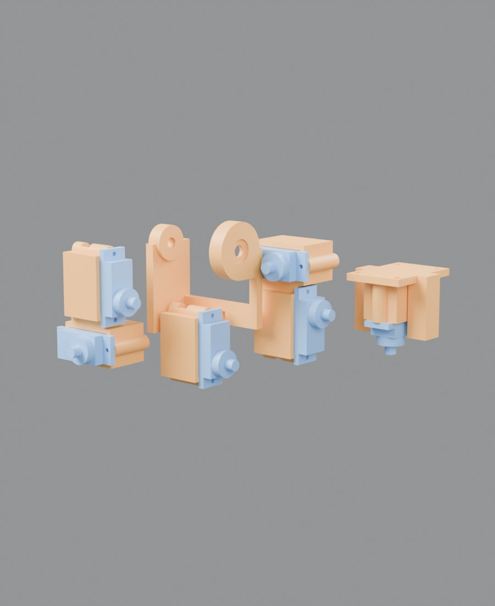
5. **Foot.** Screw the TPU `sole` under `foot` with 4 × M2×6 from below.
6. **Ankle roll.** With the ankle-roll servo centred, push the foot's horn plate onto its spline (foot level with
   the block), drive in the horn centre screw through the access hole, then the idler: W3 washer on the bearing,
   M3×6 button head into the block's M3 insert. Snug, not tight: the bearing must turn.

   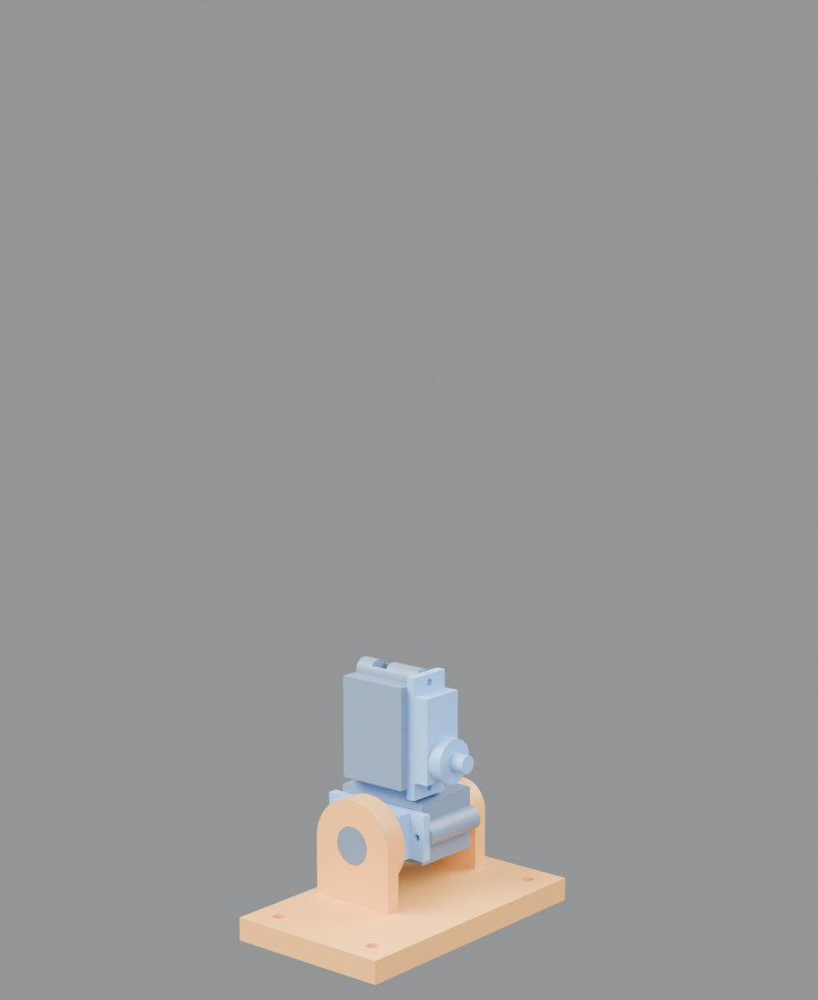
7. **Ankle pitch.** Same with `shin` on the ankle-pitch servo (shin vertical).

   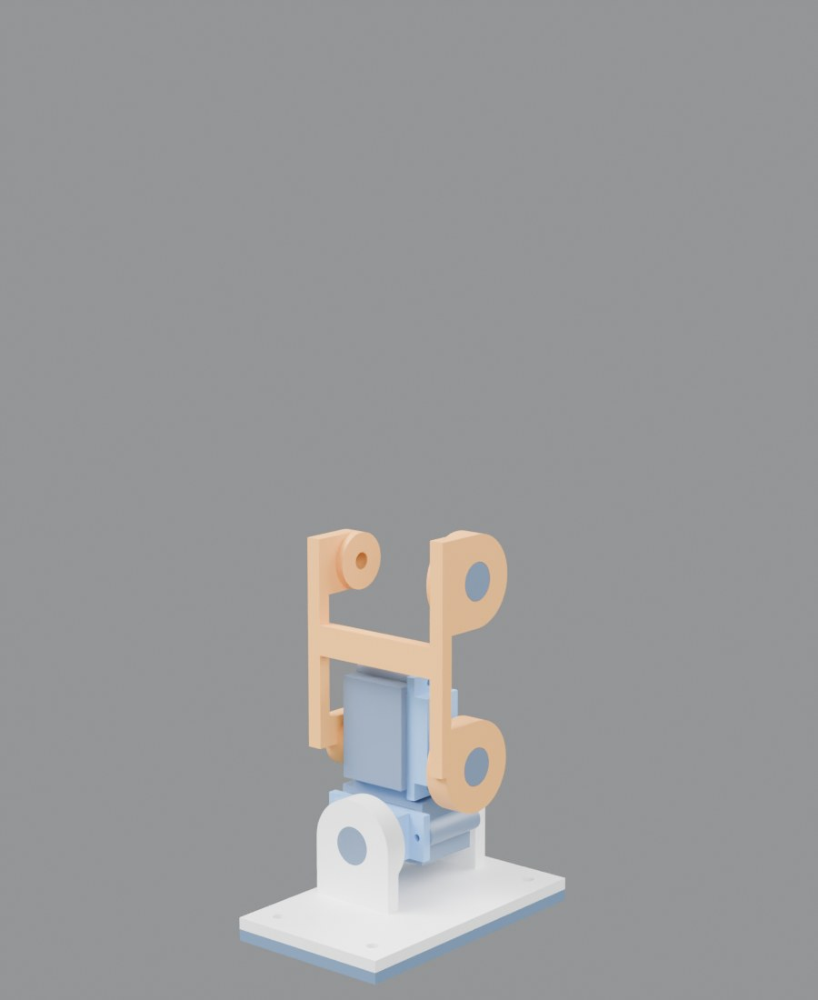
8. **Knee.** Same with `shin` on the knee servo in `thigh` (knee straight).

   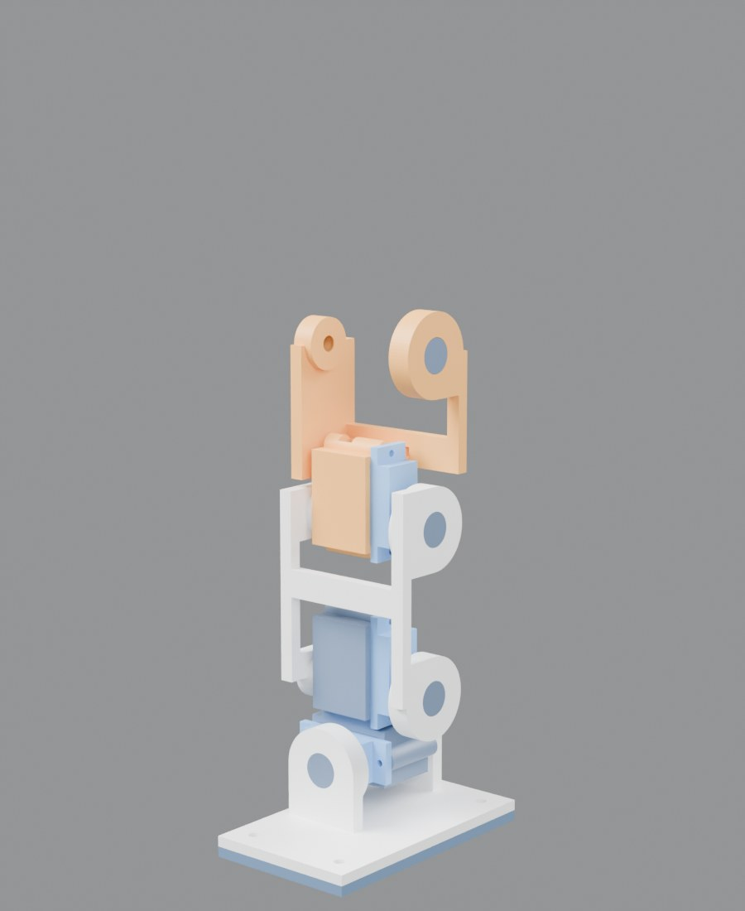
9. **Hip pitch.** Same with `thigh` on the hip-pitch servo in `hip_block`.

   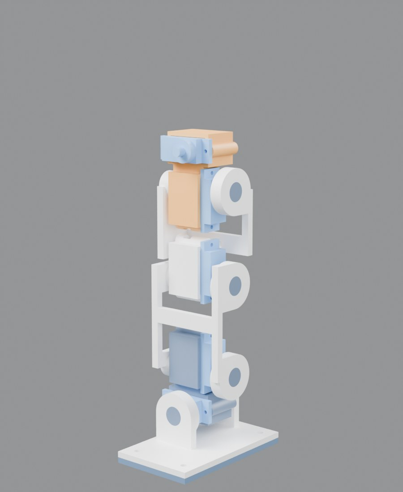
10. **Hip roll.** Same with `yaw_bracket` on the hip-roll servo (block level).

    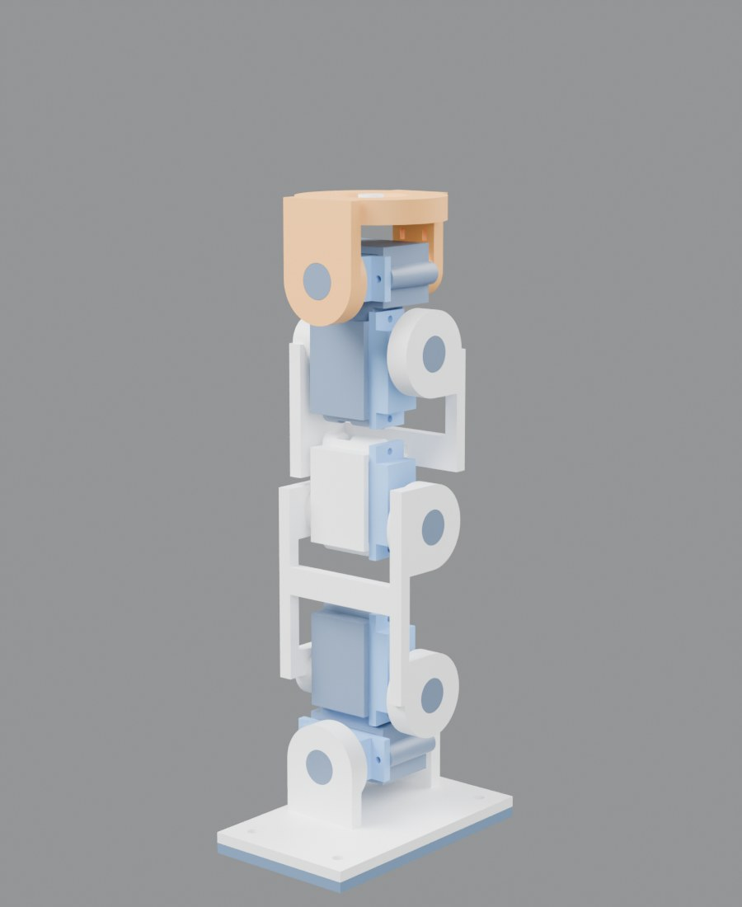
11. **Hip yaw.** Push the yaw bracket's top plate onto the hip-yaw servo in `hip_mount` (leg pointing straight
    ahead), horn centre screw from below, then the `thrust_ring` from below with 2 × M2×6 into the mount. The
    bracket must turn freely with 0.2 mm between its top face and the ring; a drop of lithium grease on the face.
12. **Caps.** Press the navy caps into the horn and idler recesses.
13. **Cables.** See the cable route below; tie each lead in the slots, leave the slack loops.
14. **Onto the pelvis.** Set the module under the pelvis floor and drive 4 × M2×8 from inside the pelvis.

## The leg is a module

`hip_mount` carries the hip-yaw servo and bolts to the pelvis floor with 4 × M2×8 from inside the pelvis into
its heat-set inserts. The `thrust_ring` under it carries the robot's weight on the yaw bracket's top face, so the
yaw servo's spline only turns the leg and never holds the robot up. To take a whole leg off: open the pelvis,
unplug the six leads at their extensions, undo the 4 screws. The other leg, the torso and the electronics are not
touched.

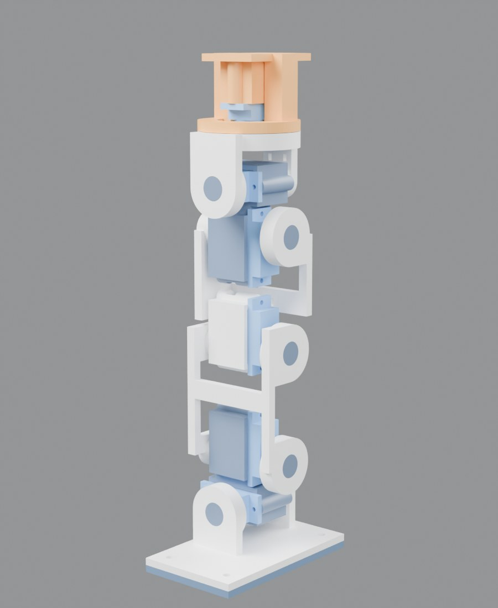

## Replacing one servo

Only the servo's own joint is opened; nothing else in the leg is touched.

| Servo | Lift off | Then |
| --- | --- | --- |
| Ankle roll | `foot` | ears of the servo in `ankle_block` (+x side), slide out forward |
| Ankle pitch | `shin` at the ankle | ears on the +y side of `ankle_block`, slide out outboard |
| Knee | `shin` at the knee | ears on the +y side of `thigh`, slide out outboard |
| Hip pitch | `thigh` | ears on the +y side of `hip_block`, slide out outboard |
| Hip roll | the leg from `yaw_bracket` | ears on the +x side of `hip_block`, slide out forward |
| Hip yaw | the leg from `yaw_bracket`, then `yaw_bracket` (horn screw from below), then `thrust_ring` (2 screws) | ears from below in `hip_mount`, slide out downward |

Lifting a link off a joint: pull both navy caps (thumbnail in the notch), undo the horn centre screw through the
access hole (Phillips #0), undo the M3 button head on the idler side (2.0 mm key), pull the link off the spline.
Unplug the servo at its extension lead, undo the two M2 ear screws (1.5 mm key), slide the servo out along its
shaft. Fit the new servo centred, then reverse. About 5 minutes and 6 screws per joint.

## Cable route

Each lead leaves its pocket through the notch at the far end of the case and runs up the back of the leg,
crossing every joint just behind its axis (where the joint moves it least), with a slack loop at each crossing,
through the tie slots (2.5 mm cable ties) in the thigh spine, the shin spine and the yaw bracket's back arm,
into the pelvis through the window at the back of `hip_mount`. Lengths to the PCA9685 (allowing 30 mm per
joint crossed and 80 mm inside the pelvis):

| Servo | Run (mm) | Joints crossed | Lead needed (mm) | Stock lead about 250 mm (MEASURE) |
| --- | --- | --- | --- | --- |
| ankle_roll | 182 | 5 | 412 | add a 200 mm extension |
| ankle_pitch | 142 | 4 | 342 | add a 200 mm extension |
| knee | 94 | 3 | 264 | add a 100 mm extension |
| hip_pitch | 81 | 2 | 221 | fits |
| hip_roll | 44 | 1 | 154 | fits |

Extensions also give each servo its own plug near the pelvis: a servo is unplugged there, not at the PCA9685.

## Clearance and service checks

`python mechanical/check.py` (CI runs `--quick`) proves, on the CAD:

- no two links of a leg overlap with each joint swept over its range (hip yaw ±45°, hip roll ±20°, hip pitch
  −80…40°, knee 0…120°, ankle pitch ±45°, ankle roll ±20°), over the demo gait and at combined extremes;
- every servo slides out along its shaft once its driven link is off;
- every screw can be reached with a straight tool (1.5 / 2.0 mm key, PH0) in the assembled leg, or once the
  parts listed in the service table are off;
- both legs at y = ±28 never touch with one hip yaw between 15° toe-in and 30° toe-out (the other
  leg straight), both yaws together up to ±12°, and a weight shift of ±17° roll. Beyond that (both feet yawed
  the same way more than 12°) the centred feet meet: the gait never does it (it turns one leg, up to 15°), and
  the joint limits in the controller should forbid it.

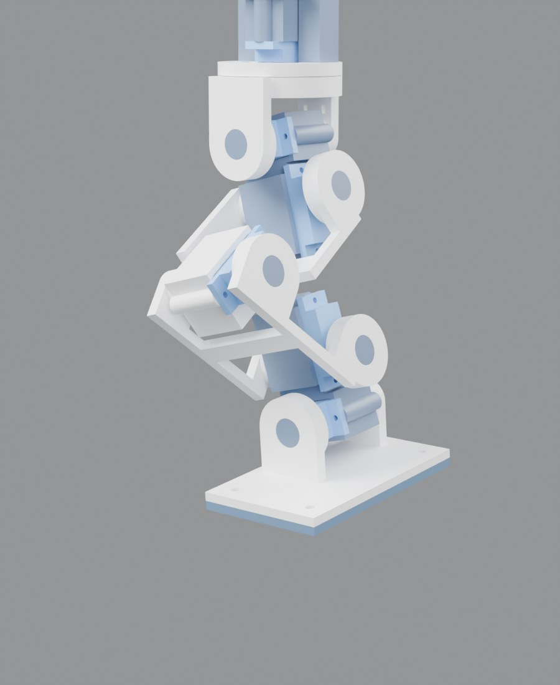

## Before printing: measure

The servo and horn sizes come from datasheets (`mechanical/hardware.py`, marked MEASURE). Clones differ by a
few tenths. Measure one servo and one horn with calipers: case length, width, height, ear thickness and height,
ear hole pitch, shaft offset from the case end, horn disc diameter and thickness, horn height above the case.
Update `hardware.py`, run `python mechanical/gen_docs.py`, and print a test pocket (`hip_block`) first.

