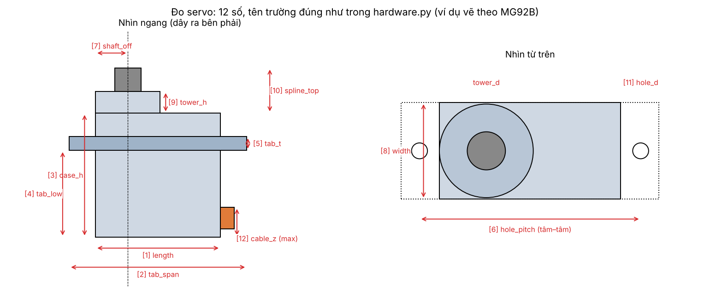
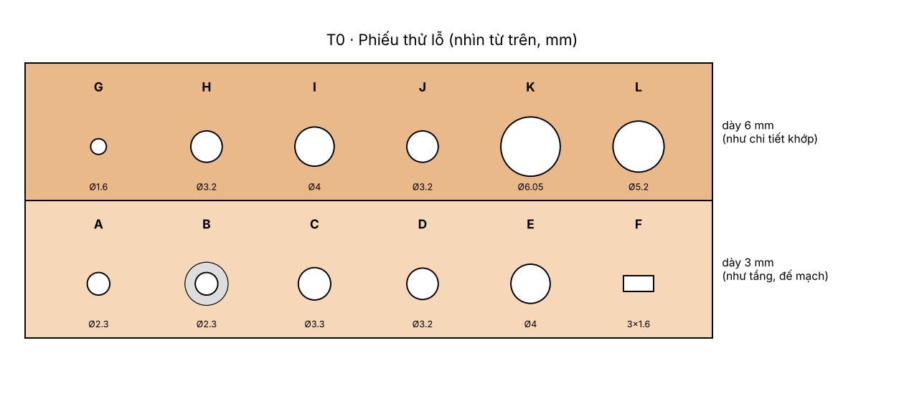

# Bazan · In thử và đo servo (bước 1)

Sinh tự động bởi `hardware/mechanical/test_prints.py` từ `hardware.py`, `joint.py`, `leg.py` — không sửa tay. Đơn vị mm.

Mục đích: trước khi in cả robot, kiểm tra 3 thứ bằng ít nhựa nhất: (1) máy in ra lỗ đúng cỡ, (2) servo thật có đúng số trong `hardware.py`, (3) ổ servo, tán cấy, bạc đạn, horn lắp được thật. Tổng in khoảng 2 giờ.

## Thứ tự

1. **Đo servo** (mục 1) — 1 con mỗi loại MG92B, MG90S, SG90 và horn tròn của từng loại. Nhập số vào `hardware.py`, xóa tên servo đó khỏi `UNMEASURED`.
2. Chạy lại (PowerShell, trong `hardware\mechanical`): `py servo_fit.py`, `py test_prints.py`, `py check.py --quick`, `py robot.py --quick`.
3. **In T0** (phiếu thử lỗ, 20 phút). Sai > 0.1 mm thì chỉnh XY hole compensation trong slicer, KHÔNG sửa file. In lại T0 đến khi đạt.
4. **In T1, T2, T3** và thử lắp (mục 3).
5. Gửi lại kết quả theo mục 4.

Cài đặt in: PLA, đầu 0.4, lớp 0.2, T1/T2 4 viền 40 % infill, T0 3 viền 40 %, T3 TPU 95A 3 viền 30 % gyroid. Không bật hole compensation (trừ khi T0 bảo). File: `hardware/mechanical/out/test_print/T*.stl`, đã xoay sẵn đúng hướng in, đặt thẳng lên bàn.

## 1. Đo servo

Thước kẹp, đo mỗi số 2 lần lấy trung bình, ghi 2 số lẻ. Cột datasheet là số đang dùng trong CAD.

| Trường | Đo gì | MG92B datasheet | MG92B đo | MG90S datasheet | MG90S đo | SG90 datasheet | SG90 đo |
| --- | --- | ---: | ---: | ---: | ---: | ---: | ---: |
| `length` | [1] dài vỏ (không tính tai, không tính dây) | 22.8 |   | 22.8 |   | 22.2 |   |
| `tab_span` | [2] tai: đầu này đến đầu kia | 32.4 |   | 32.4 |   | 32.2 |   |
| `case_h` | [3] cao vỏ: đáy đến mặt trên vỏ (không tính tháp bánh răng) | 22.7 |   | 22.7 |   | 22.5 |   |
| `tab_low` | [4] đáy vỏ đến MẶT DƯỚI tai | 15.9 |   | 15.9 |   | 15.7 |   |
| `tab_t` | [5] dày tai | 2.5 |   | 2.5 |   | 2.5 |   |
| `hole_pitch` | [6] tâm lỗ tai đến tâm lỗ tai (đo mép trong + Ø lỗ) | 27.8 |   | 27.8 |   | 27.6 |   |
| `shaft_off` | [7] tâm trục đến đầu vỏ GẦN trục | 5.9 |   | 5.9 |   | 5.9 |   |
| `width` | [8] rộng vỏ | 12.2 |   | 12.2 |   | 11.8 |   |
| `tower_h` | [9] tháp bánh răng cao hơn mặt vỏ | 4 |   | 4 |   | 4 |   |
| `spline_top` | [10] mặt vỏ đến đỉnh trục then hoa | 8.3 |   | 8.3 |   | 8.3 |   |
| `hole_d` | [11] Ø lỗ tai (thử bằng chuôi mũi khoan 2.0 / 2.2 / 2.3) | 2 |   | 2 |   | 2 |   |
| `tower_d` | Ø tháp bánh răng | 11.8 |   | 11.8 |   | 11.8 |   |
| `cable_z` | [12] đáy vỏ đến mép dưới / mép trên chỗ dây ra (2 số) | 1.5–5.5 |   | 1.5–5.5 |   | 1.5–5.5 |   |
| `mass` | khối lượng (g), cân tiểu ly | 14 |   | 13.4 |   | 9 |   |

Horn tròn (mỗi loại servo 1 cái): Ø đĩa (`disc_d`, CAD 20), dày đĩa (`disc_t`, 1.5), mặt vỏ đến MẶT DƯỚI đĩa khi ép hết vào trục (`disc_low`, 6.9). Horn của SG90 thường khác MG92B: nếu khác, ghi riêng.

Kết quả `servo_fit.py` với số datasheet hiện tại (ổ servo chung dựng theo MG92B):

| Servo | Kiểm tra không đạt | Giá trị | Cần |
| --- | --- | ---: | --- |
| MG92B | ear holes: M2 passes (hole - screw) | +0.00 | +0.20…+1.00 |
| MG90S | ear holes: M2 passes (hole - screw) | +0.00 | +0.20…+1.00 |
| SG90 | width: gap per side | +0.40 | +0.05…+0.35 |
| SG90 | ear holes: M2 passes (hole - screw) | +0.00 | +0.20…+1.00 |
| SG90 | ear holes: offset to the inserts | +0.40 | +0.00…+0.00 |

Lỗ tai servo Ø2.0 không cho ốc M2 (Ø2.0) lọt: khoan lỗ tai lên Ø2.3 bằng tay cho mọi servo là bình thường. Với SG90, theo số datasheet, tâm lỗ tai lệch tán cấy tới 0.4 mm, nên đo kỹ `hole_pitch` và `shaft_off`.

## 2. T0 · Phiếu thử lỗ

Hàng A–F dày 3 mm (in như tầng thân và đế mạch), hàng G–L dày 6 mm (in như chi tiết khớp). Mỗi lỗ in đúng như trong chi tiết thật (`hardware.HOLES`).

| Lỗ | Loại | Ø in | Sâu | Thử bằng | Đạt khi | Không đạt thì |
| --- | --- | ---: | --- | --- | --- | --- |
| **A** | `clr_m2` | 2.3 | xuyên | ốc M2 | ốc M2 lọt qua bằng tay, không phải vặn | chặt: tăng XY hole compensation 0.05–0.1 |
| **B** | `cb_m2` | 2.3 (khoét Ø4.4 sâu 2.2) | xuyên | ốc lục giác M2×6 | đầu ốc chìm bằng hoặc thấp hơn mặt | đầu ốc lồi: báo lại số đo Ø đầu ốc |
| **C** | `clr_so` | 3.3 | xuyên | ren đực trụ nhựa M3 | ren đực lọt qua bằng tay | chặt: tăng XY hole compensation |
| **D** | `ins_m2_thru` | 3.2 | xuyên | tán cấy M2 (ép từ mặt trên) | tán bằng mặt trên ±0.2, không nghiêng; mặt DƯỚI không phồng quá 0.2 mm | phồng dưới: báo lại; tầng 3 mm sẽ cần gờ 4 mm quanh lỗ |
| **E** | `ins_m3_thru` | 4 | xuyên | tán cấy M3 (ép từ mặt trên) | tán bằng mặt, ốc M3 vặn vào thẳng | tán lỏng/xoay: giảm compensation; nghiêng: ép chậm hơn |
| **F** | `tie` | 3.0 × 1.6 | xuyên | dây rút 2.5 mm | dây rút luồn qua được | không lọt: mở rộng khe trong slicer |
| **G** | `pilot_st2` | 1.6 | xuyên | vít tự ren ST2×4 | vít ăn chặt, nhựa không nứt | nứt: báo lại (lỗ mồi sẽ tăng lên Ø1.7) |
| **H** | `ins_m2` | 3.2 | 4 | tán cấy M2 + ốc M2×6 | tán bằng mặt; ốc M2×6 vặn hết, giữ chặt, không chạm đáy | chạm đáy: báo lại độ sâu |
| **I** | `ins_m3` | 4 | 3.6 | tán cấy M3 + ốc đầu dù M3×6 | tán bằng mặt; ốc vặn thẳng | như E |
| **J** | `boss_m2` | 3.2 | 5 | tán cấy M2 (lỗ sâu 5) | tán bằng mặt | như H |
| **K** | `bearing` | 6.05 | 2.5 | bạc đạn MR63ZZ | ép vào bằng ngón cái hoặc ê-tô, bằng mặt, lật ngược không rơi, vòng trong quay êm | quá lỏng: giảm compensation; quá chặt: doa nhẹ bằng mũi 6.0 |
| **L** | `access` | 5.2 | xuyên | tua vít PH0 | tua vít lọt tự do | chặt: tăng compensation |

## 3. T1, T2, T3 · Thử lắp

### T1 · `hip_block` (2 ổ servo: hip pitch và hip roll)

1. Cấy 4 tán M2 (tai servo) và 2 tán M3 (idler), 220 °C, bằng mặt.
2. Lần lượt đẩy **MG92B, MG90S, SG90** vào ổ hip pitch từ phía trục, dây luồn qua rãnh cuối ổ. Đạt: trượt vào bằng tay, lắc ngang ≤ 0.3 mm, tai nằm phẳng trên 2 gờ (không kênh).
3. Bắt 2 × M2×6 qua tai vào tán. Đạt: ốc vào thẳng không phải ép, servo không bị kéo lệch.
4. **Đo vị trí trục** (servo đang bắt ốc, khối nằm mặt in xuống bàn): bàn → đỉnh trục then hoa = **42.1 ± 0.3**. Lệch hơn thì ghi lại cho từng loại servo: đây là lỗi đã thấy giữa các model MG90S (độ cao tai lệch tới 2.7 mm).
5. Lặp với ổ hip roll (trục hướng ra mặt bên).

### T2 · `foot` (đĩa horn ankle roll, ổ bạc đạn, 4 tán đế)

1. Ép bạc đạn MR63ZZ vào ổ idler. Đạt: như lỗ K của T0.
2. Khoan 2 lỗ horn ở bán kính 7 lên Ø2.1, đặt horn tròn vào hốc (Ø20.4), bắt 2 × ST2×4. Đạt: horn nằm phẳng đáy hốc, không cấn.
3. Cấy 4 tán M2 ở 4 góc bàn chân.

### T3 · `sole` (TPU 95A)

1. Bắt đế vào T2 bằng 4 × M2×6 từ dưới. Đạt: đầu ốc chìm, đế phẳng, không vênh mép.
2. Ấn mạnh ngón cái quanh đầu ốc: TPU dưới đầu ốc chỉ còn khoảng 1 mm, xem có rách/tụt không. Nếu có: báo lại (sẽ đổi sang long đền hoặc khoét nông hơn).

## 4. Gửi lại

- Bảng số đo mục 1 (cả horn).
- T0: đạt/không đạt từng chữ A–L, và XY hole compensation cuối cùng đã dùng.
- T1: kết quả bước 2–4 cho từng loại servo, nhất là con số đỉnh trục.
- T2, T3: đạt/không đạt, ảnh chụp chỗ không đạt.

