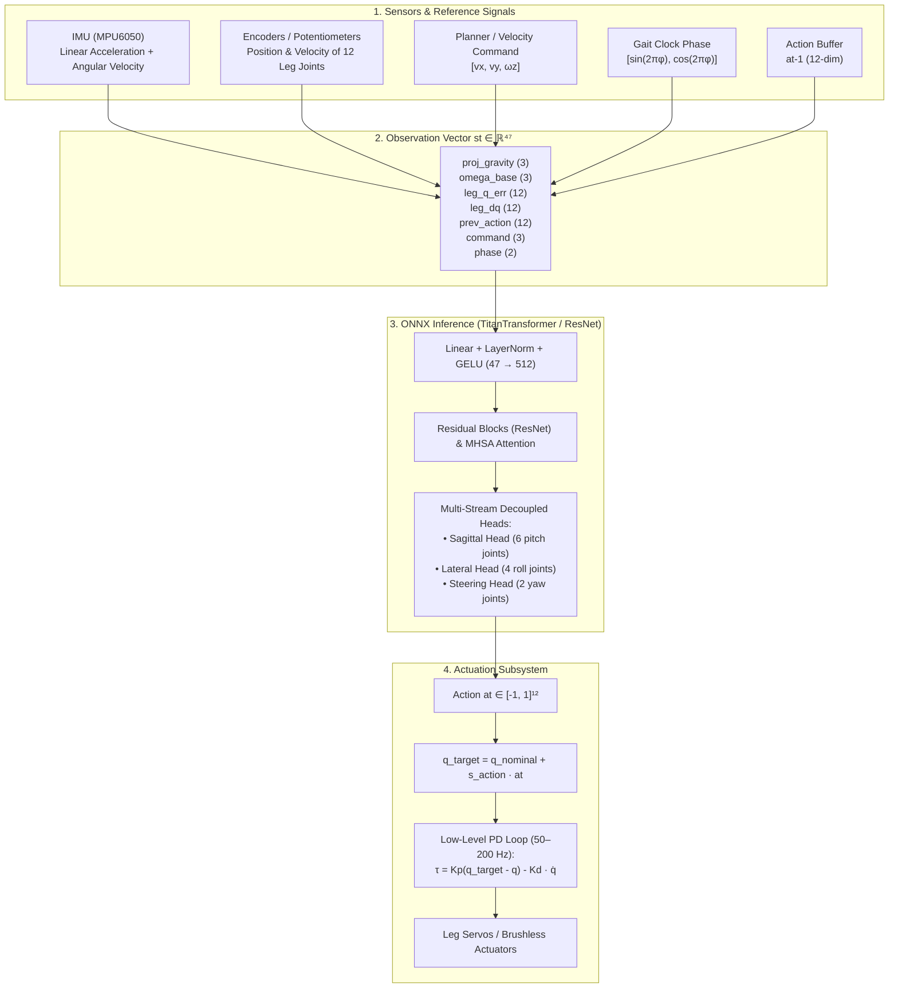
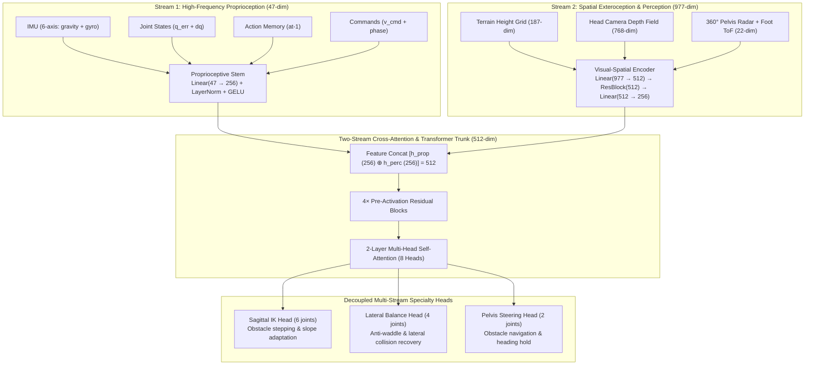

# 📚 Synapse Humanoid — Theory, Mathematical Formulations & References

This document provides a comprehensive reference for the control theory, rigid-body equations of motion, deployed ONNX policy architecture, hardware migration/upgrade strategies, and foundational scientific literature underpinning the Synapse Humanoid platform.

---

## 📑 Table of Contents
1. [ONNX Locomotion Policy Dataflow (Input $\to$ Model $\to$ Output)](#1-onnx-locomotion-policy-dataflow)
2. [Mathematical Foundations of Deep RL Locomotion](#2-mathematical-foundations-of-deep-rl-locomotion)
3. [Leg Joint & Actuator Upgrade Guide (Morphological Migration)](#3-leg-joint--actuator-upgrade-guide)
4. [Scientific Literature & References](#4-scientific-literature--references)

---

## 1. ONNX Locomotion Policy Dataflow

The locomotion policy in this repository (e.g., [`v9.0_titan_transformer`](../models/) or [`v8.1_apex_titan`](../models/)) acts as a **Nonlinear State-Feedback Controller** evaluated deterministically at 50 Hz.



### Observation Vector Breakdown ($s_t \in \mathbb{R}^{47}$ Blind vs $s_t \in \mathbb{R}^{1024}$ Perceptive)
Implemented in [`mico_rl_env.py`](../src/humanoid_control/scripts/mico_rl_env.py):

#### 1. Proprioceptive Observation Stream ($s_{\text{prop}} \in \mathbb{R}^{47}$)
| Component | Dimension | Physical Meaning | Acquisition Method |
| :--- | :---: | :--- | :--- |
| **$g_{base}$** | 3 | Gravity vector projected in base frame: $R_{base}^T [0, 0, -1]^T$ | Pelvis-mounted 6-axis IMU Accelerometer |
| **$\omega_{base}$** | 3 | Pelvis angular velocity in base frame: $R_{base}^T \omega_{world}$ | Pelvis-mounted 6-axis IMU Gyroscope |
| **$q - q_{nominal}$** | 12 | Joint position error relative to default standing pose | Potentiometer wipers via ADC Mux / Encoders |
| **$\dot{q}$** | 12 | Joint angular velocities | First-order numerical differentiation $\frac{\Delta q}{\Delta t}$ |
| **$a_{t-1}$** | 12 | Policy action vector from previous control cycle ($t-1$) | Internal buffer in the ROS 2 locomotion node |
| **$v_{cmd}$** | 3 | Target velocity commands: $[v_x, v_y, \omega_z]$ | ROS 2 `/cmd_vel` or trajectory planner |
| **Phase $(\sin, \cos)$** | 2 | Periodic gait phase coordinates: $[\sin(2\pi \phi), \cos(2\pi \phi)]$ | Internal gait timer ($\phi = (t \pmod T)/T$) |

#### 2. Exteroceptive Perception Observation Stream ($s_{\text{perc}} \in \mathbb{R}^{977}$)
| Component | Dimension | Physical Meaning | Acquisition Method |
| :--- | :---: | :--- | :--- |
| **$s_{\text{height}}$** | 187 | Local terrain height scan grid ($17 \times 11$ points, $x \in [-0.15, 0.45]\text{m}, y \in [-0.25, 0.25]\text{m}$) | Virtual heightfield raycast / Stereo Depth Elevation Map |
| **$s_{\text{depth}}$** | 768 | Forward visual depth field ($32 \times 24$ depth rays, $60^\circ \text{H} \times 45^\circ \text{V}$ FOV) | Head camera depth stream (`head_camera` raycast) |
| **$s_{\text{radar}}$** | 22 | 16-ray 360° pelvis collision radar + 6 foot ToF ground clearances | 360° Pelvis LiDAR scan + foot sole distance sensors |

$$\mathbf{s}_t = \begin{bmatrix} s_{\text{prop}} \\ s_{\text{perc}} \end{bmatrix} \in \mathbb{R}^{1024}$$



### Action Decoding via Residual Control
The network outputs a normalized vector $a_t \in [-1, 1]^{12}$. Target joint setpoints are reconstructed as:

$$q_{target} = q_{nominal} + s_{action} \cdot a_t \quad (\text{with } s_{action} = 0.25 \text{ rad})$$

The embedded microcontroller (STM32F411) or motor driver tracks this setpoint via high-frequency PD control (200 Hz):

$$\tau = K_p (q_{target} - q) - K_d \dot{q}$$

*Advantage:* If inference experiences jitter or temporary dropped packets, the passive stiffness ($K_p$) maintains upright equilibrium and prevents catastrophic robot collapse.

---

## 2. Mathematical Foundations of Deep RL Locomotion

### A. Rigid-Body Dynamics (Euler-Lagrange Formulation)
The equations of motion for a bipedal robot with floating base and ground contacts are given by:

$$M(q)\ddot{q} + C(q, \dot{q})\dot{q} + g(q) = B\tau + \sum_{k \in \{L, R\}} J_k^T(q) F_k^{contact}$$

Where:
- $M(q) \in \mathbb{R}^{n \times n}$ is the symmetric, positive-definite generalized inertia matrix.
- $C(q, \dot{q})\dot{q} \in \mathbb{R}^n$ represents Coriolis and centrifugal generalized forces.
- $g(q) \in \mathbb{R}^n$ is the gravitational force vector.
- $B$ is the actuator selection matrix mapping joint torques $\tau$ into generalized coordinates.
- $J_k(q)$ is the contact Jacobian for the left/right foot ($k \in \{L, R\}$).
- $F_k^{contact}$ is the 3D ground reaction force (GRF) constrained by the Coulomb friction cone $\|F_t\| \le \mu F_n$.

### B. Proximal Policy Optimization (PPO-Clip)
The stochastic policy $\pi_\theta(a|s)$ is optimized using the clipped surrogate objective:

$$L^{CLIP}(\theta) = \hat{\mathbb{E}}_t \left[ \min\left(r_t(\theta)\hat{A}_t, \; \text{clip}(r_t(\theta), 1-\epsilon, 1+\epsilon)\hat{A}_t\right) \right]$$

Where:
- The probability ratio is $r_t(\theta) = \frac{\pi_\theta(a_t|s_t)}{\pi_{\theta_{old}}(a_t|s_t)}$.
- The clipping threshold $\epsilon = 0.2$ bounds gradient updates within a trust region to prevent policy degradation.

### C. Generalized Advantage Estimation (GAE)
The advantage $\hat{A}_t$ estimates how much better action $a_t$ performs compared to the baseline value function:

$$\hat{A}_t^{GAE(\gamma, \lambda)} = \sum_{l=0}^{\infty} (\gamma \lambda)^l \delta_{t+l}^V$$

With the temporal-difference (TD) residual:

$$\delta_t^V = r_t + \gamma V_\phi(s_{t+1}) - V_\phi(s_t)$$

- $\gamma \in [0, 1)$ is the discount factor (typically $\gamma = 0.99$).
- $\lambda \in [0, 1]$ balances bias and variance (typically $\lambda = 0.95$).

---

## 3. Leg Joint & Actuator Upgrade Guide

When redesigning the mechanical leg joints (e.g., repositioning motor brackets for ease of machining, migrating from hobby RC servos to quasi-direct drive BLDC actuators, or adjusting thigh/shank link lengths):

> [!TIP]
> **Existing trained policies and architecture do NOT need to be discarded.** The balance equilibrium priors, gait representations, and automated training pipeline are fully reusable across hardware revisions.

### Scenario 1: Preserving 12 Leg Joints, Updating Motors/Mechanics (Recommended)
*(e.g., Replacing MG92B servos with BLDC motors and planetary reducers, or altering leg link lengths).*

1. **Compatibility:** **100% tensor shape compatibility** ($s_t \in \mathbb{R}^{47}$, $a_t \in \mathbb{R}^{12}$).
2. **Reuse Strategy — Warm-Start Fine-Tuning:**
   - Update mechanical parameters in the URDF/MJCF models (`mico.urdf.xacro` / `humanoid.urdf`): link masses $m_i$, inertia tensors $I_i$, peak torque limits $\tau_{max}$, and gear ratios.
   - Load the top-performing checkpoint as pretrained initialization:
     ```bash
     python3 src/humanoid_control/scripts/train_mico_ppo.py \
         --arch titan_transformer \
         --teacher models/v9.0_titan_transformer.onnx \
         --iterations 50 \
         --lr 3e-5
     ```
   - **Performance:** Instead of requiring hundreds of thousands of steps to learn standing from scratch, the policy adapts to the new inertia and torque response within **20k–50k steps (3–5 minutes on Apple Silicon M4)**.

### Scenario 2: Modifying Degree-of-Freedom (DoF) Count or Joint Axes
*(e.g., Simplifying from 6 DoF/leg to 5 DoF, or expanding to 7 DoF).*

1. **Challenge:** Dimensionality mismatch on the input projection $W_{in}$ and output head $W_{out}$.
2. **Reuse Strategy — Net Surgery & Backbone Freezing:**
   - **Retain 90% of Pretrained Weights:** The core feature extractors (Residual Blocks or Transformer Encoder Layers) capture deep spatial and temporal coordinate invariants.
   - **Head Surgery:** Reinitialize only the input projection matrix and actuator output heads.
   - Freeze the backbone for the first 10–20 iterations to allow new heads to stabilize, then unfreeze all layers for end-to-end convergence.
3. **Policy Distillation:** Treat the legacy Mico policy as an algorithmic Teacher to guide Center-of-Mass (CoM) trajectory tracking for the new embodiment.

### Scenario 3: Automated Toolchain Reusability
The entire infrastructure developed in this repository is embodiment-agnostic:
- `train_mico_ppo.py`: Multi-threaded parallel environment running on Apple Silicon Metal MPS (769k transitions/sec).
- `model_registry.py`: CLI for symlink management, version registration, and ONNX deployment.
- `mico_benchmark.py`: 10-criteria suite validating kick rejection, ice slips, payload capacity, and P99 latency.
- `mico_visualizer.py`: 3D interactive viewer with hotkey perturbations for instant verification.

---

## 4. Scientific Literature & References

Foundational research papers establishing the theoretical and algorithmic backbone of this repository:

### A. Reinforcement Learning Algorithms
1. **Schulman, J., Wolski, F., Dhariwal, P., Radford, A., & Klimov, O. (2017).**  
   *Proximal Policy Optimization Algorithms.*  
   arXiv preprint. [https://arxiv.org/abs/1707.06347](https://arxiv.org/abs/1707.06347)  
   *(Foundational PPO-Clip algorithm utilized in `train_mico_ppo.py`).*

2. **Schulman, J., Moritz, P., Levine, S., Jordan, M., & Abbeel, P. (2015).**  
   *High-Dimensional Continuous Control Using Generalized Advantage Estimation.*  
   arXiv preprint. [https://arxiv.org/abs/1506.02438](https://arxiv.org/abs/1506.02438)  
   *(Formulation of GAE $\hat{A}^{GAE(\gamma, \lambda)}$ for variance reduction).*

### B. Legged Robots & Sim-to-Real Transfer
3. **Hwangbo, J., Lee, J., Dosovitskiy, A., Bellicoso, D., Tsounis, V., Koltun, V., & Hutter, M. (2019).**  
   *Learning agile and dynamic motor skills for legged robots.*  
   Science Robotics, 4(26), eaau5872. [https://doi.org/10.1126/scirobotics.aau5872](https://doi.org/10.1126/scirobotics.aau5872)  
   *(Seminal paper deploying deep RL on physical quadruped ANYmal with actuator networks).*

4. **Siekmann, J., Godse, Y., Joshi, P., & Fern, A. (2021).**  
   *Sim-to-Real Learning of All-Terrain Bipedal Locomotion for Cassie With Residual Control.*  
   Robotics: Science and Systems (RSS). [https://arxiv.org/abs/2103.01428](https://arxiv.org/abs/2103.01428)  
   *(Core reference for Residual Policy formulation $q = q_{nom} + \Delta q$ over periodic gaits).*

5. **Rudin, N., Hoeller, D., Reist, P., & Hutter, M. (2022).**  
   *Learning to Walk in Minutes Using Massively Parallel Deep Reinforcement Learning.*  
   Conference on Robot Learning (CoRL). [https://arxiv.org/abs/2109.11978](https://arxiv.org/abs/2109.11978)  
   *(Foundation for parallel simulation environments and rapid training paradigms).*

6. **Radosavovic, I., Xiao, T., Zhang, B., Darrell, T., Malik, J., & Sreenath, K. (2023).**  
   *Learning Humanoid Locomotion with Transformers.*  
   arXiv preprint. [https://arxiv.org/abs/2303.03381](https://arxiv.org/abs/2303.03381)  
   *(Transformer self-attention architectures applied to bipedal balance over challenging terrain).*

### C. Morphology Adaptation & Cross-Embodiment
7. **Kumar, A., Fu, Z., Pathak, D., & Malik, J. (2021).**  
   *RMA: Rapid Motor Adaptation for Legged Robots.*  
   Robotics: Science and Systems (RSS). [https://arxiv.org/abs/2107.04034](https://arxiv.org/abs/2107.04034)  
   *(Online adaptation estimating latent physical properties under varying mass and friction).*

8. **Trabucco, B., Phielipp, M., & Berseth, G. (2022).**  
   *Any-Morphology Reinforcement Learning (MetaMorph).*  
   International Conference on Learning Representations (ICLR 2023). [https://arxiv.org/abs/2210.02609](https://arxiv.org/abs/2210.02609)  
   *(Joint-tokenized Transformer policies capable of controlling diverse robot kinematic topologies).*
